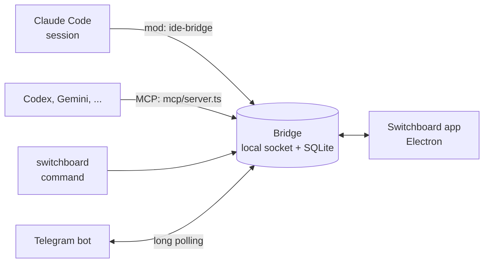

<div align="center">


# Switchboard

**A desktop app for directing many coding agents from one screen**

Claude Code, Codex and Gemini CLI sessions ask you for decisions, hand work to each other, and reach you on Telegram while you are away.

<a href="https://github.com/choco5958/switchboard/releases/latest"></a>
<a href="https://github.com/choco5958/switchboard/actions/workflows/test.yml"></a>

<a href="LICENSE"></a>

<p><b>Download</b> &nbsp; <a href="https://github.com/choco5958/switchboard/releases/latest">macOS</a> &nbsp;|&nbsp; <a href="https://github.com/choco5958/switchboard/releases/latest">Windows</a> &nbsp;|&nbsp; <a href="https://github.com/choco5958/switchboard/releases/latest">Linux</a></p>

[한국어](README.md) | **English** | [日本語](README.ja.md) | [简体中文](README.zh-CN.md)

</div>

<br>

<p align="center"><a href="https://github.com/choco5958/switchboard/blob/main/docs/intro-en.mp4"></a></p>


When a session needs a decision from you, it posts the question to a decision queue and keeps working instead of stopping. You answer with a key press, and the answer goes back to that session as a prompt. Sessions can also hand work to each other, and while you are away, decisions and permission asks reach you on Telegram.

## At a glance

<table>
<tr>
<td width="50%" valign="top">
<h3>🗳️ Decision queue</h3>
<p>A session posts its question and keeps working. Answer with one key, and the answer goes to that session as a prompt.</p>
</td>
<td width="50%" valign="top">
<h3>🤝 Sessions working together</h3>
<p>Sessions ask each other and get answers back. Replies from several sessions arrive together, and a request can be called off midway.</p>
</td>
</tr>
<tr>
<td width="50%" valign="top">
<h3>📱 While you are away</h3>
<p>Answer decisions and Claude Code's permission asks from Telegram or your phone's browser. Scheduled prompts run at the times you set.</p>
</td>
<td width="50%" valign="top">
<h3>🔍 Fix what you see</h3>
<p>Click an element in the built-in browser to leave a comment; its place, a screenshot and console errors go with it. Sessions click through local pages themselves to check.</p>
</td>
</tr>
<tr>
<td width="50%" valign="top">
<h3>🧩 Many coding CLIs</h3>
<p>Codex, Gemini CLI, Qwen Code, Copilot CLI, OpenCode, Goose and Amp join the same decision queue and task reports.</p>
</td>
<td width="50%" valign="top">
<h3>🎨 Your screen</h3>
<p>13 themes and 4 languages. Claude usage and context use sit at the top.</p>
</td>
</tr>
</table>

## Quick start

1. Get the installer for your system from [Releases](https://github.com/choco5958/switchboard/releases/latest) and open it. Details are under [Install](#install).
2. Open a session with `+ Claude` in the dock at the bottom, or pick another agent such as Codex or Gemini from the ▾ beside it, and give it work as usual.
3. When a decision comes in, answer with a key. The session carries on from there.

## Features

### Decisions and tasks

- **Decision queue**: a session posts options, a recommendation and the reason for it with `ask_decision`. Pick with keys such as `a` or `b` and send with `Enter`. You can also hold a question or answer with a note. The same question is never queued twice.
- **Tasks and progress graph**: task stages (requirements, design, work, done) and nodes (check, build, test, review) are drawn on screen, with the subagent working on each node and whether it is running or finished.
- **Waiting for you**: tasks with an open decision, a turn stalled for more than 5 minutes, a usage limit, or a dropped session gather at the top of the sidebar. Stalled sessions and sessions whose limit has reset also raise a macOS notification.
- **Per-project view**: pick a project on the left and the sidebar, home, log and dock show only that project's sessions, tasks, decisions and permission asks. The usage meters in the top bar are account-wide, and the top bar's counts show the project's number with the total beside it.

### Sessions working together

- **Ask and answer**: a session finds others with `list_sessions` and sends a request with `send_to_session`. If the receiving session ends its turn without replying, its last answer goes back as the result.
- **Asking several sessions**: answers to a question sent to several sessions are gathered into one turn. If the person writes to the asking session from the app or its terminal in the meantime, the answers so far go in with that turn; after 15 minutes, the answers that came go in without the rest.
- **When no answer is coming**: if the receiving session disconnects or its turn is interrupted, the sender is told no answer is coming, so it carries on instead of waiting.
- **Cancelling and the hand-off cap**: a session takes back requests it gave with `cancel_request`. One not delivered yet never goes in; if the receiving session's turn works on that request alone, the turn stops. Requests handed between sessions that start from one request are capped at 8 in all.
- **Forward a decision**: you can forward a decision question to another session and let it answer.
- **Usage limits**: answers and messages for a session that has hit its usage limit are held until the limit resets, then delivered.

### While you are away

- **Answer on Telegram**: when the app is closed, the screen is locked, or there has been no input for more than 5 minutes, decision questions go to your own Telegram bot. Answer with a button or a reply.
- **Permission relay**: in the same situations, Claude Code's permission asks also come to the app and to Telegram. Allowing from Telegram takes a second tap. At your desk, the terminal asks as usual.
- **Phone browser**: from a phone on the same Wi-Fi (or Tailscale), answer decisions, allow or deny permission asks, see tasks and write to sessions. There is nothing to install; add it to the home screen to open it like an app. Opened over Tailscale HTTPS, it also notifies you of new questions.
- **Scheduled prompts**: daily, weekdays, every N minutes, or once, a prompt goes to a project's session. Each routine picks the agent that gets it; with no session of that agent, the app opens that agent's terminal. Runs with nothing to report send no notification.

### Fixing what you see (live debugging)

- Register a dev server, start it, and open it in the in-app browser.
- Click an element on the page to leave a comment. The session receives it with the position, CSS, a screenshot, and the page's console errors and failed requests at that moment.
- Sessions read, click and type on local pages with the `browser_*` tools to check their own fixes. Only addresses on this computer are allowed; turn on `Let sessions open private network pages in the in-app browser` in Settings > Agent CLIs to allow private network addresses (192.168.x.x, name.local and so on) too.
- Local addresses that a CLI opens from an app terminal open in the in-app browser.

### Terminals and the shell

- **Built-in terminals**: the dock's `+` button opens the agent you opened last. The ▾ beside it lists the installed agents with how each connects (mod, connection server, terminal only), and you can type to find one. `+ Shell` opens a plain shell.
- **No stalls**: the Mac does not sleep while an agent is working. Turned on in Settings, the app records yes to the folder trust question of Codex, Copilot or Cursor for a folder where it opens for the first time, so answers and scheduled prompts it types in are not stopped by it. A CLI runs the MCP servers and hooks a trusted folder brings, so this is off by default and skips a folder with agent config of its own (.codex, .cursor, .mcp.json, .vscode/mcp.json, .github/copilot*).
- **Terminals that outlive the app**: on macOS and Linux the terminals run in a terminal host of their own, outside the app. Quitting, restarting or updating the app leaves them running, with Claude Code or any other CLI in them, and the next start shows them in the dock again, screen and all; answers keep being typed into the other CLIs. A tab's `×` still ends its terminal. To close every terminal when the app quits, turn on `Close terminals when the app quits` in Settings > Agent CLIs. On Windows the terminals close with the app, because the installer cannot replace the app while a host runs from it.
- **Other coding CLIs**: Codex, Gemini CLI, Qwen Code, GitHub Copilot CLI, OpenCode, Goose and Amp also connect to the decision queue and task reports. The app attaches its MCP server through launch options, so each CLI's config files stay untouched. Cursor CLI, Grok, Kimi and Crush open as plain terminals, and any other CLI can be registered in Settings. Only installed CLIs appear in the dock.
- **`switchboard` command**: hand a session work from a shell or script and get the result back, with the outcome also reported as an exit code.
- **Session-side pane**: type `/switchboard` in Claude Code to see this session's task flow and open decisions in a side pane.

### Display

- The top bar shows Claude's 5-hour and weekly usage and context usage.
- Group the sidebar's projects into folders made with `+ Folder`, and collapse or expand each folder. Drag a project onto a folder or move it with its ⋯ menu, and remove projects you no longer use from the list. Their files and work history stay, and you can show them again at any time.
- Korean, English, Japanese and Simplified Chinese. It follows the OS language at first; change it in Settings.
- 13 themes: Classic navy, Adventure journal, Phosphor terminal, Pixel dots, Subway map, Circuit board, Modern terminal, Blue DOS window, Dracula, Nord, Solarized Dark and Light, GitHub Light.
- With Orca installed, each node can get its own worktree, and a Linear issue can start a task.


## Support by agent

Claude Code connects through the mod; other CLIs connect through the connection server (MCP) the app attaches to that run only. Both get the same tools, so most features work whichever agent you use.

| Feature | Claude Code | CLIs with the connection server | CLIs opened as plain terminals |
| --- | --- | --- | --- |
| Task and plan reports, decision questions, asking other sessions, waits, browser tools | Yes | Yes | No |
| Receiving answers and messages | The mod puts them in the session | Typed into the app terminal; a session started outside the app fetches them with `check_answers` | No |
| Scheduled prompts | Yes | Yes (with no session, the app opens that CLI) | No |
| Relaying permission asks while you are away | Yes | Not yet | No |
| Usage meters, session-side pane (`/switchboard`), state put back after compaction | Yes | No | No |

- CLIs with the connection server: Codex, Gemini CLI, Qwen Code, GitHub Copilot CLI, OpenCode, Goose, Amp, and CLIs you add in Settings with a connection template
- CLIs opened as plain terminals: Cursor CLI, Grok, Kimi, Crush

## Screenshots

<table>
<tr>
<td width="50%"><p align="center"><sub>Decision queue: Blue DOS window theme</sub></p></td>
<td width="50%"><p align="center"><sub>Task view: stages and progress graph</sub></p></td>
</tr>
</table>

## Architecture



| Folder | Role |
| --- | --- |
| `bridge/` | Local relay server using the `~/.claude-ide/bridge.sock` socket and the `~/.claude-ide/ide.db` SQLite database. It opens no network port. Scheduled runs and the Telegram connection also run here. |
| `mod/` | The Claude Code mod `ide-bridge`. It registers the tools, puts answers from the app into the session, and draws the `/switchboard` pane. |
| `mcp/` | MCP server (stdio) for other coding CLIs: the same tools as the mod, plus `check_answers`. |
| `scripts/` | The setup script and the `switchboard` command. |
| `src/` | The Electron app (React). |

## Requirements

- macOS, Windows or Linux. Tested on macOS (Apple Silicon); Windows and Linux have passed the automated tests but are not yet tried on a real machine.
- Claude Code 2.1.309 or later (for mod support)
- Optional: other coding CLIs such as Codex or Gemini CLI, Orca (worktrees, Linear), a Telegram account
- Only to run from source: Node.js 24 or later, pnpm

## Install

### Installers

Download the file for your system from [Releases](https://github.com/choco5958/switchboard/releases/latest). The app carries its own Node, so there is nothing else to install.

#### macOS

1. Download the file for your chip: `Switchboard-<version>-mac-arm64.dmg` for Apple Silicon (M1 and later), `-mac-x64.dmg` for Intel. Apple menu > About This Mac shows which chip you have.
2. Open the dmg and drag Switchboard into Applications. Opened from anywhere else, the app first offers to move itself there.
3. Open Switchboard from Applications. It is not signed by Apple yet, so the first open says macOS cannot check it for malware. Click Done.
4. Open System Settings > Privacy & Security, scroll down to the Switchboard entry and click Open Anyway. Enter your password, then click Open in the next dialog. On macOS 14 and earlier, right-click the app and choose Open instead.

From a terminal, `xattr -dr com.apple.quarantine /Applications/Switchboard.app` does the same as step 4. If the first start after an update asks for the keychain, click Always Allow.

#### Windows

1. Download `Switchboard-<version>-win.exe`, which covers both x64 and ARM. For a smaller download, take `-win-x64.exe` or `-win-arm64.exe`.
2. Run it. In the "Windows protected your PC" dialog, click More info, then Run anyway.
3. Pick the install folder and click Install. Open Switchboard from the Start menu.

#### Linux

- AppImage: download `Switchboard-<version>-linux-x86_64.AppImage` (x64) or `-linux-arm64.AppImage` (ARM). Make it executable with `chmod +x Switchboard-*.AppImage` and run it. If Ubuntu 22.04 or later reports a FUSE error, install `libfuse2` (`libfuse2t64` on 24.04).
- deb: download `-linux-amd64.deb` or `-linux-arm64.deb` and install it with `sudo apt install ./Switchboard-*.deb`. Only the AppImage updates itself.

At each start the app rewrites the bridge start files and the `switchboard` command in `~/.claude-ide` to match where it is. The `switchboard` command lands in `~/.local/bin` on macOS and Linux and in `%USERPROFILE%\.claude-ide\bin` on Windows; add that folder to your PATH.

The app checks for new versions by itself. Windows, macOS and Linux (AppImage) download a new version and install it when the app quits. On macOS and Linux the app's terminals keep running through the update. Clicking the notification that says it is ready restarts the app and installs it at once; if that would close app terminals (on Windows, or with the setting above on), the app first asks, saying how many will close. An update never closes the app by itself. Updates are signed, and the app does not install one whose signature is missing or does not match.

macOS installs updates itself from the version after 0.3.4, so getting from 0.3.4 or earlier to that version takes one last download by hand. If the app sits where your account cannot replace it (such as the Applications folder of an account that is not an administrator), the notification opens the download page on macOS too. If the keychain asks after an update, click Always Allow as above.

### From source

```sh
git clone https://github.com/choco5958/switchboard.git
cd switchboard
pnpm install
pnpm run setup  # writes ~/.claude-ide/start-bridge.json and ~/.local/bin/switchboard
pnpm dev        # run the app
```

Run `pnpm run setup` again if you move the repo folder. `pnpm dist` builds the installers.

### Claude Code in other terminals

The app's `+ Claude` terminal loads the mod by itself. To connect Claude Code sessions started in other terminals too, install the mod from the Claude Code prompt:

```
/plugin install ide-bridge --marketplace choco5958/switchboard
```

Answer `y` to `Add marketplace?` and choose the first scope, user. From a shell: `claude plugin install ide-bridge --marketplace choco5958/switchboard`.

Sessions started after the install connect to the bridge. If the bridge is not running, the mod or the app starts it. The mod starts it with the `~/.claude-ide/start-bridge.json` that the app or `pnpm run setup` writes, so start the app once or run setup first.

## Usage

1. Start the app and click `+ Claude` in the dock, or pick another agent from the ▾ beside it. The first time, choose a project folder with `+ Project` at the top left.
2. Give the agent work as usual. The tool descriptions say when to use them, so the session posts its task on its own and asks when it needs a decision.
3. A number on the question-mark icon on the left means a decision or a permission ask is waiting; permission asks also show on the home screen. Open it and answer with a key.

### Keys

| Key | Action |
| --- | --- |
| `a`, `b`, `1`, `2` | Pick an option |
| `Enter` | Send |
| `H` twice | Hold (one press only says what the next does) |
| `M` | Write a note (`Cmd+Enter` to send, `Esc` to leave) |
| `Cmd+K` (`Ctrl+K` on Windows and Linux) | Find (open a task, ask for a progress report, and so on) |

### Connecting Telegram

1. In Telegram, send `/newbot` to `@BotFather` and choose a name and username for the bot.
2. In Switchboard, open Settings > Answer on Telegram, paste the token BotFather gave you (it looks like `123456:ABC...`), and click Connect bot.
3. Click Get a link code and, within 10 minutes, open the link on your phone and tap Start. Only that chat is connected; answers from anyone else are refused.

The bridge asks Telegram's servers for new messages itself, so there is no port to open.

### Phone access

1. In Settings > Phone access, turn on `Turn on phone access`. If macOS asks whether to accept incoming connections, choose Allow.
2. Pick the address the phone opens, type a name for the phone and press `Show a QR code`. On macOS the default is `This computer's name` (`name.local`), which stays when the router hands the computer another address, so the phone does not need pairing again.
3. Scan the QR code with the phone's camera and open it. The page works right there in the browser.

There is no app store download. Add the page to the home screen and it gets an icon and opens like an app, without the address bar.

- **iPhone**: in Safari, tap Share > Add to Home Screen > Add. The home screen app keeps its own storage apart from Safari, so it asks for a pairing code the first time: show a new QR code in the app and, instead of scanning it, type the 8-character code shown next to it into the home screen app. A code works once, within 10 minutes, and stops working as soon as a phone opens that QR code. Codes are handed out only over the Tailscale HTTPS address, so if you use the phone on the same Wi-Fi (HTTP) only, keep using the page in Safari instead of adding it to the home screen.
- **Android**: in Chrome, tap the menu (⋮) > Add to Home screen (or Install app). It shares Chrome's storage, so it needs no pairing again.

Each phone connects on its own, and `Disconnect` in Settings ends one at any time. A QR code nobody used within 10 minutes stops working.

A page opened over the Wi-Fi (an HTTP address) can answer decisions with an option, deny, and send an ask to the terminal. Allowing permission asks, writing to sessions and adding a memo to an answer take a phone paired with a QR code for the Tailscale HTTPS address, on a page opened there, since whoever controls the network the phone is on could swap a page sent over HTTP and read the key in its link. A Tailscale IP address (`100.x.y.z`) is plain HTTP too: with the phone's Tailscale off on a strange Wi-Fi, that network can answer in its place. A phone paired with a QR code for an HTTP address (a Tailscale IP included) therefore can do none of the three, is not heard at all through Tailscale HTTPS or Funnel, and Settings lists it as `Paired over HTTP`. Every phone paired with an earlier version counts as such too: pair it again with a QR code for the Tailscale HTTPS address. A command with characters that are invisible or reorder text shows them as `[U+202E]` and the like, and cannot be allowed from the phone or Telegram.

**Notifications, and away from home**: with [Tailscale](https://tailscale.com) installed and signed in on the computer and the phone, Settings offers `Turn on Tailscale HTTPS`. It has Tailscale make an HTTPS address under this computer's name, open on your tailnet only. Pair through that address to use the page anywhere, and press `Get notifications on this phone` at the bottom to hear about new decisions and permission asks while you are away. On iPhone, add the page to the home screen and open it from there before turning notifications on. A page opened over plain HTTP announces new items only while it is open, with a buzz and a count in its title.

**Off your Wi-Fi (Tailscale Funnel)**: to use the phone over mobile data or another Wi-Fi without installing Tailscale on it, turn on `Accept connections from other Wi-Fi and mobile data` under `Turn on Tailscale HTTPS`. The same HTTPS address opens to the internet, and the phone reaches it from any network. The first time, allow Funnel for this computer on the Tailscale admin page; Settings shows the link. Anyone who knows the address can load the page, but everything sent is encrypted with each phone's own key, so only paired phones can see or answer anything. The address stays the same, so the home screen app and notifications keep working.

Turn off `Accept phones on the same Wi-Fi` to listen on this computer only, for Tailscale HTTPS alone. macOS then does not ask about the firewall either.

### Scheduled prompts

In Settings > Scheduled prompts, set a name, project, prompt and schedule. Intervals are 5 minutes or longer. A run is skipped while the previous one is still going. For runs missed while the app or bridge was off, you choose whether to run them once on startup. If 5 runs in a row fail after reaching a session, the routine switches itself off and tells you. Runs that found no session or were skipped do not count. Editing the routine or switching it back on starts the count over.

### Shell command

| Command | What it does |
| --- | --- |
| `switchboard sessions` | List sessions (● connected) |
| `switchboard send <session or project> <work or -> [--wait] [--timeout 30m] [--info] [--json]` | Hand a session work and print an id such as `m7`. With `--wait` it waits for the result and prints it; `--info` sends a notice that expects no reply. `-` reads from standard input. |
| `switchboard status m7` | Status and result of work you handed over |
| `switchboard decisions`, `switchboard answer Q12 a [note]` | List open decisions and answer one |
| `switchboard waits`, `switchboard fire w3 [payload]` | List waits a session has opened and wake one |

Exit codes: 0 done, 1 failed, 2 usage error, 3 the session is waiting on a decision, 4 timed out (the session keeps working), 5 the bridge is down or there is no such session.

The `switchboard` command does not hold the app's key, and another session can run it too. So what it sends (messages, wait payloads) reaches the session marked as input from a shell command, between fence lines, and never as the person's words. An answer given with `switchboard answer` is marked as coming from the shell as well. `switchboard answer` refuses to run inside an agent session (a shell with `CLAUDECODE` or `SWITCHBOARD_AGENT` set): answer in the app or from a terminal of your own.

```sh
# Wake the session waiting on the test run when it finishes
pnpm test; switchboard fire w3 "tests finished: exit code $?"
```

## Tools sessions use

| Tool | What it does |
| --- | --- |
| `ask_decision` | Posts a question to the decision queue and returns right away without waiting. |
| `set_task` | Creates a task or updates its stage, current step and test results. |
| `plan_nodes`, `update_node` | Splits a task into nodes on the progress graph and changes their state (waiting, now, done, failed). |
| `node_worktree` | Creates an Orca worktree for a node. Requires Orca. |
| `open_in_ide` | Opens a page or dev server in the Live debugging tab. |
| `list_sessions`, `send_to_session` | Sees other sessions and sends them a request or information. The reply arrives on a later turn. |
| `cancel_request` | Cancels requests this session gave. If the receiving session's turn works on that request alone, the turn stops. |
| `await_event`, `close_wait` | Opens and closes a wait for outside work such as a build or a deploy. |
| `routine_no_update`, `routine_report_failure` | Records that a scheduled run had nothing to report, or that it failed. |
| `browser_snapshot`, `browser_click`, `browser_type`, `browser_navigate`, `browser_console`, `browser_screenshot` | Read and drive local pages in the in-app browser. A click with a stale ref is refused. |
| `check_answers` | For other coding CLIs: a session running outside the app collects answers it has not received yet. |

## Data and security

- All data stays under `~/.claude-ide/` on this computer. The folder is readable only by you (0700), and so are the socket and database (0600).
- With Telegram connected, decision questions and permission asks pass through Telegram's servers. Values that look like credentials are masked before sending. The bot token is kept only in the database, never in the screen state.
- Console and request logs attached to screen comments are masked the same way as they are collected.
- The sessions' browser tools only open addresses on this computer. Private network addresses open only when you allow them in Settings, because a router's or NAS's admin page sits there and the in-app browser keeps its sign-ins. Pages you open yourself are not limited.
- The scripts of the browser tools and screen comments run in a world of their own, apart from the page. The page's scripts cannot fake where a click lands or what is read, or save a comment in the person's place.
- Before typing a message into another CLI's terminal, the app checks the screen. While the CLI shows a confirmation menu such as "run this command?", it waits, so the typing never picks an option there.
- Answering permission asks, setting away status, setting up Telegram, scheduling prompts, changing settings and controlling sessions are for the app only. The app hands the bridge a key kept encrypted by the system keychain, on standard input, and these routes answer only that key. So a session with shell access that calls the bridge itself still cannot allow its own permission asks. A bridge a mod started first has no key, so the app starts it again once when it opens.
- Answering decision questions, sending messages to sessions and firing waits are what the `switchboard` command uses, so any program of the same user can do them. What comes in without the app's key reaches the session as collaborator input from a shell command, between fence lines, not as the person's instruction. When you give an agent shell access, block `~/.claude-ide` with the Claude Code sandbox.
- Each session gets a token from the bridge when it first registers. Receiving its answers and messages, acknowledging them, reporting command results and its permission asks need that token or the app's key, so another program that knows a session's id cannot take its answers first or close its asks. Sessions started before an update keep working without one.
- The state read without the app's key (`/state`) has secrets in permission asks masked, and leaves out terminal keys and session tokens.
- A permission allow is stored with a seal made with the app's key. An allow another program writes into the database directly does not count without it: the terminal asks again.
- A dev server command a session named through `open_in_ide` runs only after the app shows the command and its folder and you confirm, the first time and whenever it changes.
- Remote approvals show the command first, along with switches such as sandbox off, run in background and replace all (replace_all). Asks that cannot be shown whole (cut, hidden characters, edits in several places) and commands that would run outside the sandbox are asked in the terminal only, and asks with masked values cannot be allowed from Telegram.
- On Windows the bridge opens a port on 127.0.0.1 only and answers only requests carrying the token it makes at each start. Requests from web pages are refused.
- Phone access stays closed until you turn it on. Then it answers only this computer, the private network and Tailscale addresses. Every request and answer is encrypted with the key each phone got from its QR code (ChaCha20-Poly1305), and each request carries its time and a value used once, so it cannot be sent again. Someone else on the Wi-Fi can neither read it nor answer in your place. A phone can only answer decisions and permission asks, write to sessions and read the view, and allowing, writing to a session or adding a memo is accepted only from requests that came through Tailscale HTTPS. The bridge checks the `X-Forwarded-Proto: https` that tailscale serve adds and this computer's Tailscale HTTPS name, so a request through another tunnel such as cloudflared or ngrok counts as plain HTTP. Turning phone access off, or the bridge stopping, turns Tailscale HTTPS off too, and turning it on again brings it back as you left it, so a program that takes the port meanwhile never gets the HTTPS address. An address with many failed requests waits a while, and a request whose Host is not this server's address or name is refused.
- Phone notifications pass through the phone browser's push service (Apple, Google and others). They are encrypted with that browser's key (RFC 8291), so the service cannot read them, and they carry only the project name and the question's first line, or for a permission ask the tool name and the masked first line of the command.
- The work log is deleted after 7 days. Your account email is shown masked and is never sent anywhere.

## Development

```sh
pnpm test        # bridge, mod and scripts (node:test), and UI logic (vitest)
pnpm typecheck
pnpm build && pnpm start
claude plugin test mod
```

Tests run with your account environment variables removed and a temporary home folder (`scripts/test-env.ts`).

Check the UI against a bridge kept apart from your real data. macOS limits socket paths to about 104 bytes, so keep them short.

```sh
CLAUDE_IDE_SOCKET=/tmp/sb/b.sock CLAUDE_IDE_DB=/tmp/sb/ide.db node bridge/server.ts &
CLAUDE_IDE_SOCKET=/tmp/sb/b.sock CLAUDE_IDE_CAPTURE=/tmp/sb/shot.png pnpm exec electron .
```

With `CLAUDE_IDE_CAPTURE` set, the app saves the screen as a PNG without showing a window and exits. [DESIGN_SYSTEM.md](DESIGN_SYSTEM.md) explains how to add a theme. Redraw the app icon with `node scripts/icon.mjs`.

## License

[MIT](LICENSE)
