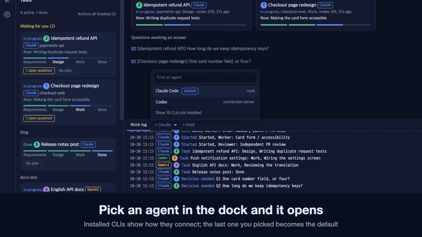
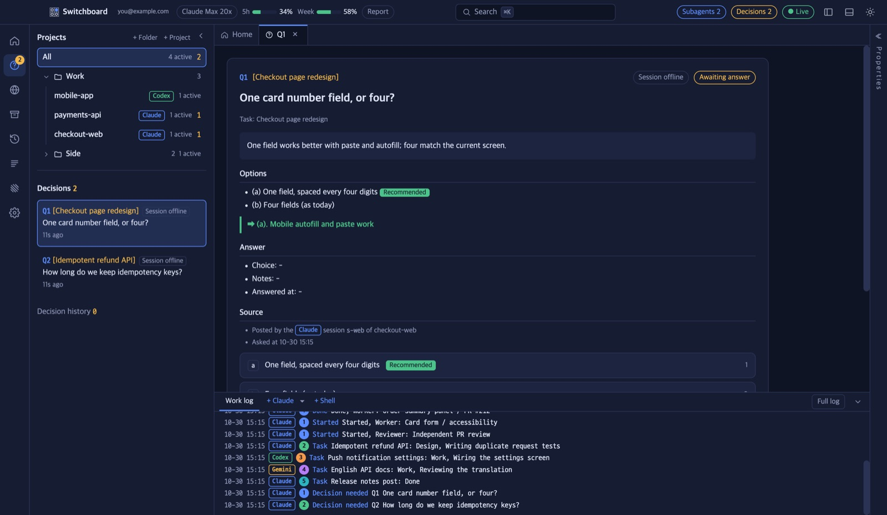
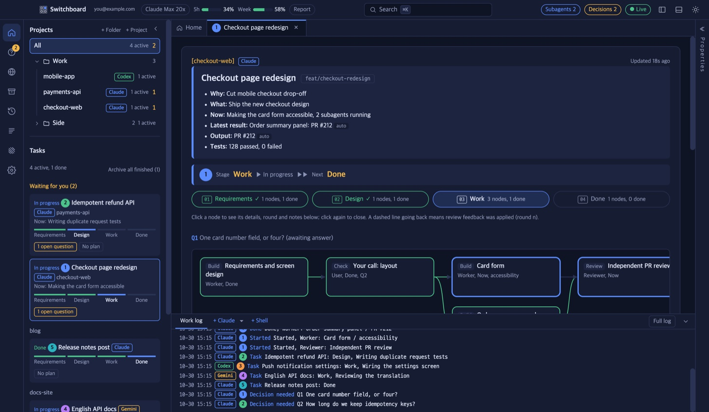
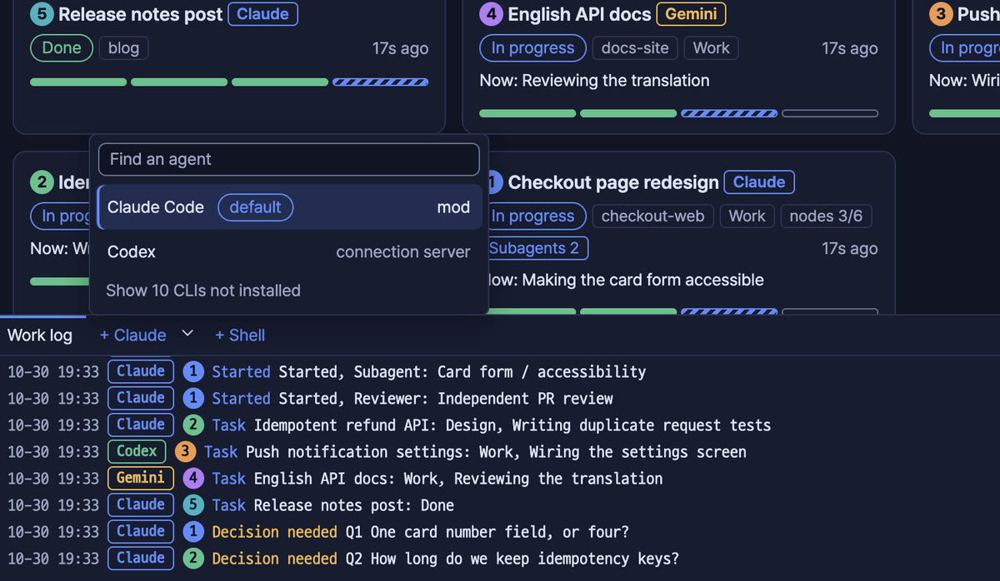
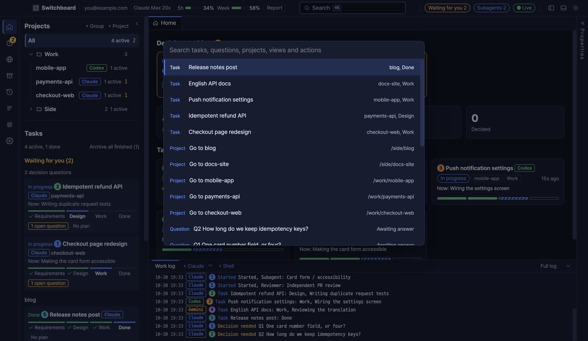
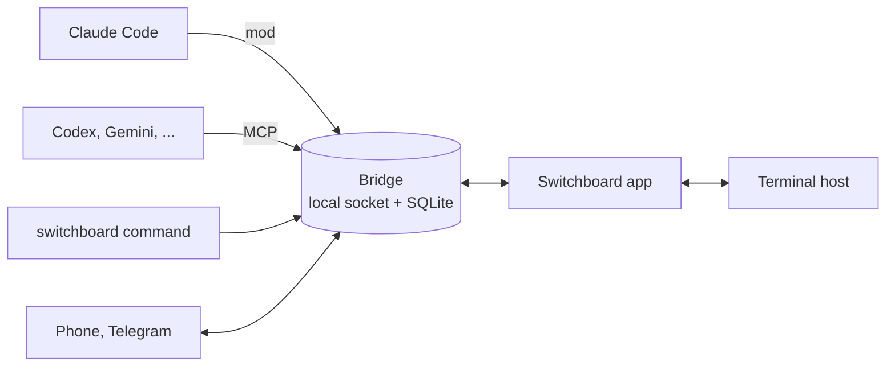

<div align="center">


# Switchboard

### Direct many coding agents from one screen

Run several Claude Code, Codex and Gemini CLI sessions and hand them work.<br>
The agents keep working, and only the questions that need you land in one place.

<a href="https://github.com/choco5958/switchboard/releases/latest"></a>
<a href="https://github.com/choco5958/switchboard/actions/workflows/test.yml"></a>

<a href="LICENSE"></a>

**[Download](https://github.com/choco5958/switchboard/releases/latest)** &nbsp;|&nbsp; [Install](#install) &nbsp;|&nbsp; [Features](#features) &nbsp;|&nbsp; [Security](#data-and-security)

[한국어](README.md) | **English** | [日本語](README.ja.md) | [简体中文](README.zh-CN.md)

<br>

<a href="https://cdn.jsdelivr.net/gh/choco5958/switchboard@main/docs/intro-en.mp4"></a><br>
<sub><a href="https://cdn.jsdelivr.net/gh/choco5958/switchboard@main/docs/intro-en.mp4">▶ Click to watch the full video with sound (58s)</a></sub>

</div>

<br>

## Who it is for

- With agents in many terminals, you lose track of **who is waiting on what**.
- While an agent sits on one question, **nothing moves**.
- Step away, and **one permission prompt** can stall work for hours.

In Switchboard, a session posts its question to a decision queue and keeps working. You answer with a key press, and the answer goes back to that session as a prompt. While you are away, questions and permission asks reach your phone and Telegram.

## Features

<table>
<tr>
<td width="50%"></td>
<td width="50%"></td>
</tr>
<tr>
<td width="50%" valign="top">
<h3>🗳️ Decide with one key</h3>
Sessions post options, a recommendation and the reason for it. Pick with <code>a</code>, <code>b</code> and send with <code>Enter</code>. You can also hold a question or answer with a note.
</td>
<td width="50%" valign="top">
<h3>📊 Stages and a live progress graph</h3>
Requirements, design, work and done stages, with progress per node. See how far each subagent has got, as it happens.
</td>
</tr>
<tr>
<td width="50%"></td>
<td width="50%"></td>
</tr>
<tr>
<td width="50%" valign="top">
<h3>🧩 Bring the agents you use</h3>
Pick an installed CLI from ▾ in the dock. Each CLI's own config files are left alone, and the last agent you picked becomes the default.
</td>
<td width="50%" valign="top">
<h3>⌘K to anything</h3>
Jump to any task, question or project. Group projects into folders and fold them away.
</td>
</tr>
</table>

<table>
<tr><td width="26%">🤝 <b>Sessions working together</b></td><td>Ask another session and get its answer back. Collect answers from several sessions into one turn, and take back work you handed off.</td></tr>
<tr><td width="26%">📱 <b>While you are away</b></td><td>Answer decisions and Claude Code permission asks from your phone or Telegram, on any network.</td></tr>
<tr><td width="26%">⏰ <b>Scheduled prompts</b></td><td>Send a prompt to a session daily, on weekdays, at an interval or once.</td></tr>
<tr><td width="26%">🔍 <b>Fix what you see</b></td><td>Click an element in the in-app browser to leave a comment with its location, a screenshot and console errors. Sessions click through local pages to check their work.</td></tr>
<tr><td width="26%">🖥️ <b>Terminals that keep going</b></td><td>On macOS and Linux, agents in the terminals keep working when you quit or update the app, and come back as they were when you reopen it.</td></tr>
<tr><td width="26%">🔒 <b>Safe by default</b></td><td>Only signed updates install. Only the app and phones paired over HTTPS can allow permission asks, and sessions cannot pose as you.</td></tr>
<tr><td width="26%">🎨 <b>Your look</b></td><td>13 themes and 4 languages. Claude usage and context use sit at the top.</td></tr>
</table>

<details>
<summary><b>More on the features</b></summary>

#### Decisions and tasks
- **Decision queue**: a session posts a question with `ask_decision` and goes on working without waiting. The same question is never posted twice.
- **Waiting on you**: tasks with a pending decision, a turn stalled for over 5 minutes, a usage limit or a dropped session gather at the top of the sidebar. Stalled sessions and lifted limits also come as notifications.
- **Per project**: pick a project on the left and the sidebar, home, log and dock show only that project.

#### Sessions working together
- A session finds others with `list_sessions` and sends a request with `send_to_session`. If the receiver ends its turn without replying, its last answer comes back as the result.
- Answers to a question sent to several sessions are collected into one turn. After 15 minutes, the ones that arrived go first.
- If the receiver drops or its turn is interrupted, the sender is told.
- `cancel_request` takes back a request. Requests passed between sessions from one starting request are capped at 8 in total.
- A decision can be handed to another session to answer. Answers for a session at its usage limit are held until the limit resets.

#### While you are away
- When the app is closed, the screen is locked or there has been no input for 5 minutes, decisions and permission asks go to Telegram and your phone. At your desk, the terminal asks as usual.
- Each scheduled prompt names the agent it goes to; if that agent has no session, the app opens its terminal. Runs with nothing to report send no notification.

#### Fix what you see
- Register a dev server, start it and open it in the in-app browser. Local addresses a CLI opens in an app terminal open there too.
- Sessions read, click and type in local pages with the `browser_*` tools. By default they reach only this computer's addresses; allow private network addresses in Settings > Agent CLIs.

#### Terminals
- `+` in the dock opens the agent you opened last, ▾ lists the installed agents, and `+ Shell` opens a plain shell.
- Your Mac does not sleep while an agent is working.
- To close the terminals when the app quits, turn on `Close terminals when the app quits` in Settings > Agent CLIs. On Windows the terminals close with the app.
- When turned on in Settings, the app answers yes ahead of time to the folder trust question of Codex, Copilot and Cursor for a folder they open for the first time. It is off by default and skips folders with agent config of their own (.codex, .cursor, .mcp.json and so on).
- Type `/switchboard` in Claude Code to see that session's flow and decisions in a side pane.

#### Display
- Group projects in the sidebar with `+ Folder` and fold them. Delete a folder with `Delete folder` in its ⋯ menu or the Delete key; its projects stay in the list. Removing a project from the list keeps its files and history.
- 한국어, English, 日本語, 简体中文; it follows the OS language at first.
- 13 themes: Classic navy, Adventure journal, Phosphor terminal, Pixel dots, Subway map, Circuit board, Modern terminal, Blue DOS window, Dracula, Nord, Solarized Dark and Light, GitHub Light.
- With Orca installed, each node can get a worktree, and a Linear issue can start a task.

</details>

## Supported agents

Claude Code connects through a mod; other CLIs connect through a server (MCP) the app attaches to that run only. Both use the same tools, so most features work whatever the agent.

| Feature | Claude Code | Codex, Gemini CLI, Qwen Code,<br>Copilot CLI, OpenCode, Goose, Amp | Cursor CLI, Grok,<br>Kimi, Crush |
| --- | :---: | :---: | :---: |
| Task reports, decisions, asking other sessions, browser tools | ✅ | ✅ | Terminal only |
| Receiving answers and messages | ✅ | ✅ typed into the app terminal | |
| Scheduled prompts | ✅ | ✅ | |
| Permission asks relayed while away | ✅ | Not yet | |
| Usage bars, `/switchboard` pane | ✅ | | |

Add any other CLI in Settings > Agent CLIs with its command and how it connects. Only installed CLIs show in the dock.

## Quick start

1. Get the installer from [Releases](https://github.com/choco5958/switchboard/releases/latest). [Install](#install) below has the steps for each system.
2. Pick a project folder with `+ Project` at the top left, then open an agent with `+ Claude` or ▾ in the dock below.
3. Hand it work as usual. When a number shows on the question mark icon on the left, open the question and answer with a key.

| Key | Action |
| --- | --- |
| `a`, `b`, `1`, `2` | Pick an option |
| `Enter` | Send |
| `H` twice | Hold |
| `M` | Add a note (`Cmd+Enter` sends, `Esc` leaves) |
| `Cmd+K` (`Ctrl+K` on Windows and Linux) | Find |

## Install

Requires Claude Code 2.1.309 or later. Node comes inside the app, so there is nothing else to install. The app is not yet code-signed by Apple or Microsoft, so a warning appears the first time you open it.

<details open>
<summary><b>macOS</b></summary>

1. Get `Switchboard-<version>-mac-arm64.dmg` for Apple Silicon (M1 and later) or `-mac-x64.dmg` for Intel. Apple menu > About This Mac shows which chip you have.
2. Open the dmg and drag Switchboard into Applications.
3. Open Switchboard. When macOS says it cannot verify the app is free of malware, click Done.
4. In System Settings > Privacy & Security, click Open Anyway next to Switchboard, enter your password and click Open. Before macOS 14, right-click the app > Open also works.

Instead of step 4 you can run `xattr -dr com.apple.quarantine /Applications/Switchboard.app` in a terminal. If the keychain asks after an update, click Always Allow.

</details>

<details>
<summary><b>Windows</b></summary>

1. Get `Switchboard-<version>-win.exe` (x64 and ARM in one), or `-win-x64.exe` / `-win-arm64.exe` for your device.
2. Run it, and in "Windows protected your PC" click More info > Run anyway.
3. Choose a folder, click Install and open Switchboard from the Start menu.

</details>

<details>
<summary><b>Linux</b></summary>

- AppImage: get `Switchboard-<version>-linux-x86_64.AppImage` (`-linux-arm64.AppImage` for ARM), `chmod +x` it and run it. If FUSE errors appear, install `libfuse2` (`libfuse2t64` on Ubuntu 24.04).
- deb: get `-linux-amd64.deb` or `-linux-arm64.deb` and install with `sudo apt install ./Switchboard-*.deb`. Only the AppImage updates itself.

</details>

**Updates**: the app checks for new versions, downloads them and installs when you quit. An update never closes the app by itself, and an update with a missing or wrong signature is not installed. On macOS and Linux the app terminals keep running through an update. From macOS 0.3.4 or earlier, download and install once by hand.

<details>
<summary><b>Connecting Claude Code from other terminals</b></summary>

The app's `+ Claude` terminals load the mod themselves. To connect sessions you open in other terminals, install the mod from the Claude Code prompt:

```
/plugin install ide-bridge --marketplace choco5958/switchboard
```

Answer `y` to `Add marketplace?` and pick the user scope. Sessions opened after that connect, and the mod starts the bridge if it is not running. Open the app once first so the mod knows how to start the bridge (`~/.claude-ide/start-bridge.json`).

</details>

<details>
<summary><b>Running from source</b></summary>

Requires Node.js 24 or later and pnpm.

```sh
git clone https://github.com/choco5958/switchboard.git
cd switchboard
pnpm install
pnpm run setup  # writes ~/.claude-ide/start-bridge.json and ~/.local/bin/switchboard
pnpm dev
```

Run `pnpm run setup` again if you move the repo folder. `pnpm dist` builds the installers.

</details>

## While you are away

### Phone access

Answer decisions, allow or deny permission asks, follow tasks and message sessions from your phone's browser, with no app to install.

1. Install [Tailscale](https://tailscale.com) on the computer and the phone and sign in.
2. In Settings > Phone access, turn on `Turn on phone access` and `Turn on Tailscale HTTPS`.
3. Choose the Tailscale HTTPS address, click `Show a QR code` and scan it with the phone's camera.
4. Add it to the home screen: Safari's Share button > Add to Home Screen on iPhone, Chrome's menu (⋮) > Add to Home screen on Android. The first time the iPhone home screen app opens, show a new QR code in the desktop app and type the 8-character code shown next to it.

Turn on `Get notifications on this phone` in the home screen app to be notified of new questions and permission asks while you are away.

<details>
<summary><b>Without Tailscale on the phone, or on the same Wi-Fi only</b></summary>

- **Tailscale Funnel**: turn on `Accept connections from other Wi-Fi and mobile data` under `Turn on Tailscale HTTPS` to open the same HTTPS address to the internet, so the phone works from any network without Tailscale. Allow Funnel for this computer once in the Tailscale admin page (Settings shows the link). Anyone with the address can open the page, but the content is encrypted with a key per phone, so only paired phones can read and answer.
- **Same Wi-Fi (HTTP address)**: choose `This computer's name` (`name.local`) or an IP to skip Tailscale. Over this connection you can only answer decisions with an option, deny, or send an ask to the terminal. Allowing permission asks, messaging sessions and notes on answers need a phone paired over Tailscale HTTPS, because whoever controls the network can swap a page sent over HTTP. A Tailscale IP (`100.x.y.z`) is HTTP too and has the same limits.
- Each phone pairs on its own; `Disconnect` in Settings removes it. Phones paired with 0.3.5 or earlier must pair again with a QR code for the Tailscale HTTPS address to allow permission asks.

</details>

### Connecting Telegram

1. Send `/newbot` to `@BotFather` in Telegram to make a bot.
2. Paste the token into Settings > Answer on Telegram and click Connect bot.
3. Click Get a link code and open the link on your phone within 10 minutes, then tap Start. Only that chat is connected.

Allowing on Telegram takes a second tap, and requests with masked secrets cannot be allowed there.

### Scheduled prompts

In Settings > Scheduled prompts, set a name, project, agent, prompt and schedule. Intervals are 5 minutes or longer. A run is skipped while the previous one is still going, and runs missed while the app was off can run once at start. After 5 failed runs in a row, the schedule turns itself off and tells you.

## From the shell

| Command | What it does |
| --- | --- |
| `switchboard sessions` | List sessions (● connected) |
| `switchboard send <session or project> <task or -> [--wait] [--timeout 30m] [--info] [--json]` | Hand a session work and print a number like `m7`. `--wait` waits for the result, `--info` sends a note that needs no reply. `-` reads standard input. |
| `switchboard status m7` | Status and result of the work |
| `switchboard decisions`, `switchboard answer Q12 a [note]` | See and answer pending decisions |
| `switchboard waits`, `switchboard fire w3 [text]` | See and fire waits sessions opened |

```sh
# Wake the session waiting on the test results
pnpm test; switchboard fire w3 "tests done: exit code $?"
```

Exit codes: 0 done, 1 failed, 2 usage error, 3 the session waits on a decision, 4 timed out (the session keeps working), 5 bridge down or no such session. The command lives in `~/.local/bin` on macOS and Linux and `%USERPROFILE%\.claude-ide\bin` on Windows.

Text sent with this command reaches the session marked as input from a shell, never as your instructions. `switchboard answer` does not run inside an agent session.

<details>
<summary><b>Tools sessions use</b></summary>

| Tool | What it does |
| --- | --- |
| `ask_decision` | Posts a question to the decision queue and returns at once. |
| `set_task` | Creates a task or updates its stage, current step and test results. |
| `plan_nodes`, `update_node` | Splits a task into nodes on the progress graph and updates their state. |
| `node_worktree` | Makes an Orca worktree for a node, inside the session's folder only. |
| `open_in_ide` | Opens a page or dev server in the in-app browser; a new command needs your OK in the app. |
| `list_sessions`, `send_to_session` | Sees other sessions and sends them requests or information. |
| `cancel_request` | Cancels a request the session made. |
| `await_event`, `close_wait` | Opens and closes a wait for outside work such as a build or deploy. |
| `routine_no_update`, `routine_report_failure` | Records that a scheduled run had nothing to report or failed. |
| `browser_snapshot`, `browser_click`, `browser_type`, `browser_navigate`, `browser_console`, `browser_screenshot` | Reads and works local pages in the in-app browser. |
| `check_answers` | For other CLIs: a session outside the app takes answers it has not received yet. |

</details>

## Data and security

- **Everything stays on this computer** (`~/.claude-ide/`, readable only by you). A port reachable from outside exists only while phone access is on.
- **Only signed updates install.** Every release signs its update metadata, and the app checks it with a pinned public key.
- **Only you allow permission asks.** Allowing needs the app's key (encrypted in the OS keychain), and each allow is signed with it. A session with a shell cannot allow its own request by calling the bridge or editing the database. The app sends its key only to a bridge or terminal host that has proved it holds the key.
- **Sessions cannot pose as you.** Text from shell commands is marked with its source and fenced, and acting for a session needs the token it got at registration.
- **Phones**: requests and replies are encrypted with a key per phone (ChaCha20-Poly1305) and cannot be replayed. Only phones paired over Tailscale HTTPS can allow permission asks.
- **Remote approval** shows the command itself and settings such as sandbox off. Requests that cannot be shown in full and commands to run outside the sandbox are asked in the terminal only.
- **What leaves the computer**: with Telegram connected, questions and permission asks pass through Telegram's servers; phone notifications pass through push servers. Values that look like tokens are masked, and notification content is encrypted so push servers cannot read it. Your account email is masked on screen and sent nowhere.

<details>
<summary><b>More on security</b></summary>

- The socket and database are 0600 and the folder 0700. On Windows the bridge listens on 127.0.0.1 only and answers only requests with a token made at each start.
- Permission answers, away status, Telegram settings, scheduled prompts, setting changes and session control are the app's alone. A bridge the mod started first has no key, so the app restarts it once when it opens.
- Read without the app's key, the screen state masks secrets in permission asks and leaves out terminal keys and session tokens.
- Answers are typed only into terminals the app opened for that agent, and wait while the CLI shows a confirmation menu; the screen is checked again right before Enter.
- Sessions' browser tools open only this computer's addresses by default. The scripts behind the browser tools and comments run in a world apart from the page.
- A dev server command a session adds with `open_in_ide` is shown with its folder for your OK the first time and whenever it changes. Commands with hidden characters are refused.
- Phone access is closed until you turn it on. Then it accepts only this computer, the private network and Tailscale, and checks the `X-Forwarded-Proto: https` Tailscale serve adds and this computer's HTTPS name. Turning phone access off or stopping the bridge turns Tailscale HTTPS off too. Addresses with many failed requests are blocked for a while.
- Commands with hidden or text-reordering characters show markers like `[U+202E]` and cannot be allowed from a phone or Telegram.
- `NODE_OPTIONS` and `--inspect` are blocked in the app executable.
- When you give an agent a shell, consider blocking `~/.claude-ide` with the Claude Code sandbox.
- Work logs are deleted after 7 days.

</details>

## Architecture and development



<details>
<summary><b>Folders and development commands</b></summary>

| Folder | Role |
| --- | --- |
| `bridge/` | Local relay server on `~/.claude-ide/bridge.sock` with SQLite. Scheduled runs, Telegram and phone access run here too. |
| `mod/` | The Claude Code mod `ide-bridge`: registers tools, delivers answers into sessions, draws the `/switchboard` pane. |
| `mcp/` | MCP server (stdio) for other coding CLIs. |
| `scripts/` | Setup, the `switchboard` command and the release signing script. |
| `src/` | The Electron app (React) and the terminal host. |

```sh
pnpm test        # bridge, mod, scripts (node:test) and UI logic (vitest)
pnpm typecheck
pnpm build && pnpm start
claude plugin test mod
```

Tests clear real account variables and run in a temporary home folder. Check the UI against a bridge kept apart from your real data:

```sh
CLAUDE_IDE_SOCKET=/tmp/sb/b.sock CLAUDE_IDE_DB=/tmp/sb/ide.db node bridge/server.ts &
CLAUDE_IDE_SOCKET=/tmp/sb/b.sock CLAUDE_IDE_CAPTURE=/tmp/sb/shot.png pnpm exec electron .
```

With `CLAUDE_IDE_CAPTURE` the app saves the screen as a PNG without a window and quits. [DESIGN_SYSTEM.md](DESIGN_SYSTEM.md) explains how to add a theme.

</details>

## License

[MIT](LICENSE)
