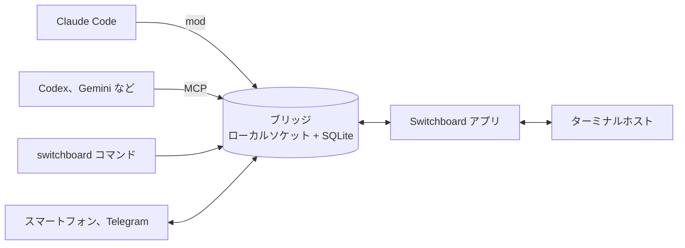

<div align="center">


# Switchboard

### 複数のコーディングエージェントをひとつの画面で指揮します

Claude Code、Codex、Gemini CLI をいくつも立ち上げて仕事を任せましょう。<br>
エージェントは止まらずに作業を続け、人の判断が必要な質問だけが一か所に集まります。

<a href="https://github.com/choco5958/switchboard/releases/latest"></a>
<a href="https://github.com/choco5958/switchboard/actions/workflows/test.yml"></a>

<a href="LICENSE"></a>

**[ダウンロード](https://github.com/choco5958/switchboard/releases/latest)** &nbsp;|&nbsp; [インストール](#インストール) &nbsp;|&nbsp; [機能](#機能) &nbsp;|&nbsp; [セキュリティ](#データとセキュリティ)

[한국어](README.md) | [English](README.en.md) | **日本語** | [简体中文](README.zh-CN.md)

<br>

<a href="https://cdn.jsdelivr.net/gh/choco5958/switchboard@main/docs/intro-en.mp4"></a><br>
<sub><a href="https://cdn.jsdelivr.net/gh/choco5958/switchboard@main/docs/intro-en.mp4">▶ クリックすると音声付きの全編を再生します (58秒、英語)</a></sub>

</div>

<br>

## こんな方に

- ターミナルをいくつも開いてエージェントを動かしていると、**誰が何を待っているのか**見失います。
- エージェントがひとつの質問で止まっている間、**何も進みません**。
- 席を外すと、**権限の確認ひとつ**で作業が何時間も止まります。

Switchboard では、セッションが判断の質問をキューに載せて別の作業を続けます。キーひとつで答えると、その答えがプロンプトとしてセッションに入ります。席を外している間は、質問と権限の確認がスマートフォンと Telegram に届きます。

## 機能

<table>
<tr>
<td width="50%" valign="top">

<h3>🗳️ 判断はキーひとつで</h3>
セッションが選択肢、おすすめ、その理由を載せます。<code>a</code>、<code>b</code> で選び <code>Enter</code> で送ります。保留やメモ付きの回答もできます。
</td>
<td width="50%" valign="top">

<h3>📊 作業段階と進行グラフ</h3>
要件、設計、作業、完了の段階とノードごとの進行が描かれます。サブエージェントがどこまで進んだかをリアルタイムで見られます。
</td>
</tr>
<tr>
<td width="50%" valign="top">

<h3>🧩 使っているエージェントをそのまま</h3>
ドックの ▾ からインストール済みの CLI を選んで開きます。各 CLI の設定ファイルには触れず、最後に選んだエージェントが既定になります。
</td>
<td width="50%" valign="top">

<h3>⌘K でどこへでも</h3>
タスク、質問、プロジェクトをすぐに探して開きます。プロジェクトはフォルダーにまとめて折りたためます。
</td>
</tr>
</table>

|  |  |
| --- | --- |
| 🤝 **セッション同士の連携** | 別のセッションに尋ねて答えを受け取ります。複数のセッションの答えをまとめて 1 ターンに入れ、任せた仕事は途中で取り下げられます。 |
| 📱 **席を外している間** | 判断の質問と Claude Code の権限確認に、スマートフォンや Telegram から答えます。同じ Wi-Fi でなくても使えます。 |
| ⏰ **予約プロンプト** | 毎日、平日、間隔、1 回から選び、決めた時刻にセッションへプロンプトを入れます。 |
| 🔍 **画面を見ながら直す** | 内蔵ブラウザーで要素をクリックしてコメントを残すと、位置、スクリーンショット、コンソールエラーが一緒に届きます。セッションはローカルページを自分でクリックして確かめます。 |
| 🖥️ **続くターミナル** | macOS と Linux では、アプリを閉じてもアップデートしても、ターミナルのエージェントは作業を続け、開き直すと画面ごと戻ります。 |
| 🔒 **安全が標準** | 署名されたアップデートだけをインストールします。権限の許可はアプリと HTTPS で接続したスマートフォンだけができ、セッションが人になりすますことはできません。 |
| 🎨 **選べる見た目** | テーマ 13 種、言語 4 種。Claude の使用量とコンテキスト使用率が上部に表示されます。 |

<details>
<summary><b>機能の詳細</b></summary>

#### 判断とタスク
- **判断待ちキュー**: セッションは `ask_decision` で質問を載せ、待たずにすぐ作業を続けます。同じ質問が二度載ることはありません。
- **自分待ち**: 判断待ちがある、ターンが 5 分以上止まっている、使用量の上限に達した、セッションが切れた、というタスクがサイドバーの一番上に集まります。止まったセッションと上限が解けたセッションは通知でも知らせます。
- **プロジェクト別表示**: 左の一覧でプロジェクトを選ぶと、サイドバー、ホーム、ログ、ドックがそのプロジェクトのものだけになります。

#### セッション同士の連携
- セッションは `list_sessions` でほかのセッションを探し、`send_to_session` で依頼を送ります。受け取ったセッションが返事をせずにターンを終えると、最後の回答が結果として返ります。
- 複数のセッションに送った質問の答えはまとめて 1 ターンに入れます。15 分を過ぎると届いた分から渡します。
- 受け取ったセッションが切れたりターンが中断されたりすると、送った側に知らせます。
- `cancel_request` で任せた依頼を取り下げます。ひとつの依頼から始まってセッション同士で任せる依頼は合計 8 回までです。
- 判断の質問をほかのセッションに渡して代わりに答えさせられます。使用量の上限に達したセッションへの答えは、リセットまでためておきます。

#### 席を外している間
- アプリが閉じている、画面がロックされている、5 分以上入力がない、というときは、判断の質問と権限の確認が Telegram とスマートフォンに届きます。席にいるときはこれまでどおりターミナルが尋ねます。
- 予約プロンプトの送り先エージェントは予約ごとに選び、そのエージェントのセッションがなければアプリがターミナルを開きます。知らせることのない実行は通知しません。

#### 画面を見ながら直す
- 開発サーバーを登録して起動し、内蔵ブラウザーで開きます。アプリのターミナルで CLI が開くローカルアドレスも内蔵ブラウザーで開きます。
- セッションは `browser_*` ツールでローカルページを読み、クリックし、入力します。既定ではこのコンピューターのアドレスだけを扱い、設定 > エージェント CLI で許可するとプライベートネットワークのアドレスも扱います。

#### ターミナル
- ドックの `+` は最後に開いたエージェントを、▾ はインストール済みエージェントの一覧を、`+ シェル` は通常のシェルを開きます。
- エージェントが作業している間は Mac がスリープしません。
- アプリを閉じるときにターミナルも閉じるには、設定 > エージェント CLI で `アプリを閉じるときにターミナルも閉じる` をオンにします。Windows ではターミナルはアプリと一緒に閉じます。
- 設定でオンにすると、Codex、Copilot、Cursor を初めて開くフォルダーの信頼確認に先にはいと記録します。既定はオフで、独自のエージェント設定 (.codex、.cursor、.mcp.json など) があるフォルダーは記録しません。
- Claude Code で `/switchboard` と入力すると、そのセッションの作業の流れと判断待ちを横のペインで見られます。

#### 表示
- サイドバーのプロジェクトは `+ フォルダー` でまとめて折りたたみます。一覧から外してもファイルと記録は残ります。
- 한국어、English、日本語、简体中文。最初は OS の言語に従います。
- テーマ 13 種: ベーシック紺、冒険日誌、蛍光ターミナル、ドット絵、地下鉄路線図、回路基板、モダンターミナル、青い DOS 画面、Dracula、Nord、Solarized ダークとライト、GitHub ライト。
- Orca があれば、ノードごとにワークツリーを作り、Linear のイシューからタスクを始められます。

</details>

## 対応エージェント

Claude Code は mod で、ほかの CLI はアプリがその実行にだけ付ける接続サーバー (MCP) でつながります。使うツールは同じなので、ほとんどの機能はエージェントに関係なく使えます。

| 機能 | Claude Code | Codex、Gemini CLI、Qwen Code、<br>Copilot CLI、OpenCode、Goose、Amp | Cursor CLI、Grok、<br>Kimi、Crush |
| --- | :---: | :---: | :---: |
| タスク報告、判断の質問、セッション同士の質問、ブラウザーツール | ✅ | ✅ | ターミナルのみ |
| 答えとメッセージの受け取り | ✅ | ✅ アプリのターミナルに入力 | |
| 予約プロンプト | ✅ | ✅ | |
| 席を外している間の権限確認の中継 | ✅ | まだ | |
| 使用量バー、`/switchboard` ペイン | ✅ | | |

一覧にない CLI は、設定 > エージェント CLI でコマンドと接続方法を書いて追加します。ドックにはインストール済みの CLI だけが出ます。

## クイックスタート

1. [Releases](https://github.com/choco5958/switchboard/releases/latest) からインストーラーを入手してインストールします。OS ごとの手順は下の [インストール](#インストール) にあります。
2. 左上の `+ プロジェクト` で作業するフォルダーを選び、下のドックの `+ Claude` か ▾ からエージェントを開きます。
3. いつもどおり仕事を任せます。左の疑問符アイコンに数字が出たら、質問を開いてキーで答えます。

| キー | 動作 |
| --- | --- |
| `a`、`b`、`1`、`2` | 選択肢を選ぶ |
| `Enter` | 送る |
| `H` を 2 回 | 保留 |
| `M` | メモを入力 (`Cmd+Enter` で送信、`Esc` で抜ける) |
| `Cmd+K` (Windows と Linux は `Ctrl+K`) | 検索 |

## インストール

Claude Code 2.1.309 以降が必要です。アプリに Node が入っているので、ほかにインストールするものはありません。まだ Apple と Microsoft のコード署名を受けていないため、初めて開くときに一度警告が出ます。

<details open>
<summary><b>macOS</b></summary>

1. Apple Silicon (M1 以降) は `Switchboard-<バージョン>-mac-arm64.dmg`、Intel は `-mac-x64.dmg` を入手します。チップはアップルメニュー > この Mac についてで確認できます。
2. dmg を開き、Switchboard をアプリケーションフォルダーにドラッグします。
3. Switchboard を開きます。マルウェアを確認できないというダイアログが出たら完了を押します。
4. システム設定 > プライバシーとセキュリティで Switchboard の項目の「このまま開く」を押し、パスワードを入力して開くを押します。macOS 14 より前は、アプリを右クリック > 開くでも開けます。

4 の代わりにターミナルで `xattr -dr com.apple.quarantine /Applications/Switchboard.app` を実行してもかまいません。アップデート後にキーチェーンの使用を尋ねられたら、常に許可を押します。

</details>

<details>
<summary><b>Windows</b></summary>

1. `Switchboard-<バージョン>-win.exe` (x64 と ARM 兼用) か、機器に合う `-win-x64.exe` / `-win-arm64.exe` を入手します。
2. 実行し、「Windows によって PC が保護されました」で詳細情報 > 実行を押します。
3. インストール先を選んでインストールを押し、スタートメニューから Switchboard を開きます。

</details>

<details>
<summary><b>Linux</b></summary>

- AppImage: `Switchboard-<バージョン>-linux-x86_64.AppImage` (ARM は `-linux-arm64.AppImage`) を入手し、`chmod +x` で実行権限を付けて実行します。FUSE のエラーが出たら `libfuse2` (Ubuntu 24.04 は `libfuse2t64`) をインストールします。
- deb: `-linux-amd64.deb` か `-linux-arm64.deb` を入手し、`sudo apt install ./Switchboard-*.deb` でインストールします。自動アップデートは AppImage だけです。

</details>

**アップデート**: アプリが新しいバージョンを確認してダウンロードしておき、アプリを閉じるときにインストールします。アップデートのためにアプリが勝手に閉じることはなく、署名がない、または合わないアップデートはインストールしません。macOS と Linux ではアップデート中もアプリのターミナルが動き続けます。macOS 0.3.4 以前からは一度だけ手動でインストールします。

<details>
<summary><b>ほかのターミナルで開いた Claude Code をつなぐ</b></summary>

アプリの `+ Claude` ターミナルは mod を自動で読み込みます。ほかのターミナルで開いたセッションもつなぐには、Claude Code の入力欄で mod をインストールします。

```
/plugin install ide-bridge --marketplace choco5958/switchboard
```

`Add marketplace?` に `y` を押し、範囲は user を選びます。その後に開いたセッションからつながり、ブリッジが止まっていれば mod が起動します。mod がブリッジの起動方法 (`~/.claude-ide/start-bridge.json`) を知るために、アプリを一度起動しておいてください。

</details>

<details>
<summary><b>ソースから実行</b></summary>

Node.js 24 以降と pnpm が必要です。

```sh
git clone https://github.com/choco5958/switchboard.git
cd switchboard
pnpm install
pnpm run setup  # ~/.claude-ide/start-bridge.json と ~/.local/bin/switchboard を作ります
pnpm dev
```

リポジトリのフォルダーを移したら `pnpm run setup` をもう一度実行します。インストーラーは `pnpm dist` で作ります。

</details>

## 席を外しているときに使う

### スマートフォン接続

アプリをインストールせずに、スマートフォンのブラウザーから判断の質問に答え、権限の確認を許可または拒否し、タスクを見て、セッションにメッセージを送ります。

1. コンピューターとスマートフォンに [Tailscale](https://tailscale.com) をインストールしてログインします。
2. 設定 > スマートフォン接続で `スマートフォン接続をオンにする` と `Tailscale HTTPS をオンにする` をオンにします。
3. アドレスに Tailscale HTTPS を選び、`QR コードを表示` を押してスマートフォンのカメラで読み取ります。
4. ホーム画面に追加します。iPhone は Safari の共有ボタン > ホーム画面に追加、Android は Chrome のメニュー (⋮) > ホーム画面に追加です。iPhone のホーム画面アプリを初めて開いたら、PC アプリで QR コードを新しく表示し、横の 8 文字のコードを入力します。

ホーム画面アプリで通知をオンにすると、席を外している間に新しい質問と権限確認の通知を受け取れます。

<details>
<summary><b>スマートフォンに Tailscale を入れずに使う、同じ Wi-Fi だけで使う</b></summary>

- **Tailscale Funnel**: `Tailscale HTTPS をオンにする` の下の `ほかの Wi-Fi やモバイル回線からも接続を受ける` をオンにすると、同じ HTTPS アドレスがインターネットに開き、スマートフォンに Tailscale がなくてもどのネットワークからでも使えます。最初の一度だけ、Tailscale の管理ページでこのコンピューターの Funnel を許可します (設定にリンクが出ます)。アドレスを知っている人はページを開けますが、内容はスマートフォンごとに違う鍵で暗号化され、接続したスマートフォンだけが見て答えられます。
- **同じ Wi-Fi (HTTP アドレス)**: アドレスに `このコンピューターの名前` (`名前.local`) か IP を選ぶと Tailscale なしで使えます。ただしこの接続でできるのは、選択肢で判断に答える、拒否する、ターミナルで尋ねるだけです。権限の許可、セッションへのメッセージ、判断の答えのメモは、Tailscale HTTPS で接続したスマートフォンだけができます。HTTP でやり取りする画面は、そのネットワークを握った人がすり替えられるからです。Tailscale IP (`100.x.y.z`) も HTTP なので同じ制限を受けます。
- スマートフォンごとに接続し、設定の `接続を解除` で切ります。0.3.5 以前で接続したスマートフォンで権限を許可するには、Tailscale HTTPS アドレスの QR コードで接続し直します。

</details>

### Telegram の接続

1. Telegram で `@BotFather` に `/newbot` を送ってボットを作ります。
2. 設定 > Telegram で答えるに受け取ったトークンを貼り付け、ボットを接続します。
3. `接続コードを受け取る` を押し、10 分以内にスマートフォンでリンクを開いて開始を押します。そのチャットだけがつながります。

Telegram で許可するにはもう一度押す必要があり、秘密の値を隠した依頼は Telegram では許可できません。

### 予約プロンプト

設定 > 予約プロンプトで名前、プロジェクト、送り先エージェント、プロンプト、スケジュールを決めます。間隔は 5 分以上です。前の実行が終わっていなければ飛ばし、止まっていた間に逃した実行は起動時に一度実行するか選べます。セッションに入った実行が 5 回続けて失敗すると、その予約をオフにして知らせます。

## シェルから使う

| コマンド | すること |
| --- | --- |
| `switchboard sessions` | セッション一覧 (● 接続中) |
| `switchboard send <セッションかプロジェクト> <仕事か -> [--wait] [--timeout 30m] [--info] [--json]` | セッションに仕事を任せ、`m7` のような番号を出力します。`--wait` は結果まで待ち、`--info` は返事のいらない知らせとして送ります。`-` は標準入力を読みます。 |
| `switchboard status m7` | 任せた仕事の状態と結果 |
| `switchboard decisions`、`switchboard answer Q12 a [メモ]` | 判断待ちを見て答えます。 |
| `switchboard waits`、`switchboard fire w3 [内容]` | セッションが開いた待機を見て起こします。 |

```sh
# テストが終わったら、その結果を待っていたセッションを起こします
pnpm test; switchboard fire w3 "テスト終了: 終了コード $?"
```

終了コードは 0 完了、1 失敗、2 コマンドラインの誤り、3 セッションが判断待ち、4 タイムアウト (セッションは作業を続けます)、5 ブリッジが止まっているかセッションがない、です。コマンドは macOS と Linux では `~/.local/bin`、Windows では `%USERPROFILE%\.claude-ide\bin` にできます。

このコマンドで送った文はセッションに「シェルからの入力」と示されて入り、人の指示としては読まれません。`switchboard answer` はエージェントのセッションの中では実行されません。

<details>
<summary><b>セッションが使うツール</b></summary>

| ツール | すること |
| --- | --- |
| `ask_decision` | 判断待ちキューに質問を載せ、すぐに戻ります。 |
| `set_task` | タスクを作るか、段階、今していること、テスト結果を更新します。 |
| `plan_nodes`、`update_node` | タスクをノードに分けて進行グラフに載せ、状態を変えます。 |
| `node_worktree` | ノードに Orca のワークツリーを作ります。セッションのフォルダー内だけで動きます。 |
| `open_in_ide` | ページや開発サーバーを内蔵ブラウザーで開きます。新しいコマンドはアプリで確認を受けます。 |
| `list_sessions`、`send_to_session` | ほかのセッションを見て、依頼や情報を送ります。 |
| `cancel_request` | 自分が任せた依頼を取り消します。 |
| `await_event`、`close_wait` | ビルドやデプロイのような外の作業を待つ待機を開いて閉じます。 |
| `routine_no_update`、`routine_report_failure` | 予約実行で知らせることがない、または失敗したことを残します。 |
| `browser_snapshot`、`browser_click`、`browser_type`、`browser_navigate`、`browser_console`、`browser_screenshot` | 内蔵ブラウザーのローカルページを読んで操作します。 |
| `check_answers` | ほかのコーディング CLI 用。アプリの外で動くセッションがまだ受け取っていない答えを取ります。 |

</details>

## データとセキュリティ

- **すべてのデータはこのコンピューターだけ**に保存されます (`~/.claude-ide/`、本人だけが読める権限)。外から届くポートはスマートフォン接続をオンにしたときだけできます。
- **署名されたアップデートだけをインストール**します。リリースごとにアップデート情報へ署名し、アプリは固定した公開鍵で確かめます。
- **権限の許可は人だけ**ができます。許可にはアプリの鍵 (OS のキーチェーンで暗号化) が必要で、許可の答えにはその鍵で署名します。シェル権限のあるセッションがブリッジに直接頼んだり DB を書き換えたりしても、自分の依頼を許可できません。アプリは鍵を持っていると証明したブリッジとターミナルホストにだけ鍵を送ります。
- **セッションは人になりすませません。** シェルコマンドから入った文は出どころを示して境界の中に入れ、セッションごとに受け取ったトークンがないとそのセッションの答えや依頼を扱えません。
- **スマートフォン**: スマートフォンごとに違う鍵で要求と応答をすべて暗号化し (ChaCha20-Poly1305)、同じ要求を送り直せないようにします。権限の許可は Tailscale HTTPS で接続したスマートフォンだけができます。
- **リモート承認**では、コマンドの原文とサンドボックス解除などの設定を一緒に表示します。すべてを見せられない依頼と、サンドボックスの外で動かすコマンドはターミナルでだけ尋ねます。
- **外に出るもの**: Telegram をつなぐと質問と権限確認の内容が Telegram のサーバーを通り、スマートフォンの通知はプッシュサーバーを通ります。どちらもトークンのように見える値は隠し、通知の内容は暗号化されてプッシュサーバーには読めません。アカウントのメールアドレスは画面で隠し、どこにも送りません。

<details>
<summary><b>セキュリティの詳細</b></summary>

- ソケットと DB は 0600、フォルダーは 0700 です。Windows ではブリッジが 127.0.0.1 にだけポートを開き、起動ごとに作るトークン付きの要求にだけ答えます。
- 権限確認の答え、離席の表示、Telegram の設定、予約プロンプト、設定の変更、セッションの制御はアプリだけができます。mod が先に立ち上げたブリッジは鍵を持たないので、アプリが起動するときに一度立ち上げ直します。
- アプリの鍵なしで読む画面の状態では、権限確認の秘密の値を隠し、ターミナルキーとセッショントークンを除きます。
- ほかの CLI のターミナルには、アプリがそのエージェント用に開いたターミナルにだけ入力し、CLI が確認メニューを出している間は待ちます。Enter の直前にももう一度確かめます。
- セッションのブラウザーツールは、既定ではこのコンピューターのアドレスだけを開きます。ブラウザーツールと画面コメントのスクリプトは、ページとは分けた領域で動きます。
- セッションが `open_in_ide` で加えた開発サーバーのコマンドは、初回 (と変わるたび) にアプリが原文とフォルダーを見せて確認を受けます。隠れた文字の入ったコマンドは拒否します。
- スマートフォン接続はオンにするまで開きません。オンにすると、このコンピューター、プライベートネットワーク、Tailscale からの接続だけを受け、Tailscale serve が付ける `X-Forwarded-Proto: https` とこのコンピューターの HTTPS 名を確かめます。スマートフォン接続をオフにするかブリッジが止まると、Tailscale HTTPS もオフにします。失敗した要求の多いアドレスはしばらく止めます。
- 隠れた文字や文字の並びを変える文字が入ったコマンドは `[U+202E]` のように表示し、スマートフォンと Telegram では許可できません。
- アプリの実行ファイルでは `NODE_OPTIONS` と `--inspect` を止めています。
- エージェントにシェル権限を与えるときは、Claude Code のサンドボックスで `~/.claude-ide` へのアクセスを止めておくことをおすすめします。
- 作業ログは 7 日を過ぎると消します。

</details>

## 構成と開発



<details>
<summary><b>フォルダー構成と開発コマンド</b></summary>

| フォルダー | 役割 |
| --- | --- |
| `bridge/` | ローカルの中継サーバー。`~/.claude-ide/bridge.sock` と SQLite を使います。予約実行、Telegram、スマートフォン接続もここで動きます。 |
| `mod/` | Claude Code の mod `ide-bridge`。ツールを登録し、答えをセッションに入れ、`/switchboard` ペインを描きます。 |
| `mcp/` | ほかのコーディング CLI 用の MCP サーバー (stdio)。 |
| `scripts/` | セットアップ、`switchboard` コマンド、リリース署名のスクリプト。 |
| `src/` | Electron アプリ (React) とターミナルホスト。 |

```sh
pnpm test        # ブリッジ、mod、スクリプト (node:test) と画面ロジック (vitest)
pnpm typecheck
pnpm build && pnpm start
claude plugin test mod
```

テストは実際のアカウントの環境変数を消し、一時的なホームフォルダーで動きます。画面の確認は、実際のデータと分けたブリッジで行います。

```sh
CLAUDE_IDE_SOCKET=/tmp/sb/b.sock CLAUDE_IDE_DB=/tmp/sb/ide.db node bridge/server.ts &
CLAUDE_IDE_SOCKET=/tmp/sb/b.sock CLAUDE_IDE_CAPTURE=/tmp/sb/shot.png pnpm exec electron .
```

`CLAUDE_IDE_CAPTURE` を渡すと、ウィンドウを出さずに画面を PNG で保存して終わります。テーマの追加方法は [DESIGN_SYSTEM.md](DESIGN_SYSTEM.md) にあります。

</details>

## ライセンス

[MIT](LICENSE)
