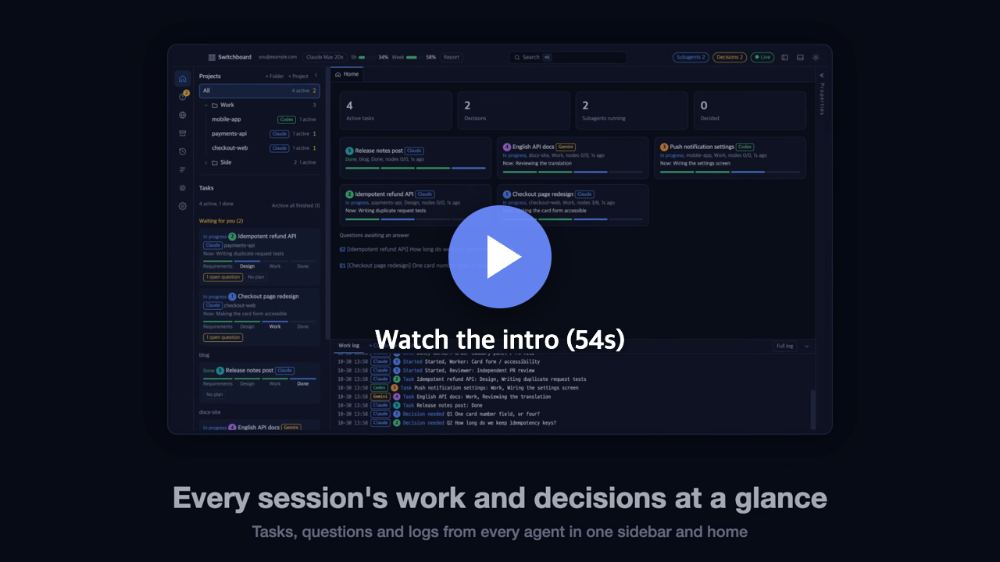
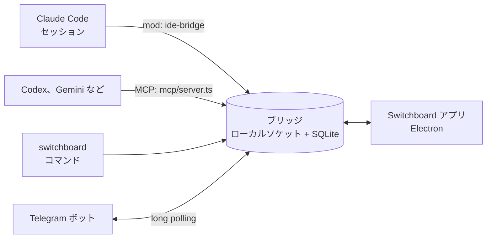

<div align="center">


# Switchboard

**複数のコーディングエージェントをひとつの画面で指揮するデスクトップアプリ**

Claude Code、Codex、Gemini CLI のセッションが判断を尋ね、互いに仕事を任せ、席を外している間は Telegram で連絡します。

<a href="https://github.com/choco5958/switchboard/releases/latest"></a>
<a href="https://github.com/choco5958/switchboard/actions/workflows/test.yml"></a>

<a href="LICENSE"></a>

<p><b>ダウンロード</b> &nbsp; <a href="https://github.com/choco5958/switchboard/releases/latest">macOS</a> &nbsp;|&nbsp; <a href="https://github.com/choco5958/switchboard/releases/latest">Windows</a> &nbsp;|&nbsp; <a href="https://github.com/choco5958/switchboard/releases/latest">Linux</a></p>

[한국어](README.md) | [English](README.en.md) | **日本語** | [简体中文](README.zh-CN.md)

</div>

<br>

<p align="center"><a href="https://github.com/choco5958/switchboard/blob/main/docs/intro-en.mp4"></a></p>


セッションは人の判断が必要になると質問を判断待ちキューに載せ、答えを待たずにほかの作業を続けます。キーひとつで答えると、その答えがプロンプトとしてセッションに入ります。セッション同士で仕事をやり取りでき、席を外している間は判断の質問と権限の確認が自分の Telegram に届きます。

## ひと目でわかる

<table>
<tr>
<td width="50%" valign="top">
<h3>🗳️ 判断待ちキュー</h3>
<p>セッションは質問を載せたままほかの作業を続けます。キーひとつで答えると、そのセッションにプロンプトとして入ります。</p>
</td>
<td width="50%" valign="top">
<h3>🤝 セッション同士の連携</h3>
<p>ほかのセッションに尋ねて答えを受け取ります。複数のセッションの答えをまとめて入れ、任せた仕事は途中で取り消せます。</p>
</td>
</tr>
<tr>
<td width="50%" valign="top">
<h3>📱 席を外している間</h3>
<p>判断の質問と Claude Code の権限確認に、Telegram やスマートフォンのブラウザーから答えます。予約プロンプトは決めた時刻に実行されます。</p>
</td>
<td width="50%" valign="top">
<h3>🔍 画面を見ながら直す</h3>
<p>内蔵ブラウザーで要素をクリックしてコメントを残すと、位置、スクリーンショット、コンソールのエラーが一緒に届きます。セッションはローカルのページを自分で操作して確かめます。</p>
</td>
</tr>
<tr>
<td width="50%" valign="top">
<h3>🧩 さまざまなコーディング CLI</h3>
<p>Codex、Gemini CLI、Qwen Code、Copilot CLI、OpenCode、Goose、Amp も同じ判断待ちと作業報告につながります。</p>
</td>
<td width="50%" valign="top">
<h3>🎨 選べる画面</h3>
<p>テーマ 13 種類と 4 つの言語に対応します。Claude の使用量とコンテキスト使用率を上部に表示します。</p>
</td>
</tr>
</table>

## クイックスタート

1. [Releases](https://github.com/choco5958/switchboard/releases/latest) から OS に合ったインストーラーを入手して開きます。詳しくは[インストール](#インストール)にあります。
2. 下のドックの `+ Claude` でセッションを開くか、横の ▾ から Codex や Gemini などほかのエージェントを選んで開き、いつもどおり仕事を任せます。
3. 判断の質問が来たらキーで答えます。あとはセッションが続けます。

## 主な機能

### 判断とタスク

- **判断待ちキュー**: セッションが `ask_decision` で選択肢、おすすめ、その理由を載せます。`a`、`b` などのキーで選び、`Enter` で送ります。保留にしたり、メモを付けて答えたりもできます。同じ質問が二重に載ることはありません。
- **タスクと進行グラフ**: タスクの段階 (要件、設計、作業、完了) とノード (確認、実装、テスト、レビュー) が画面に描かれ、ノードごとに担当のサブエージェントが実行中か終わったかが分かります。
- **あなた待ち**: 判断待ちがある、ターンが 5 分以上止まっている、使用量の上限に達した、セッションが切れた、といったタスクがサイドバーの一番上に集まります。止まったセッションと上限が解除されたセッションは macOS の通知でも知らせます。
- **プロジェクト別の表示**: 左の一覧でプロジェクトを選ぶと、サイドバー、ホーム、ログ、ドックがそのプロジェクトのセッション、タスク、判断、権限の確認だけを表示します。上部の使用量メーターはアカウント全体の値で、上部の件数はそのプロジェクトの数と全体の数を並べて表示します。

### セッション同士の連携

- **質問と回答**: セッションが `list_sessions` でほかのセッションを探し、`send_to_session` で依頼を送ります。受け取ったセッションが返事をせずにターンを終えると、最後の回答が結果として戻ります。
- **複数のセッションに聞く**: 複数のセッションに送った質問は、返事を集めてひとつのターンに入れます。その間に人がアプリやターミナルで話しかけると、それまでに届いた返事を一緒に入れます。15 分たつと、先に届いた返事から渡します。
- **返事が来ないとき**: 受け取ったセッションの接続が切れたりターンが中断されたりすると、送ったセッションに返事が来ないことを知らせます。送ったセッションは待たずに作業を続けます。
- **任せた仕事の取り消しと委任の上限**: セッションは `cancel_request` で自分が任せた依頼を取り消します。まだ届いていなければ入らず、受け取ったセッションのターンがその依頼だけを処理していればターンを止めます。ひとつの依頼から始まってセッション同士で任せる依頼は、合わせて 8 回までです。
- **判断の転送**: 判断の質問をほかのセッションに渡し、代わりに答えてもらえます。
- **使用量の上限**: 上限に達したセッションへの答えとメッセージは、リセットされるまで預かってから届けます。

### 席を外している間

- **Telegram で答える**: アプリが閉じている、画面がロックされている、5 分以上入力がない、のいずれかのとき、判断の質問を自分の Telegram ボットに送ります。ボタンか返信で答えます。
- **権限の確認の中継**: 同じ状況では Claude Code の権限の確認もアプリと Telegram に届きます。Telegram で許可するには、もう一度確認のボタンを押します。席にいるときは、これまでどおりターミナルが確認します。
- **スマートフォンのブラウザー**: 同じ Wi-Fi(または Tailscale)のスマートフォンから、判断の質問に答え、権限の確認を許可または拒否し、タスクを見て、セッションにメッセージを送ります。インストールするものはなく、ホーム画面に追加するとアプリのように開けます。Tailscale HTTPS で開くと、新しい質問の通知も受け取れます。
- **予約プロンプト**: 毎日、平日、間隔、1 回から選び、プロジェクトのセッションにプロンプトを送ります。受け取るエージェントは予約ごとに選び、そのエージェントのセッションがなければアプリがそのエージェントのターミナルを開きます。知らせることのない実行は通知しません。

### 画面を見ながら直す (ライブデバッグ)

- 開発サーバーを登録して起動し、内蔵ブラウザーで開きます。
- 画面の要素をクリックしてコメントを残すと、位置、CSS、スクリーンショット、その時点のページのコンソールエラーと失敗したリクエストが一緒にセッションへ届きます。
- セッションは `browser_*` ツールでローカルのページを読み、クリックし、入力して、直した結果を自分で確かめます。扱えるのはこのコンピューターのアドレスだけです。設定 > エージェント CLI で `内蔵ブラウザーでプライベートネットワークのアドレスも許可する` をオンにすると、プライベートネットワークのアドレス (192.168.x.x、名前.local など) も扱えます。
- アプリのターミナルで CLI が開くローカルアドレスは内蔵ブラウザーで開きます。

### ターミナルとシェル

- **内蔵ターミナル**: ドックの `+` ボタンは最後に開いたエージェントを開きます。横の ▾ を押すと、インストール済みのエージェントが接続方法 (mod、接続サーバー、ターミナルのみ) とともに並び、名前で探して選べます。`+ シェル` は通常のシェルを開きます。
- **止まらないように**: エージェントが作業している間は Mac がスリープしません。Codex、Copilot、Cursor を初めて開くフォルダーは、その CLI のフォルダー信頼の確認に先にはいと記録しておくので、アプリが入力する回答や予約プロンプトが信頼の確認で止まりません (設定でオフにできます)。
- **アプリを閉じても続くターミナル**: macOS と Linux では、ターミナルはアプリの外にあるターミナルホストで動きます。アプリを閉じても、再起動しても、アップデートしても、ターミナルとその中の Claude Code やほかの CLI は動き続け、次にアプリを開くと画面ごとドックに戻ります。ほかの CLI への回答の入力も続きます。タブの `×` はこれまでどおりそのターミナルを終了します。アプリを閉じるときにすべてのターミナルも閉じるには、設定 > エージェント CLI で `アプリを閉じるときにターミナルも閉じる` をオンにします。Windows では、ホストが動いている間はインストーラーがアプリを置き換えられないため、ターミナルはアプリと一緒に閉じます。
- **ほかのコーディング CLI**: Codex、Gemini CLI、Qwen Code、GitHub Copilot CLI、OpenCode、Goose、Amp も判断待ちとタスク報告につながります。アプリが MCP サーバーを起動オプションで付けるので、各 CLI の設定ファイルには手を加えません。Cursor CLI、Grok、Kimi、Crush はターミナルとしてだけ開き、それ以外の CLI は設定でコマンドを登録します。ドックにはインストール済みの CLI だけが並びます。
- **`switchboard` コマンド**: シェルやスクリプトからセッションに仕事を任せ、結果を受け取ります。結果は終了コードでも区別できます。
- **セッション側のパネル**: Claude Code で `/switchboard` と入力すると、このセッションの作業の流れと判断待ちを横のパネルで見られます。

### 表示

- 上部に Claude の 5 時間と週間の使用量、コンテキストの使用率が表示されます。
- サイドバーのプロジェクトは `+ フォルダー` で作ったフォルダーにまとめ、フォルダーごとに開閉します。プロジェクトをフォルダーにドラッグするか ⋯ メニューで移し、使わないプロジェクトは一覧から外します。ファイルと作業の記録はそのまま残り、いつでも再表示できます。
- 한국어、English、日本語、简体中文に対応しています。最初は OS の言語に従い、設定で切り替えます。
- テーマ 13 種: ベーシック紺、冒険日誌、蛍光ターミナル、ドット絵、地下鉄路線図、回路基板、モダンターミナル、青い DOS 画面、Dracula、Nord、Solarized ダークとライト、GitHub ライト。
- Orca がインストールされていれば、ノードごとにワークツリーを作り、Linear の課題からタスクを始められます。


## エージェントごとの対応

Claude Code は mod で、ほかの CLI はアプリがその実行だけに付ける接続サーバー (MCP) でつながります。どちらも同じツールを使うので、ほとんどの機能はエージェントに関係なく使えます。

| 機能 | Claude Code | 接続サーバーを使う CLI | ターミナルとして開くだけの CLI |
| --- | --- | --- | --- |
| タスクと計画の報告、判断の質問、セッション同士の問い合わせ、待機、ブラウザーツール | 使える | 使える | 使えない |
| 回答とメッセージの受け取り | mod がセッションに入れる | アプリのターミナルに入力。アプリの外で開いたセッションは `check_answers` で取得 | 使えない |
| 予約プロンプト | 使える | 使える (セッションがなければアプリがその CLI を開く) | 使えない |
| 席を外している間の権限確認の中継 | 使える | まだ使えない | 使えない |
| 使用量メーター、セッション側パネル (`/switchboard`)、圧縮後の状態の再投入 | 使える | 使えない | 使えない |

- 接続サーバーを使う CLI: Codex、Gemini CLI、Qwen Code、GitHub Copilot CLI、OpenCode、Goose、Amp、設定で接続方法を書いて追加した CLI
- ターミナルとして開くだけの CLI: Cursor CLI、Grok、Kimi、Crush

## スクリーンショット

<table>
<tr>
<td width="50%"><p align="center"><sub>判断待ち: 青い DOS 画面テーマ</sub></p></td>
<td width="50%"><p align="center"><sub>タスク画面: 段階と進行グラフ</sub></p></td>
</tr>
</table>

## 構成



| フォルダー | 役割 |
| --- | --- |
| `bridge/` | ローカルの中継サーバー。`~/.claude-ide/bridge.sock` ソケットと `~/.claude-ide/ide.db` SQLite を使います。ネットワークのポートは開きません。予約の実行と Telegram との接続もここで動きます。 |
| `mod/` | Claude Code の mod `ide-bridge`。ツールを登録し、アプリからの答えをセッションに入れ、`/switchboard` パネルを描きます。 |
| `mcp/` | ほかのコーディング CLI 向けの MCP サーバー (stdio)。mod と同じツールに `check_answers` を加えて提供します。 |
| `scripts/` | セットアップスクリプトと `switchboard` コマンド。 |
| `src/` | Electron アプリ (React)。 |

## 必要なもの

- macOS、Windows、Linux。macOS (Apple Silicon) で確認済みです。Windows と Linux は自動テストを通過しましたが、実機ではまだ確認していません。
- Claude Code 2.1.309 以上 (mod 機能を使います)
- 任意: Codex、Gemini CLI などのほかのコーディング CLI、Orca (ワークツリー、Linear)、Telegram アカウント
- ソースから動かすときだけ: Node.js 24 以上、pnpm

## インストール

### インストーラー

[Releases](https://github.com/choco5958/switchboard/releases/latest) から自分の OS に合うファイルを取得します。アプリに Node が入っているので、ほかにインストールするものはありません。

#### macOS

1. チップに合うファイルを取得します。Apple Silicon (M1 以降) は `Switchboard-<バージョン>-mac-arm64.dmg`、Intel は `-mac-x64.dmg` です。どちらかはアップルメニュー > この Mac についてのチップ欄でわかります。
2. dmg を開き、Switchboard をアプリケーションフォルダーにドラッグします。ほかの場所で開くと、アプリが移動するかを先に尋ねます。
3. アプリケーションフォルダーから Switchboard を開きます。まだ Apple の署名がないため、最初はマルウェアを確認できないという画面が出ます。完了を押します。
4. システム設定 > プライバシーとセキュリティを開き、下のほうの Switchboard の項目で「このまま開く」を押します。パスワードを入力し、次の画面で開くを押します。macOS 14 以前では、アプリを右クリック > 開くでも開けます。

ターミナルを使うなら、4 の代わりに `xattr -dr com.apple.quarantine /Applications/Switchboard.app` を実行してからアプリを開いてもかまいません。アップデート後の初回起動でキーチェーンの使用を尋ねられたら、常に許可を押します。

#### Windows

1. `Switchboard-<バージョン>-win.exe` を取得します。x64 と ARM の両方に対応します。サイズを抑えるなら x64 は `-win-x64.exe`、ARM は `-win-arm64.exe` を取得します。
2. 取得したファイルを実行します。「Windows によって PC が保護されました」の画面が出たら、詳細情報 > 実行を押します。
3. インストーラーでインストール先を選び、インストールを押します。スタートメニューから Switchboard を開きます。

#### Linux

- AppImage: x64 は `Switchboard-<バージョン>-linux-x86_64.AppImage`、ARM は `-linux-arm64.AppImage` を取得します。`chmod +x Switchboard-*.AppImage` で実行権限を付けて実行します。Ubuntu 22.04 以降で FUSE のエラーが出たら `sudo apt install libfuse2` (24.04 は `libfuse2t64`) をインストールします。
- deb: `-linux-amd64.deb` または `-linux-arm64.deb` を取得し、`sudo apt install ./Switchboard-*.deb` でインストールします。自動アップデートは AppImage だけです。

アプリは起動するたびに、ブリッジの起動ファイルと `switchboard` コマンドを `~/.claude-ide` にアプリの場所に合わせて書き直します。`switchboard` コマンドは macOS と Linux では `~/.local/bin`、Windows では `%USERPROFILE%\.claude-ide\bin` にできるので、そのフォルダーを PATH に加えます。

新しいバージョンはアプリが自分で確認します。Windows、macOS、Linux (AppImage) は新しいバージョンをダウンロードしておき、アプリを閉じるときにインストールします。macOS と Linux では、アップデートの間もアプリのターミナルは動き続けます。準備ができたという通知を押すとすぐ再起動してインストールしますが、それで閉じるアプリのターミナルがあれば (Windows の場合や上の設定をオンにした場合)、いくつ閉じるかを先に尋ねます。アップデートのためにアプリが勝手に閉じることはありません。アップデートには署名があり、署名がないものや一致しないものはアプリがインストールしません。

macOS の自動インストールは 0.3.4 の次のバージョンからなので、0.3.4 以前からそのバージョンへは一度だけ手でダウンロードしてインストールします。アプリを置き換える権限がない場所 (管理者ではないアカウントのアプリケーションフォルダーなど) にあるときは、macOS でも通知を押すとダウンロードページが開きます。アップデート後にキーチェーンの使用を尋ねられたら、上に書いたとおり常に許可を押します。

### ソースから動かす

```sh
git clone https://github.com/choco5958/switchboard.git
cd switchboard
pnpm install
pnpm run setup  # ~/.claude-ide/start-bridge.json と ~/.local/bin/switchboard を作ります
pnpm dev        # アプリを起動
```

リポジトリのフォルダーを移動したら `pnpm run setup` をもう一度実行します。インストーラーは `pnpm dist` で作ります。

### ほかのターミナルの Claude Code をつなぐ

アプリの `+ Claude` ターミナルは mod を自動で読み込みます。ほかのターミナルで開いた Claude Code のセッションもつなぐには、Claude Code の入力欄で mod をインストールします。

```
/plugin install ide-bridge --marketplace choco5958/switchboard
```

`Add marketplace?` には `y` を押し、範囲は一番上の user を選びます。シェルからは `claude plugin install ide-bridge --marketplace choco5958/switchboard` でインストールします。

インストール後に開いたセッションからブリッジにつながります。ブリッジが止まっていれば mod かアプリが先に起動します。mod はアプリか `pnpm run setup` が作った `~/.claude-ide/start-bridge.json` でブリッジを起動するので、先にアプリを一度起動するか setup を実行しておいてください。

## 使い方

1. アプリを起動し、下のドックで `+ Claude` を押すか、横の ▾ からほかのエージェントを選びます。初めてなら左上の `+ プロジェクト` で作業するプロジェクトのフォルダーを選びます。
2. いつもどおりエージェントに仕事を任せます。ツールの説明にいつ使うかが書いてあるので、セッションが自分でタスクを載せ、判断が必要になれば質問を載せます。
3. 左の疑問符アイコンに数字が出たら、判断の質問か権限の確認が届いています。権限の確認はホーム画面にも出ます。質問を開いてキーで答えます。

### キー

| キー | 動作 |
| --- | --- |
| `a`、`b`、`1`、`2` | 選択肢を選ぶ |
| `Enter` | 送る |
| `H` を 2 回 | 保留(1 回押すと案内だけが出ます) |
| `M` | メモを入力 (`Cmd+Enter` で送る、`Esc` で抜ける) |
| `Cmd+K`(Windows、Linux は `Ctrl+K`) | 検索 (タスクを開く、進捗報告を受け取る、などの操作) |

### Telegram の接続

1. Telegram で `@BotFather` に `/newbot` を送り、ボットの名前と ID を決めます。
2. Switchboard の 設定 > Telegram で答える に、BotFather がくれたトークン (`123456:ABC...` の形) を貼り付けて「ボットを接続」を押します。
3. 「接続コードを受け取る」を押し、10 分以内にスマートフォンでリンクを開いて開始を押します。接続されるのはそのチャットだけで、ほかの人からの答えは受け付けません。

ブリッジが Telegram のサーバーに新しいメッセージを自分で問い合わせる方式なので、開けておくポートはありません。

### スマートフォン接続

1. 設定 > スマートフォン接続で「スマートフォン接続をオンにする」をオンにします。macOS が受信接続を許可するか尋ねたら「許可」を選びます。
2. スマートフォンが開くアドレスを選び、スマートフォンの名前を入力して「QR コードを表示」を押します。macOS では「このコンピューターの名前」(`名前.local`)が既定です。ルーターが PC のアドレスを変えてもそのままなので、接続し直す必要がありません。
3. スマートフォンのカメラで QR コードを読み取って開きます。そのままブラウザーで使えます。

スマートフォンのアプリはアプリストアから入手しません。開いた画面をホーム画面に追加するとアイコンができ、アドレスバーなしでアプリのように開きます。

- **iPhone**: Safari で開いた画面の共有ボタン > ホーム画面に追加 > 追加を押します。ホーム画面のアプリは Safari と保存領域が別なので、最初に開くと接続コードを尋ねます。PC アプリで新しい QR コードを表示し、今度は読み取らずに、横に出る 8 文字のコードをホーム画面のアプリに入力します。コードは 10 分以内に 1 回だけ使え、スマートフォンがその QR コードで接続するとすぐ使えなくなります。接続コードは Tailscale HTTPS のアドレスでしか受け取れないため、同じ Wi-Fi (HTTP) だけで使うならホーム画面に追加せず Safari で開きます。
- **Android**: Chrome のメニュー(⋮) > ホーム画面に追加(またはアプリをインストール)を押します。Chrome と保存領域を共有するので、接続し直す必要はありません。

スマートフォンごとに接続し、設定の「接続を解除」でいつでも切れます。10 分以内に使われなかった QR コードは使えなくなります。

同じ Wi-Fi(HTTP のアドレス)で開いた画面では、判断への回答、拒否、ターミナルで確認だけができます。権限の許可とセッションへのメッセージは、Tailscale HTTPS のアドレス(または Tailscale のアドレス)の QR コードで接続したスマートフォンが、そのアドレスで開いた画面で行います。同じネットワークを握った人が、HTTP でやり取りする画面をすり替えてリンクの鍵を読めるためです。そのため HTTP のアドレスの QR コードで接続したスマートフォンは、後で Tailscale や Funnel から開いてもどちらもできず、設定の一覧に「Wi-Fi(HTTP)で接続」と表示されます。以前のバージョンで接続したスマートフォンも同じ扱いなので、Tailscale HTTPS のアドレスの QR コードで接続し直します。

**通知と外出先での利用**: PC とスマートフォンに [Tailscale](https://tailscale.com) をインストールしてログインすると、設定に「Tailscale HTTPS をオンにする」が出ます。このボタンで、Tailscale がこのコンピューターの名前で HTTPS アドレスを作り、自分の tailnet だけに開きます。このアドレスで QR コードを表示して接続すれば外出先でも使え、画面下の「このスマートフォンで通知を受け取る」で、席を外している間に新しい判断の質問と権限の確認の通知を受け取れます。iPhone では、ホーム画面に追加してからホーム画面で開くと通知をオンにできます。HTTP のアドレスで開いた画面は、開いている間だけ新しい項目を振動とタイトルの数字で知らせます。

**同じ Wi-Fi でないとき (Tailscale Funnel)**: スマートフォンに Tailscale を入れずにモバイル回線やほかの Wi-Fi から使うには、「Tailscale HTTPS をオンにする」の下の「ほかの Wi-Fi やモバイル回線からも接続を受ける」をオンにします。同じ HTTPS アドレスがインターネットに開かれ、スマートフォンはどのネットワークからでもこのアドレスで開けます。最初の一度だけ、Tailscale の管理ページでこのコンピューターの Funnel を許可する必要があり、設定にそのリンクが出ます。アドレスを知っている人はページを開けますが、やり取りはスマートフォンごとの鍵で暗号化されるため、内容を見て答えられるのは接続したスマートフォンだけです。アドレスが変わらないので、ホーム画面のアプリと通知もそのまま使えます。

「同じ Wi-Fi からの接続を受け付ける」をオフにすると、このコンピューター内だけで待ち受け、Tailscale HTTPS からだけ接続します。このとき macOS のファイアウォールの確認も出ません。

### 予約プロンプト

設定 > 予約プロンプト で名前、プロジェクト、プロンプト、スケジュールを決めます。間隔は 5 分以上です。前回の実行が終わっていなければ今回の実行は飛ばします。アプリやブリッジが止まっていた間に逃した実行を、起動時に 1 回だけ実行するかどうかを選べます。セッションに入った実行が 5 回続けて失敗すると、その予約をオフにして通知します。セッションが見つからなかった実行や飛ばした実行は数えません。予約を直すか再びオンにすると、最初から数え直します。

### シェルコマンド

| コマンド | 内容 |
| --- | --- |
| `switchboard sessions` | セッション一覧 (● 接続中) |
| `switchboard send <セッションかプロジェクト> <仕事 または -> [--wait] [--timeout 30m] [--info] [--json]` | セッションに仕事を任せ、`m7` のような番号を出力します。`--wait` を付けると結果まで待って出力し、`--info` は返事を求めないお知らせとして送ります。`-` は標準入力を読みます。 |
| `switchboard status m7` | 任せた仕事の状態と結果 |
| `switchboard decisions`、`switchboard answer Q12 a [メモ]` | 判断待ちを見て答えます。 |
| `switchboard waits`、`switchboard fire w3 [内容]` | セッションが開いた待機を見て、起こします。 |

終了コード: 0 完了、1 失敗、2 コマンドラインの誤り、3 セッションが判断を待っている、4 時間切れ (セッションは作業を続けます)、5 ブリッジが止まっているかセッションがない。

```sh
# テストが終わったら、その結果を待っていたセッションを起こします
pnpm test; switchboard fire w3 "テスト終了: 終了コード $?"
```

## セッションが使うツール

| ツール | 内容 |
| --- | --- |
| `ask_decision` | 判断待ちキューに質問を載せます。待たずにすぐ戻ります。 |
| `set_task` | タスクを作るか、段階、いまの作業、テスト結果を更新します。 |
| `plan_nodes`、`update_node` | タスクをノードに分けて進行グラフに載せ、状態 (待機、実行中、完了、失敗) を変えます。 |
| `node_worktree` | ノードに Orca のワークツリーを作ります。Orca が必要です。 |
| `open_in_ide` | ライブデバッグのタブでページや開発サーバーを開きます。 |
| `list_sessions`、`send_to_session` | ほかのセッションを見て、依頼や情報を送ります。返事は次のターンに届きます。 |
| `cancel_request` | 自分が任せた依頼を取り消します。受け取ったセッションがその依頼だけを処理していればターンを止めます。 |
| `await_event`、`close_wait` | ビルドやデプロイのような外の作業を待つ待機を開閉します。 |
| `routine_no_update`、`routine_report_failure` | 予約の実行で知らせることがなかった、または失敗したことを記録します。 |
| `browser_snapshot`、`browser_click`、`browser_type`、`browser_navigate`、`browser_console`、`browser_screenshot` | 内蔵ブラウザーのローカルページを読み、操作します。古い ref でクリックしようとすると拒否します。 |
| `check_answers` | ほかのコーディング CLI 向け。アプリの外で動くセッションが、まだ受け取っていない答えを取りに行きます。 |

## データとセキュリティ

- すべてのデータはこのコンピューターの `~/.claude-ide/` の下にだけ保存されます。フォルダーは本人だけが読めて (0700)、ソケットと DB も本人専用です (0600)。
- Telegram を接続すると、判断の質問と権限の確認の内容が Telegram のサーバーを通ります。トークンらしい値は送る前に伏せます。ボットのトークンは画面の状態に載せず、DB にだけ置きます。
- 画面のコメントに付くコンソールとリクエストの記録も、収集する時点でトークンらしい値を伏せます。
- セッションのブラウザーツールが開くのは、このコンピューターのアドレスだけです。プライベートネットワークのアドレスは、設定で許可したときだけ開きます。ルーターや NAS の管理画面がそこにあり、内蔵ブラウザーはログインを覚えているためです。自分でアドレスを入力して開くページは制限しません。
- ブラウザーツールと画面コメントのスクリプトは、ページとは分かれた領域で実行します。ページのスクリプトがクリック位置や読み取る内容を偽ったり、代わりにコメントを保存したりはできません。
- ほかの CLI のターミナルにメッセージを入力する前に画面を確認します。CLI が「このコマンドを実行しますか？」のような確認メニューを出しているあいだは、入力がその選択肢を選ばないよう待ちます。
- 権限の確認への回答、不在の表示、Telegram の設定、予約プロンプト、設定の変更、セッションの操作はアプリだけができます。アプリは OS のキーチェーンで暗号化しておいた鍵を標準入力でブリッジに渡し、これらの経路はその鍵があるときだけ答えます。そのため、シェル権限を持つセッションがブリッジに直接リクエストしても、自分の権限の確認を許可することはできません。mod が先に起動したブリッジは鍵を持たないため、アプリが起動するときに一度起動し直します。
- 判断待ちへの回答、セッションへのメッセージ、待機の解除は `switchboard` コマンドが使う経路なので、同じユーザーのプログラムなら実行できます。エージェントにシェル権限を与えるときは、Claude Code のサンドボックスで `~/.claude-ide` へのアクセスを塞いでおくことをおすすめします。
- セッションが `open_in_ide` で指定した開発サーバーのコマンドは、初めて実行するとき (と変わるたび) に、アプリがコマンドとフォルダーを表示して確認を取ります。
- 遠隔での承認はコマンドを先頭に表示し、サンドボックスの解除、バックグラウンド実行、すべて置換 (replace_all) などの設定も合わせて表示します。全部を表示できない依頼 (切れている、隠れた文字がある、複数か所の編集) とサンドボックスの外で動かすコマンドはターミナルでだけ確認し、値を伏せた依頼は Telegram からは許可できません。
- Windows ではブリッジは 127.0.0.1 にだけポートを開き、起動のたびに作るトークンを持つリクエストにだけ答えます。Web ページからのリクエストは拒否します。
- スマートフォン接続は、オンにするまで開きません。オンにすると、このコンピューター、プライベートネットワーク、Tailscale のアドレスからの接続だけを受け付けます。スマートフォンごとに QR コードで受け取った鍵で、要求と応答をすべて暗号化し(ChaCha20-Poly1305)、要求ごとに時刻と一度だけ使う値を入れて、同じ要求を送り直せないようにします。同じ Wi-Fi のほかの人は、内容を見ることも代わりに答えることもできません。スマートフォンができるのは、判断と権限確認への回答、セッションへのメッセージ、画面の読み取りだけで、権限の許可とセッションへのメッセージは Tailscale から来た要求だけを受け付けます。失敗した要求が多いアドレスはしばらく止め、このサーバーのアドレスや名前ではない Host で来た要求は拒否します。
- スマートフォンの通知は、スマートフォンのブラウザーのプッシュサーバー(Apple、Google など)を経由します。内容はそのブラウザーの鍵で暗号化するため(RFC 8291)プッシュサーバーは読めず、通知にはプロジェクト名と質問の 1 行目、権限の確認ならツール名と伏せたコマンドの 1 行目だけを載せます。
- 作業ログは 7 日たつと消します。アカウントのメールアドレスは伏せて表示し、どこにも送りません。

## 開発

```sh
pnpm test        # ブリッジ、mod、スクリプト (node:test) と画面ロジック (vitest)
pnpm typecheck
pnpm build && pnpm start
claude plugin test mod
```

テストは実際のアカウントの環境変数を消し、一時的なホームフォルダーで動きます (`scripts/test-env.ts`)。

画面の確認は、実際のデータと切り離したブリッジで行います。macOS はソケットのパスを約 104 バイトに制限するので、短くしておきます。

```sh
CLAUDE_IDE_SOCKET=/tmp/sb/b.sock CLAUDE_IDE_DB=/tmp/sb/ide.db node bridge/server.ts &
CLAUDE_IDE_SOCKET=/tmp/sb/b.sock CLAUDE_IDE_CAPTURE=/tmp/sb/shot.png pnpm exec electron .
```

`CLAUDE_IDE_CAPTURE` を指定すると、ウィンドウを出さずに画面を PNG に保存して終了します。テーマの追加方法は [DESIGN_SYSTEM.md](DESIGN_SYSTEM.md) にあります。アプリのアイコンは `node scripts/icon.mjs` で描き直します。

## ライセンス

[MIT](LICENSE)
