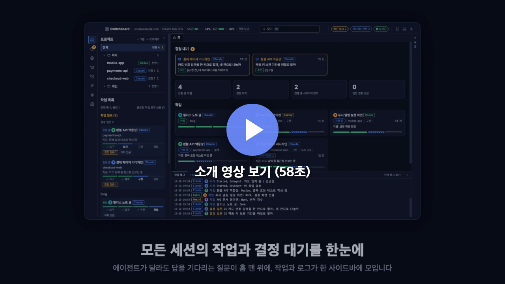
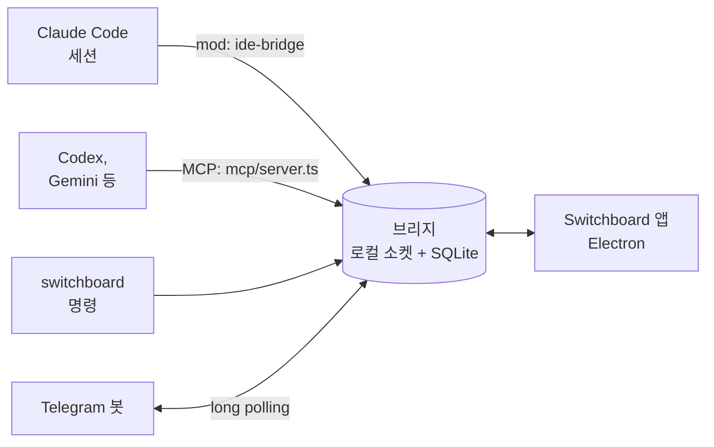

<div align="center">


# Switchboard

**코딩 에이전트 여러 개를 한 화면에서 지휘하는 데스크톱 앱**

Claude Code, Codex, Gemini CLI 세션이 결정을 묻고, 서로 일을 맡기고, 자리를 비운 사이에는 Telegram으로 연락합니다.

<a href="https://github.com/choco5958/switchboard/releases/latest"></a>
<a href="https://github.com/choco5958/switchboard/actions/workflows/test.yml"></a>

<a href="LICENSE"></a>

<p><b>내려받기</b> &nbsp; <a href="https://github.com/choco5958/switchboard/releases/latest">macOS</a> &nbsp;|&nbsp; <a href="https://github.com/choco5958/switchboard/releases/latest">Windows</a> &nbsp;|&nbsp; <a href="https://github.com/choco5958/switchboard/releases/latest">Linux</a></p>

**한국어** | [English](README.en.md) | [日本語](README.ja.md) | [简体中文](README.zh-CN.md)

</div>

<br>

<p align="center"><a href="https://github.com/choco5958/switchboard/blob/main/docs/intro-ko.mp4"></a></p>


세션은 사람의 결정이 필요하면 질문을 결정 대기 큐에 올리고, 답을 기다리지 않고 다른 일을 이어 갑니다. 키 하나로 답하면 그 답이 해당 세션에 프롬프트로 들어갑니다. 세션끼리 일을 주고받고, 자리를 비운 동안에는 결정 질문과 권한 확인이 내 Telegram으로 옵니다.

## 한눈에 보기

<table>
<tr>
<td width="50%" valign="top">
<h3>🗳️ 결정 대기 큐</h3>
<p>세션은 질문을 올려 두고 다른 일을 이어 갑니다. 키 하나로 답하면 그 세션에 프롬프트로 들어갑니다.</p>
</td>
<td width="50%" valign="top">
<h3>🤝 세션끼리 일하기</h3>
<p>다른 세션에 묻고 답을 받습니다. 여러 세션의 답을 모아 한 번에 넣고, 맡긴 일은 도중에 취소합니다.</p>
</td>
</tr>
<tr>
<td width="50%" valign="top">
<h3>📱 자리를 비운 동안</h3>
<p>결정 질문과 Claude Code의 권한 확인에 Telegram이나 휴대폰 브라우저로 답합니다. 예약 프롬프트는 정한 시간에 실행됩니다.</p>
</td>
<td width="50%" valign="top">
<h3>🔍 화면 보며 고치기</h3>
<p>내장 브라우저에서 요소를 눌러 코멘트를 남기면 위치, 스크린샷, 콘솔 오류가 함께 갑니다. 세션은 로컬 페이지를 직접 눌러 확인합니다.</p>
</td>
</tr>
<tr>
<td width="50%" valign="top">
<h3>🧩 여러 코딩 CLI</h3>
<p>Codex, Gemini CLI, Qwen Code, Copilot CLI, OpenCode, Goose, Amp가 같은 결정 대기와 작업 보고에 연결됩니다.</p>
</td>
<td width="50%" valign="top">
<h3>🎨 고르는 화면</h3>
<p>테마 13개와 언어 4개를 지원합니다. Claude 사용량과 컨텍스트 사용률이 상단에 보입니다.</p>
</td>
</tr>
</table>

## 빠른 시작

1. [Releases](https://github.com/choco5958/switchboard/releases/latest)에서 운영체제에 맞는 설치 파일을 받아 엽니다. 자세한 내용은 [설치](#설치)에 있습니다.
2. 아래 도크의 `+ Claude`로 세션을 열거나, 옆의 ▾에서 Codex, Gemini 같은 다른 에이전트를 골라 열고 평소처럼 일을 맡깁니다.
3. 결정 질문이 오면 키로 답합니다. 나머지는 세션이 이어 갑니다.

## 주요 기능

### 결정과 작업

- **결정 대기 큐**: 세션이 `ask_decision`으로 선택지, 추천, 추천 이유를 올립니다. `a`, `b` 같은 키로 고르고 `Enter`로 보냅니다. 보류하거나 메모를 붙여 답할 수도 있습니다. 같은 질문은 두 번 올라가지 않습니다.
- **작업과 진행 그래프**: 작업 단계(요구, 설계, 작업, 완료)와 노드(확인, 구현, 시험, 검토)가 화면에 그려지고, 노드마다 맡은 서브에이전트가 실행 중인지 끝났는지 보입니다.
- **나를 기다림**: 결정 대기가 있거나, 턴이 5분 넘게 멈췄거나, 사용량 한도에 걸렸거나, 세션이 끊긴 작업이 사이드바 맨 위에 모입니다. 멈춘 세션과 한도가 풀린 세션은 macOS 알림으로도 알립니다.
- **프로젝트별 보기**: 왼쪽 목록에서 프로젝트를 고르면 사이드바, 홈, 로그, 도크가 그 프로젝트의 세션, 작업, 결정, 권한 확인만 보여 줍니다. 상단의 사용량 막대는 계정 전체 기준이고, 상단의 개수는 그 프로젝트의 수 옆에 전체 수를 함께 적습니다.

### 세션끼리 일하기

- **묻고 답하기**: 세션이 `list_sessions`로 다른 세션을 찾고 `send_to_session`으로 요청을 보냅니다. 받은 세션이 따로 답하지 않고 턴을 끝내면 마지막 답변이 결과로 돌아갑니다.
- **여러 세션에 묻기**: 여러 세션에 보낸 질문은 답을 모아 한 턴에 넣습니다. 그사이 사람이 앱이나 터미널에서 말을 걸면 그때까지 온 답을 함께 넣고, 15분이 지나면 먼저 온 답부터 넘깁니다.
- **답이 오지 않을 때**: 받은 세션의 연결이 끊기거나 턴이 중단되면, 보낸 세션에 답이 오지 않는다는 알림이 갑니다. 보낸 세션은 기다리지 않고 일을 이어 갑니다.
- **맡긴 일 취소와 위임 한도**: 세션은 `cancel_request`로 자기가 맡긴 요청을 거둬들입니다. 전달 전이면 들어가지 않고, 받은 세션의 턴이 그 요청만 처리하고 있으면 턴을 멈춥니다. 한 요청에서 시작해 세션끼리 맡기는 요청은 모두 합쳐 8번까지입니다.
- **결정 넘기기**: 결정 질문을 다른 세션에게 넘겨 대신 답하게 할 수 있습니다.
- **사용량 한도**: 한도에 걸린 세션에 보낼 답과 메시지는 리셋될 때까지 모아 두었다가 전달합니다.

### 자리를 비운 동안

- **Telegram으로 답하기**: 앱이 꺼졌거나, 화면이 잠겼거나, 5분 넘게 입력이 없으면 결정 질문을 내 Telegram 봇으로 보냅니다. 버튼이나 답장으로 답합니다.
- **권한 확인 중계**: 같은 상황에서 Claude Code의 권한 확인도 앱과 Telegram으로 옵니다. Telegram에서 허용하려면 한 번 더 눌러야 합니다. 책상 앞에 있을 때는 지금처럼 터미널이 묻습니다.
- **휴대폰 브라우저**: 같은 Wi-Fi(또는 Tailscale)의 휴대폰에서 결정 질문에 답하고, 권한 확인을 허용하거나 거절하고, 작업을 보고, 세션에 메시지를 보냅니다. 설치할 앱은 없고, 홈 화면에 추가해 앱처럼 엽니다. Tailscale HTTPS로 열면 새 질문 알림도 받습니다.
- **예약 프롬프트**: 매일, 평일, 간격, 한 번 중에 골라 프로젝트의 세션에 프롬프트를 넣습니다. 받을 에이전트는 예약마다 고르고, 그 에이전트의 세션이 없으면 앱이 그 에이전트의 터미널을 엽니다. 알릴 것이 없는 실행은 알림을 보내지 않습니다.

### 화면을 보며 고치기 (다이나믹 디버깅)

- 개발 서버를 등록해 띄우고 내장 브라우저로 엽니다.
- 화면 요소를 눌러 코멘트를 남기면 위치, CSS, 스크린샷, 그때 페이지의 콘솔 오류와 실패한 요청이 함께 세션에 갑니다.
- 세션은 `browser_*` 도구로 로컬 페이지를 직접 읽고, 누르고, 입력해 고친 결과를 확인합니다. 이 컴퓨터나 사설망의 주소만 다룹니다.
- 앱 터미널에서 CLI가 여는 로컬 주소는 내장 브라우저로 열립니다.

### 터미널과 셸

- **내장 터미널**: 도크의 `+` 버튼은 마지막으로 연 에이전트를 엽니다. 옆의 ▾를 누르면 설치된 에이전트가 연결 방식(mod 연결, 연결 서버, 터미널만)과 함께 나오고, 이름으로 찾아 고를 수 있습니다. `+ 셸`은 일반 셸을 엽니다.
- **끊기지 않게**: 에이전트가 일하는 동안에는 Mac이 잠들지 않습니다. Codex, Copilot, Cursor를 처음 여는 폴더는 그 CLI의 폴더 신뢰 질문에 미리 예라고 기록해 두어, 앱이 입력하는 답과 예약 프롬프트가 신뢰 질문에서 멈추지 않습니다(설정에서 끌 수 있습니다).
- **앱을 닫아도 이어지는 터미널**: macOS와 Linux에서는 터미널이 앱 밖의 터미널 호스트에서 실행됩니다. 앱을 닫거나 다시 시작하거나 업데이트해도 터미널과 그 안의 Claude Code, 다른 CLI는 계속 실행되고, 다음에 앱을 열면 도크에 화면 그대로 다시 나옵니다. 다른 CLI에 답을 입력하는 일도 이어집니다. 탭의 `×`는 지금처럼 그 터미널을 끝냅니다. 앱을 닫을 때 터미널도 모두 닫으려면 설정 > 에이전트 CLI에서 `앱을 닫을 때 터미널도 닫기`를 켭니다. Windows에서는 호스트가 실행 중인 앱 파일을 설치 프로그램이 바꿀 수 없어서, 터미널이 앱과 함께 닫힙니다.
- **다른 코딩 CLI**: Codex, Gemini CLI, Qwen Code, GitHub Copilot CLI, OpenCode, Goose, Amp도 결정 대기와 작업 보고에 연결됩니다. 앱이 MCP 서버를 실행 옵션으로 붙이므로 각 CLI의 설정 파일은 건드리지 않습니다. Cursor CLI, Grok, Kimi, Crush는 터미널로만 열고, 그 밖의 CLI는 설정에서 명령을 등록합니다. 설치된 CLI만 도크에 나옵니다.
- **`switchboard` 명령**: 셸이나 스크립트에서 세션에 일을 맡기고 결과를 받습니다. 결과는 종료 코드로도 구분됩니다.
- **세션 쪽 패널**: Claude Code 안에서 `/switchboard`를 입력하면 이 세션의 작업 흐름과 결정 대기를 옆 창으로 봅니다.

### 화면

- 상단에 Claude의 5시간, 주간 사용량과 컨텍스트 사용률이 보입니다.
- 사이드바의 프로젝트는 `+ 폴더`로 만든 폴더에 묶고, 폴더마다 접고 펼칩니다. 프로젝트를 폴더에 끌어다 놓거나 ⋯ 메뉴로 옮기고, 쓰지 않는 프로젝트는 목록에서 뺍니다. 파일과 작업 기록은 그대로 남고, 언제든 다시 보이게 할 수 있습니다.
- 한국어, English, 日本語, 简体中文을 지원합니다. 처음에는 OS 언어를 따르고 설정에서 바꿉니다.
- 테마 13개: 기본 남색, 모험 일지, 인광 터미널, 도트 픽셀, 지하철 노선도, 회로 기판, 요즘 터미널, 파란 도스 창, Dracula, Nord, Solarized 어두움과 밝음, GitHub 밝음.
- Orca가 설치되어 있으면 노드마다 워크트리를 만들고, Linear 이슈를 작업으로 시작할 수 있습니다.


## 에이전트별 지원

Claude Code는 mod로, 다른 CLI는 앱이 그 실행에만 붙이는 연결 서버(MCP)로 연결됩니다. 두 쪽이 쓰는 도구는 같아서 대부분의 기능은 에이전트와 상관없이 됩니다.

| 기능 | Claude Code | 연결 서버를 쓰는 CLI | 터미널로만 여는 CLI |
| --- | --- | --- | --- |
| 작업과 계획 보고, 결정 질문, 세션끼리 묻기, 대기, 브라우저 도구 | 됨 | 됨 | 안 됨 |
| 답과 메시지 받기 | mod가 세션에 넣음 | 앱 터미널에 입력. 앱 밖에서 연 세션은 `check_answers`로 가져감 | 안 됨 |
| 예약 프롬프트 | 됨 | 됨 (세션이 없으면 앱이 그 CLI를 엶) | 안 됨 |
| 자리 비운 동안의 권한 확인 중계 | 됨 | 아직 안 됨 | 안 됨 |
| 사용량 막대, 세션 쪽 패널(`/switchboard`), 압축 뒤 상태 다시 넣기 | 됨 | 안 됨 | 안 됨 |

- 연결 서버를 쓰는 CLI: Codex, Gemini CLI, Qwen Code, GitHub Copilot CLI, OpenCode, Goose, Amp, 그리고 설정에서 연결 방법을 적어 추가한 CLI
- 터미널로만 여는 CLI: Cursor CLI, Grok, Kimi, Crush

## 스크린샷

<table>
<tr>
<td width="50%"><p align="center"><sub>결정 대기: 파란 도스 창 테마</sub></p></td>
<td width="50%"><p align="center"><sub>작업 화면: 단계와 진행 그래프</sub></p></td>
</tr>
</table>

## 구조



| 폴더 | 역할 |
| --- | --- |
| `bridge/` | 로컬 중계 서버. `~/.claude-ide/bridge.sock` 소켓과 `~/.claude-ide/ide.db` SQLite를 씁니다. 외부 네트워크에는 포트를 열지 않습니다. 예약 실행과 Telegram 연결도 여기서 돕니다. |
| `mod/` | Claude Code mod `ide-bridge`. 도구를 등록하고, 앱에서 온 답을 세션에 넣고, `/switchboard` 패널을 그립니다. |
| `mcp/` | 다른 코딩 CLI용 MCP 서버(stdio). mod와 같은 도구에 `check_answers`를 더해 엽니다. |
| `scripts/` | 설치 스크립트와 `switchboard` 명령. |
| `src/` | Electron 앱(React). |

## 준비물

- macOS, Windows, Linux. macOS(Apple Silicon)에서 확인했습니다. Windows와 Linux는 자동 테스트만 거쳤고 실제 기기에서는 아직 확인하지 않았습니다.
- Claude Code 2.1.309 이상 (mod 기능을 씁니다)
- 선택: Codex, Gemini CLI 같은 다른 코딩 CLI, Orca(워크트리, Linear), Telegram 계정, 터미널 한글 표시용 [D2Coding](https://github.com/naver/d2codingfont) 글꼴
- 소스에서 실행할 때만: Node.js 24 이상, pnpm

## 설치

### 설치 파일

[Releases](https://github.com/choco5958/switchboard/releases/latest)에서 운영체제에 맞는 파일을 받습니다. 앱에 Node가 들어 있어서 따로 설치할 것이 없습니다.

#### macOS

1. 칩에 맞는 파일을 받습니다. Apple Silicon(M1 이후)은 `Switchboard-<버전>-mac-arm64.dmg`, Intel은 `-mac-x64.dmg`입니다. 어느 쪽인지는 애플 메뉴 > 이 Mac에 관하여의 칩 항목에 나옵니다.
2. dmg를 열고 Switchboard를 응용 프로그램 폴더로 끌어 옮깁니다. 다른 곳에서 열면 앱이 옮길지 먼저 묻습니다.
3. 응용 프로그램 폴더에서 Switchboard를 엽니다. 아직 Apple 서명을 받지 않아서 처음에는 악성 코드를 확인할 수 없다는 창이 뜹니다. 완료를 누릅니다.
4. 시스템 설정 > 개인정보 보호 및 보안을 열고 아래쪽의 Switchboard 항목에서 그래도 열기를 누릅니다. 암호를 입력하고 다시 뜨는 창에서 열기를 누릅니다. macOS 14 이전에는 앱을 우클릭 > 열기로도 열립니다.

터미널을 쓴다면 4번 대신 `xattr -dr com.apple.quarantine /Applications/Switchboard.app`을 실행한 뒤 앱을 열어도 됩니다. 업데이트한 뒤 처음 켤 때 키체인 사용을 물으면 항상 허용을 누릅니다.

#### Windows

1. `Switchboard-<버전>-win.exe`를 받습니다. x64와 ARM 겸용입니다. 파일 크기를 줄이려면 x64는 `-win-x64.exe`, ARM은 `-win-arm64.exe`를 받습니다.
2. 받은 파일을 실행합니다. "Windows의 PC 보호" 창이 뜨면 추가 정보 > 실행을 누릅니다.
3. 설치 프로그램에서 설치 폴더를 고르고 설치를 누릅니다. 시작 메뉴에서 Switchboard를 엽니다.

#### Linux

- AppImage: x64는 `Switchboard-<버전>-linux-x86_64.AppImage`, ARM은 `-linux-arm64.AppImage`를 받습니다. `chmod +x Switchboard-*.AppImage`로 실행 권한을 주고 실행합니다. Ubuntu 22.04 이후에서 FUSE 오류가 나면 `sudo apt install libfuse2`(24.04는 `libfuse2t64`)를 설치합니다.
- deb: `-linux-amd64.deb` 또는 `-linux-arm64.deb`를 받아 `sudo apt install ./Switchboard-*.deb`로 설치합니다. 자동 업데이트는 AppImage만 됩니다.

앱은 켤 때마다 `~/.claude-ide`에 브리지 시작 파일과 `switchboard` 명령을 이 앱 위치에 맞춰 다시 씁니다. `switchboard` 명령은 macOS와 Linux에서 `~/.local/bin`에, Windows에서 `%USERPROFILE%\.claude-ide\bin`에 생기므로 그 폴더를 PATH에 넣습니다.

새 버전은 앱이 알아서 확인합니다. Windows, macOS, Linux(AppImage)는 새 버전을 내려받아 두었다가 앱을 닫을 때 설치합니다. macOS와 Linux에서는 업데이트하는 동안에도 앱 터미널이 계속 실행됩니다. 준비됐다는 알림을 누르면 바로 다시 시작해 설치하는데, 그때 닫히는 앱 터미널이 있으면(Windows이거나 위 설정을 켠 경우) 몇 개가 닫히는지 먼저 묻습니다. 업데이트 때문에 앱이 스스로 닫히지는 않습니다.

macOS의 자동 설치는 0.3.4 다음 버전부터 들어 있어서, 0.3.4 이하에서 그 버전으로 올릴 때는 한 번 직접 내려받아 설치합니다. 앱을 바꿀 권한이 없는 위치(관리자가 아닌 계정의 응용 프로그램 폴더 등)에 있으면 macOS에서도 알림을 누르면 다운로드 페이지가 열립니다. 업데이트한 뒤 키체인 사용을 물으면 위에 적은 대로 항상 허용을 누릅니다.

### 소스에서 실행

```sh
git clone https://github.com/choco5958/switchboard.git
cd switchboard
pnpm install
pnpm run setup  # ~/.claude-ide/start-bridge.json과 ~/.local/bin/switchboard를 만듭니다
pnpm dev        # 앱 실행
```

레포 폴더를 옮기면 `pnpm run setup`을 다시 실행합니다. 설치 파일은 `pnpm dist`로 만듭니다.

### 다른 터미널의 Claude Code 연결

앱의 `+ Claude` 터미널은 mod를 자동으로 불러옵니다. 다른 터미널에서 연 Claude Code 세션도 연결하려면 Claude Code 입력창에서 mod를 설치합니다.

```
/plugin install ide-bridge --marketplace choco5958/switchboard
```

`Add marketplace?`에 `y`를 누르고, 범위는 첫 번째인 user를 고릅니다. 셸에서는 `claude plugin install ide-bridge --marketplace choco5958/switchboard`로 설치합니다.

설치한 뒤 새로 연 세션부터 브리지에 연결됩니다. 브리지가 꺼져 있으면 mod나 앱이 먼저 켭니다. mod는 앱이나 `pnpm run setup`이 만든 `~/.claude-ide/start-bridge.json`으로 브리지를 켜므로, 앱을 한 번 켜 두거나 setup을 실행해 두어야 합니다.

## 쓰는 법

1. 앱을 켜고 아래 도크에서 `+ Claude`를 누르거나 옆의 ▾에서 다른 에이전트를 고릅니다. 처음이면 왼쪽 위 `+ 프로젝트`로 작업할 프로젝트 폴더를 고릅니다.
2. 평소처럼 에이전트에게 일을 맡깁니다. 도구 설명에 언제 쓰는지 적혀 있어서, 세션이 알아서 작업을 올리고 결정이 필요하면 질문을 올립니다.
3. 왼쪽 물음표 아이콘에 숫자가 뜨면 결정 질문이나 권한 확인이 온 것입니다. 권한 확인은 홈 화면에도 나옵니다. 질문을 열고 키로 답합니다.

### 키

| 키 | 동작 |
| --- | --- |
| `a`, `b`, `1`, `2` | 선택지 고르기 |
| `Enter` | 보내기 |
| `H` 두 번 | 보류 (한 번 누르면 안내만 나옵니다) |
| `M` | 메모 입력 (`Cmd+Enter` 보내기, `Esc` 나가기) |
| `Cmd+K` (Windows, Linux는 `Ctrl+K`) | 찾기 (작업 열기, 진행 보고 받기 같은 할 일) |

### Telegram 연결

1. Telegram에서 `@BotFather`에게 `/newbot`을 보내고 봇 이름과 아이디를 정합니다.
2. Switchboard의 설정 > Telegram으로 답하기에 BotFather가 준 토큰(`123456:ABC...` 꼴)을 붙여 넣고 봇 연결을 누릅니다.
3. 연결 코드 받기를 누르고, 10분 안에 휴대폰에서 링크를 열어 시작을 누릅니다. 그 대화방만 연결되고, 다른 사람이 보낸 답은 받지 않습니다.

브리지가 Telegram 서버에 새 메시지를 직접 물어보는 방식이라 열어 둘 포트가 없습니다.

### 휴대폰 연결

1. 설정 > 휴대폰 연결에서 `휴대폰 연결 켜기`를 켭니다. macOS가 들어오는 연결을 허용할지 물으면 허용을 누릅니다.
2. 휴대폰이 접속할 주소를 고르고, 휴대폰 이름을 적은 뒤 `QR 코드 띄우기`를 누릅니다. macOS에서는 `이 컴퓨터 이름`(`이름.local`)이 기본입니다. 공유기가 PC 주소를 바꿔도 그대로라 다시 연결하지 않아도 됩니다.
3. 휴대폰 카메라로 QR 코드를 찍어 엽니다. 브라우저에서 바로 쓸 수 있습니다.

휴대폰 앱은 앱 스토어에서 받지 않습니다. 위에서 연 화면을 홈 화면에 추가하면 아이콘이 생기고, 주소창 없이 앱처럼 열립니다.

- **iPhone**: Safari에서 연 화면의 공유 버튼 > 홈 화면에 추가 > 추가를 누릅니다. 홈 화면 앱은 Safari와 저장 공간이 따로라서, 처음 열면 연결 코드를 묻습니다. PC 앱에서 QR 코드를 새로 띄우고, 이번에는 찍지 말고 옆에 나오는 8자리 코드를 홈 화면 앱에 입력합니다. 코드는 10분 안에 한 번만 쓸 수 있고, 휴대폰이 그 QR 코드로 접속하면 바로 막힙니다. 연결 코드는 Tailscale HTTPS 주소에서만 받을 수 있으므로, 같은 Wi-Fi(HTTP)로만 쓴다면 홈 화면에 추가하지 말고 Safari에서 엽니다.
- **Android**: Chrome 메뉴(⋮) > 홈 화면에 추가(또는 앱 설치)를 누릅니다. Chrome과 저장 공간을 같이 써서 다시 연결하지 않아도 됩니다.

휴대폰마다 따로 연결하고, 설정의 `연결 해제`로 언제든 끊습니다. 연결하지 않은 채 10분이 지난 QR 코드는 쓸 수 없습니다.

같은 Wi-Fi(HTTP 주소)로 연 화면에서는 선택지로 결정에 답하기, 거절, 터미널에서 묻기만 됩니다. 권한 허용, 세션 메시지, 결정 답의 메모는 Tailscale HTTPS 주소의 QR 코드로 연결한 휴대폰이 그 주소로 연 화면에서 합니다. 휴대폰이 있는 네트워크를 장악한 사람이 HTTP로 오가는 화면을 바꿔치기해 링크에 든 키를 읽을 수 있어서입니다. Tailscale IP 주소(`100.x.y.z`)도 HTTP라서, 휴대폰의 Tailscale이 꺼진 채 낯선 Wi-Fi에 있으면 그 네트워크가 이 주소인 척 답할 수 있습니다. 그래서 HTTP 주소(Tailscale IP 포함)의 QR 코드로 연결한 휴대폰은 셋 다 할 수 없고, Tailscale HTTPS나 Funnel로 열면 아예 받지 않으며, 설정의 휴대폰 목록에 `HTTP 주소로 연결함`으로 표시됩니다. 이전 버전에서 연결한 휴대폰도 모두 여기에 해당하니, Tailscale HTTPS 주소의 QR 코드로 다시 연결합니다. 보이지 않거나 글자 순서를 바꾸는 문자가 든 명령은 `[U+202E]`처럼 표시하고, 휴대폰과 Telegram에서는 허용할 수 없습니다.

**알림 받기와 밖에서 쓰기**: PC와 휴대폰에 [Tailscale](https://tailscale.com)을 설치하고 로그인하면, 설정에 `Tailscale HTTPS 켜기`가 나옵니다. 이 버튼은 Tailscale이 이 컴퓨터 이름으로 HTTPS 주소를 만들어 내 tailnet에만 엽니다. 이 주소로 QR 코드를 띄워 연결하면 집이나 회사 밖에서도 쓰고, 화면 아래 `이 휴대폰으로 알림 받기`로 자리를 비운 동안 새 결정 질문과 권한 확인 알림을 받습니다. iPhone은 홈 화면에 추가한 뒤 홈 화면에서 열어야 알림을 켤 수 있습니다. HTTP 주소로 연 화면은 열려 있는 동안에만 새 항목을 진동과 제목의 숫자로 알립니다.

**같은 Wi-Fi가 아닐 때 (Tailscale Funnel)**: 휴대폰에 Tailscale을 설치하지 않고 LTE나 다른 Wi-Fi에서 쓰려면, `Tailscale HTTPS 켜기` 아래의 `다른 Wi-Fi와 LTE에서도 접속 받기`를 켭니다. 같은 HTTPS 주소가 인터넷에 열리고, 휴대폰은 어느 네트워크에서나 이 주소로 엽니다. 처음 한 번은 Tailscale 관리 페이지에서 이 컴퓨터의 Funnel을 허용해야 하며, 설정에 그 링크가 나옵니다. 주소를 아는 사람은 페이지를 열 수 있지만, 주고받는 내용은 휴대폰마다 다른 키로 암호화되어 연결한 휴대폰만 보고 답할 수 있습니다. 주소가 바뀌지 않아서 홈 화면 앱과 알림도 그대로 씁니다.

`같은 Wi-Fi에서 바로 접속 받기`를 끄면 이 컴퓨터 안에서만 열어 두고 Tailscale HTTPS로만 접속합니다. 이때는 macOS 방화벽도 묻지 않습니다.

### 예약 프롬프트

설정 > 예약 프롬프트에서 이름, 프로젝트, 프롬프트, 일정을 정합니다. 간격은 5분 이상입니다. 이전 실행이 끝나지 않았으면 이번 실행은 건너뜁니다. 앱이나 브리지가 꺼져 있던 동안 놓친 실행은 켜질 때 한 번 실행할지 고를 수 있습니다. 세션에 들어간 실행이 연속 5번 실패하면 그 예약을 끄고 알립니다. 세션을 찾지 못했거나 건너뛴 실행은 세지 않습니다. 프롬프트를 고치거나 다시 켜면 처음부터 다시 셉니다.

### 셸 명령

| 명령 | 하는 일 |
| --- | --- |
| `switchboard sessions` | 세션 목록 (● 연결됨) |
| `switchboard send <세션 또는 프로젝트> <할 일 또는 -> [--wait] [--timeout 30m] [--info] [--json]` | 세션에 일을 맡기고 `m7` 같은 번호를 출력합니다. `--wait`를 붙이면 결과까지 기다려 출력하고, `--info`는 답을 기대하지 않는 알림으로 보냅니다. `-`는 표준 입력을 읽습니다. |
| `switchboard status m7` | 맡긴 일의 상태와 결과 |
| `switchboard decisions`, `switchboard answer Q12 a [메모]` | 결정 대기를 보고 답합니다. |
| `switchboard waits`, `switchboard fire w3 [내용]` | 세션이 연 대기를 보고 깨웁니다. |

종료 코드: 0 완료, 1 실패, 2 명령줄 오류, 3 세션이 결정을 기다림, 4 시간 초과(세션은 계속 일함), 5 브리지가 꺼졌거나 세션이 없음.

```sh
# 테스트가 끝나면 그 결과를 기다리던 세션을 깨웁니다
pnpm test; switchboard fire w3 "테스트 끝남: 종료 코드 $?"
```

## 세션이 쓰는 도구

| 도구 | 하는 일 |
| --- | --- |
| `ask_decision` | 결정 대기 큐에 질문을 올립니다. 기다리지 않고 바로 돌아옵니다. |
| `set_task` | 작업을 만들거나 단계, 지금 하는 일, 시험 결과를 갱신합니다. |
| `plan_nodes`, `update_node` | 작업을 노드로 나눠 진행 그래프에 올리고 상태(대기, 지금, 끝, 실패)를 바꿉니다. |
| `node_worktree` | 노드에 Orca 워크트리를 만듭니다. Orca가 있어야 합니다. |
| `open_in_ide` | 다이나믹 디버깅 탭에서 페이지나 개발 서버를 엽니다. |
| `list_sessions`, `send_to_session` | 다른 세션을 보고 요청이나 정보를 보냅니다. 답은 다음 턴에 들어옵니다. |
| `cancel_request` | 자기가 맡긴 요청을 취소합니다. 받은 세션이 그 요청만 처리하고 있으면 턴을 멈춥니다. |
| `await_event`, `close_wait` | 빌드나 배포처럼 바깥 일을 기다리는 대기를 열고 닫습니다. |
| `routine_no_update`, `routine_report_failure` | 예약 실행에서 알릴 것이 없거나 실패했음을 남깁니다. |
| `browser_snapshot`, `browser_click`, `browser_type`, `browser_navigate`, `browser_console`, `browser_screenshot` | 내장 브라우저의 로컬 페이지를 읽고 다룹니다. 오래된 ref로 누르려 하면 거절합니다. |
| `check_answers` | 다른 코딩 CLI용. 앱 밖에서 도는 세션이 아직 받지 않은 답을 가져갑니다. |

## 데이터와 보안

- 모든 데이터는 이 컴퓨터의 `~/.claude-ide/` 아래에만 저장됩니다. 폴더는 본인만 읽을 수 있고(0700), 소켓과 DB도 본인 전용입니다(0600).
- Telegram을 연결하면 결정 질문과 권한 확인 내용이 Telegram 서버를 거칩니다. 토큰처럼 보이는 값은 보내기 전에 가립니다. 봇 토큰은 화면 상태에 싣지 않고 DB에만 둡니다.
- 화면 코멘트에 붙는 콘솔 기록과 요청 기록도 토큰처럼 보이는 값을 수집할 때 가립니다.
- 세션의 브라우저 도구는 이 컴퓨터와 사설망 주소만 엽니다.
- 브라우저 도구와 화면 코멘트의 스크립트는 페이지와 분리된 영역에서 실행됩니다. 페이지의 스크립트가 클릭 위치나 읽는 내용을 속이거나, 코멘트를 대신 저장할 수 없습니다.
- 다른 CLI의 터미널에 메시지를 입력하기 전에 화면을 확인합니다. CLI가 "이 명령을 실행할까요?" 같은 확인 메뉴를 띄우고 있으면, 입력이 그 메뉴를 고르지 않도록 기다립니다.
- 권한 확인 답, 자리 비움 표시, Telegram 설정, 예약 프롬프트, 설정 변경, 세션 제어는 앱만 할 수 있습니다. 앱은 OS 키체인으로 암호화해 둔 키를 브리지에 표준 입력으로 넘기고, 이 경로들은 그 키가 있어야 답합니다. 그래서 셸 권한이 있는 세션이 브리지에 직접 요청해도 자기 권한 요청을 허용할 수 없습니다. mod가 먼저 띄운 브리지는 키가 없어서, 앱이 켜질 때 한 번 다시 띄웁니다.
- 결정 질문 답, 세션에 메시지 보내기, 대기 깨우기는 `switchboard` 명령이 쓰는 경로라 같은 사용자의 프로그램이면 할 수 있습니다. 에이전트에게 셸 권한을 줄 때는 Claude Code 샌드박스로 `~/.claude-ide` 접근을 막아 두기를 권합니다.
- 세션이 `open_in_ide`로 넣은 개발 서버 명령은 처음 실행할 때(그리고 바뀔 때마다) 앱이 명령 원문과 폴더를 보여 주고 확인을 받습니다.
- 원격 승인은 명령을 맨 앞에 보여 줍니다. 다 보여 줄 수 없는 요청(잘림, 숨은 문자, 여러 곳 수정)은 터미널에서만 묻고, 비밀값을 가린 요청은 Telegram에서 허용할 수 없습니다.
- Windows에서는 브리지가 127.0.0.1에만 포트를 열고, 켤 때마다 새로 만든 토큰이 있는 요청에만 답합니다. 웹 페이지에서 온 요청은 거절합니다.
- 휴대폰 연결은 켜기 전까지 열리지 않습니다. 켜면 이 컴퓨터와 사설망, Tailscale 주소에서 오는 접속만 받습니다. 휴대폰마다 QR 코드로 받은 키로 요청과 응답을 모두 암호화하고(ChaCha20-Poly1305), 요청마다 시각과 한 번만 쓰는 값을 넣어 같은 요청을 다시 보낼 수 없게 합니다. 그래서 같은 Wi-Fi의 다른 사람은 내용을 보거나 대신 답할 수 없습니다. 휴대폰은 결정 답, 권한 확인 답, 세션 메시지, 화면 읽기만 할 수 있고, 권한 허용, 세션 메시지, 결정 답의 메모는 Tailscale HTTPS로 온 요청만 받습니다. 이때 Tailscale serve가 붙이는 `X-Forwarded-Proto: https`와 이 컴퓨터의 Tailscale HTTPS 이름을 확인하므로, cloudflared나 ngrok 같은 다른 터널로 온 요청은 HTTP로 취급합니다. 휴대폰 연결을 끄거나 브리지가 멈추면 Tailscale HTTPS도 끄고, 다시 켜면 둔 대로 되살립니다. 그 포트를 다른 프로그램이 차지해도 HTTPS 주소가 그 프로그램으로 가지 않게 하기 위해서입니다. 실패한 요청이 많은 주소는 잠시 막고, 이 서버의 주소나 이름이 아닌 Host로 온 요청은 거절합니다.
- 휴대폰 알림은 휴대폰 브라우저의 푸시 서버(Apple, Google 등)를 거칩니다. 내용은 그 브라우저의 키로 암호화해서(RFC 8291) 푸시 서버는 읽을 수 없고, 알림에는 프로젝트 이름과 질문 첫 줄, 권한 확인이면 도구 이름과 가린 명령 첫 줄만 담습니다.
- 작업 로그는 7일이 지나면 지웁니다. 계정 이메일은 화면에 가려서 보여 주고 어디에도 보내지 않습니다.

## 개발

```sh
pnpm test        # 브리지, mod, 스크립트(node:test)와 화면 로직(vitest)
pnpm typecheck
pnpm build && pnpm start
claude plugin test mod
```

테스트는 실제 계정 환경변수를 지우고 임시 홈 폴더에서 돕니다(`scripts/test-env.ts`).

화면 확인은 실제 데이터와 분리된 브리지로 합니다. macOS는 소켓 경로를 약 104바이트로 제한하므로 짧게 둡니다.

```sh
CLAUDE_IDE_SOCKET=/tmp/sb/b.sock CLAUDE_IDE_DB=/tmp/sb/ide.db node bridge/server.ts &
CLAUDE_IDE_SOCKET=/tmp/sb/b.sock CLAUDE_IDE_CAPTURE=/tmp/sb/shot.png pnpm exec electron .
```

`CLAUDE_IDE_CAPTURE`를 주면 창을 띄우지 않고 화면을 PNG로 저장한 뒤 끝납니다. 테마를 더하는 법은 [DESIGN_SYSTEM.md](DESIGN_SYSTEM.md)에 있습니다. 앱 아이콘은 `node scripts/icon.mjs`로 다시 그립니다.

## 라이선스

[MIT](LICENSE)
