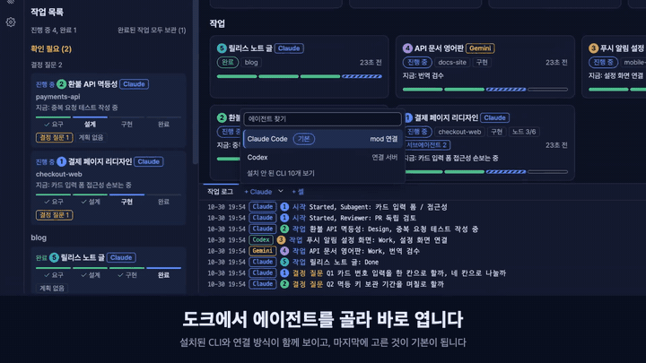
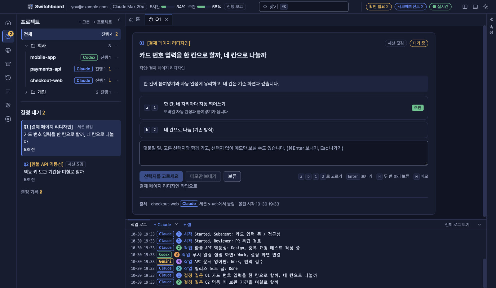
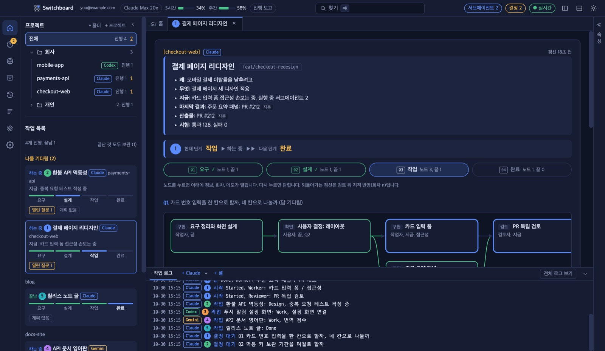
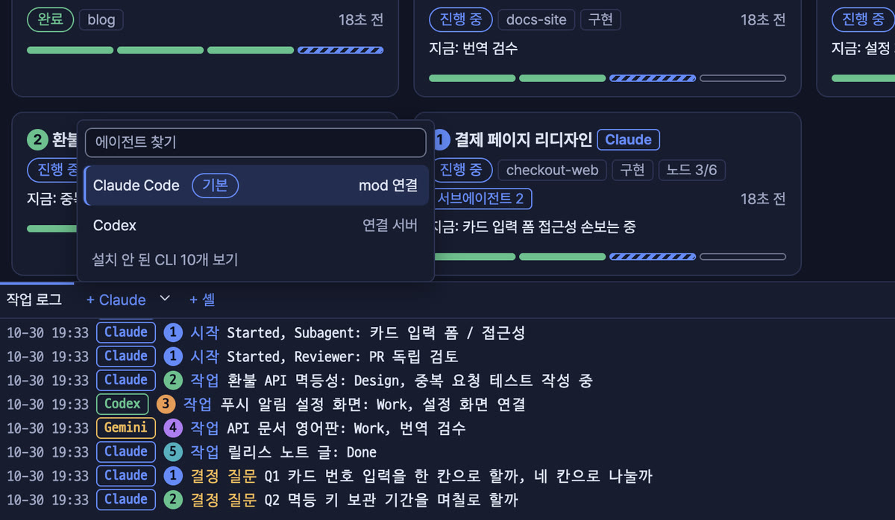
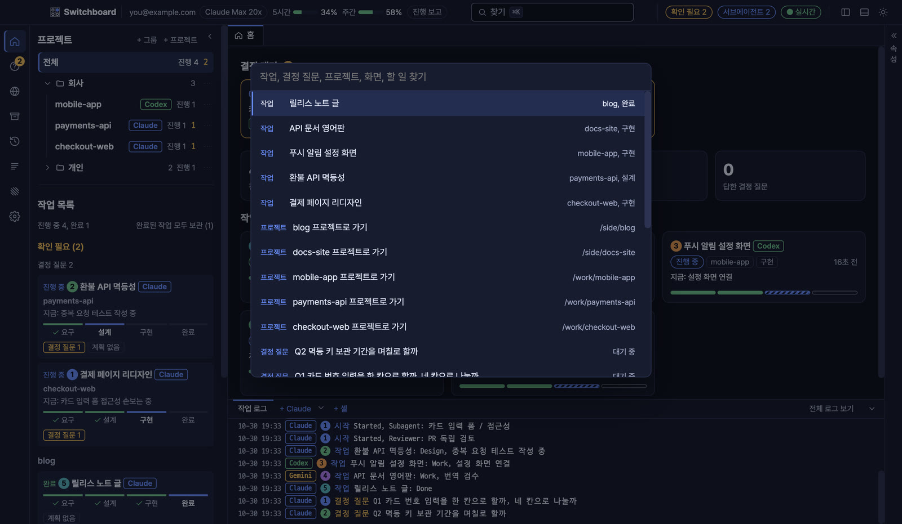
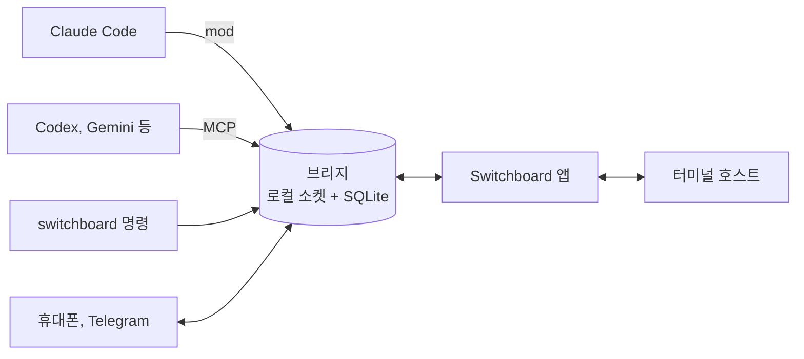

<div align="center">


# Switchboard

### 코딩 에이전트 여러 개를 한 화면에서 지휘합니다

Claude Code, Codex, Gemini CLI를 여러 개 띄워 두고 일을 맡기세요.<br>
에이전트는 멈추지 않고 일하고, 사람의 결정이 필요한 질문만 한곳에 모입니다.

<a href="https://github.com/choco5958/switchboard/releases/latest"></a>
<a href="https://github.com/choco5958/switchboard/actions/workflows/test.yml"></a>

<a href="LICENSE"></a>

**[내려받기](https://github.com/choco5958/switchboard/releases/latest)** &nbsp;|&nbsp; [설치](#설치) &nbsp;|&nbsp; [기능](#기능) &nbsp;|&nbsp; [보안](#데이터와-보안)

**한국어** | [English](README.en.md) | [日本語](README.ja.md) | [简体中文](README.zh-CN.md)

<br>

<a href="https://cdn.jsdelivr.net/gh/choco5958/switchboard@main/docs/intro-ko.mp4"></a><br>
<sub><a href="https://cdn.jsdelivr.net/gh/choco5958/switchboard@main/docs/intro-ko.mp4">▶ 눌러서 소리와 함께 전체 영상 보기 (58초)</a></sub>

</div>

<br>

## 이런 분께 맞습니다

- 터미널 여러 개에서 에이전트를 돌리다 보면 **누가 무엇을 기다리는지** 놓칩니다.
- 에이전트가 질문 하나에 멈춰 서 있는 동안 **아무 일도 진행되지 않습니다.**
- 자리를 비우면 **권한 확인 하나 때문에** 작업이 몇 시간씩 멈춥니다.

Switchboard에서는 세션이 결정 질문을 큐에 올려 두고 다른 일을 이어 갑니다. 키 하나로 답하면 그 답이 해당 세션에 프롬프트로 들어갑니다. 자리를 비운 동안에는 질문과 권한 확인이 휴대폰과 Telegram으로 옵니다.

## 기능

<table>
<tr>
<td width="50%"></td>
<td width="50%"></td>
</tr>
<tr>
<td width="50%" valign="top">
<h3>🗳️ 결정은 키 하나로</h3>
세션이 선택지와 추천, 추천 이유를 올립니다. <code>a</code>, <code>b</code>로 고르고 <code>Enter</code>로 보냅니다. 보류하거나 메모를 붙여 답할 수도 있습니다.
</td>
<td width="50%" valign="top">
<h3>📊 작업 단계와 진행 그래프</h3>
요구, 설계, 작업, 완료 단계와 노드별 진행이 그려집니다. 서브에이전트가 어디까지 왔는지 실시간으로 봅니다.
</td>
</tr>
<tr>
<td width="50%"></td>
<td width="50%"></td>
</tr>
<tr>
<td width="50%" valign="top">
<h3>🧩 쓰던 에이전트를 그대로</h3>
도크의 ▾에서 설치된 CLI를 골라 엽니다. 각 CLI의 설정 파일은 건드리지 않고, 마지막에 고른 에이전트가 기본이 됩니다.
</td>
<td width="50%" valign="top">
<h3>⌘K 로 어디든</h3>
작업, 질문, 프로젝트를 바로 찾아 엽니다. 프로젝트는 폴더로 묶고 접어 둡니다.
</td>
</tr>
</table>

<table>
<tr><td width="26%">🤝 <b>세션끼리 일하기</b></td><td>다른 세션에 묻고 답을 받습니다. 여러 세션의 답을 모아 한 턴에 넣고, 맡긴 일은 도중에 거둬들입니다.</td></tr>
<tr><td width="26%">📱 <b>자리를 비운 동안</b></td><td>결정 질문과 Claude Code의 권한 확인에 휴대폰이나 Telegram으로 답합니다. 같은 Wi-Fi가 아니어도 됩니다.</td></tr>
<tr><td width="26%">⏰ <b>예약 프롬프트</b></td><td>매일, 평일, 간격, 한 번 중에 골라 정한 시간에 세션에 프롬프트를 넣습니다.</td></tr>
<tr><td width="26%">🔍 <b>화면 보며 고치기</b></td><td>내장 브라우저에서 요소를 눌러 코멘트를 남기면 위치, 스크린샷, 콘솔 오류가 함께 갑니다. 세션은 로컬 페이지를 직접 눌러 확인합니다.</td></tr>
<tr><td width="26%">🖥️ <b>이어지는 터미널</b></td><td>macOS와 Linux에서는 앱을 닫거나 업데이트해도 터미널 속 에이전트가 계속 일하고, 다시 열면 화면 그대로 돌아옵니다.</td></tr>
<tr><td width="26%">🔒 <b>기본이 안전하게</b></td><td>서명된 업데이트만 설치합니다. 권한 허용은 앱과 HTTPS로 연결한 휴대폰만 할 수 있고, 세션이 사람 행세를 하지 못합니다.</td></tr>
<tr><td width="26%">🎨 <b>고르는 화면</b></td><td>테마 13개, 언어 4개. Claude 사용량과 컨텍스트 사용률이 상단에 보입니다.</td></tr>
</table>

<details>
<summary><b>기능 자세히 보기</b></summary>

#### 결정과 작업
- **결정 대기 큐**: 세션이 `ask_decision`으로 질문을 올리고 기다리지 않고 바로 일을 이어 갑니다. 같은 질문은 두 번 올라가지 않습니다.
- **나를 기다림**: 결정 대기가 있거나, 턴이 5분 넘게 멈췄거나, 사용량 한도에 걸렸거나, 세션이 끊긴 작업이 사이드바 맨 위에 모입니다. 멈춘 세션과 한도가 풀린 세션은 알림으로도 알립니다.
- **프로젝트별 보기**: 왼쪽 목록에서 프로젝트를 고르면 사이드바, 홈, 로그, 도크가 그 프로젝트 것만 보여 줍니다.

#### 세션끼리 일하기
- 세션이 `list_sessions`로 다른 세션을 찾고 `send_to_session`으로 요청을 보냅니다. 받은 세션이 따로 답하지 않고 턴을 끝내면 마지막 답변이 결과로 돌아갑니다.
- 여러 세션에 보낸 질문은 답을 모아 한 턴에 넣습니다. 15분이 지나면 먼저 온 답부터 넘깁니다.
- 받은 세션이 끊기거나 턴이 중단되면 보낸 세션에 알림이 갑니다.
- `cancel_request`로 맡긴 요청을 거둬들입니다. 한 요청에서 시작해 세션끼리 맡기는 요청은 모두 합쳐 8번까지입니다.
- 결정 질문을 다른 세션에 넘겨 대신 답하게 할 수 있습니다. 사용량 한도에 걸린 세션에 보낼 답은 리셋될 때까지 모아 둡니다.

#### 자리를 비운 동안
- 앱이 꺼졌거나, 화면이 잠겼거나, 5분 넘게 입력이 없으면 결정 질문과 권한 확인이 Telegram과 휴대폰으로 갑니다. 책상 앞에 있을 때는 지금처럼 터미널이 묻습니다.
- 예약 프롬프트를 받을 에이전트는 예약마다 고르고, 그 에이전트의 세션이 없으면 앱이 터미널을 엽니다. 알릴 것이 없는 실행은 알림을 보내지 않습니다.

#### 화면 보며 고치기
- 개발 서버를 등록해 띄우고 내장 브라우저로 엽니다. 앱 터미널에서 CLI가 여는 로컬 주소도 내장 브라우저로 열립니다.
- 세션은 `browser_*` 도구로 로컬 페이지를 읽고, 누르고, 입력합니다. 기본은 이 컴퓨터의 주소만 다루고, 설정 > 에이전트 CLI에서 허용하면 사설망 주소도 다룹니다.

#### 터미널
- 도크의 `+`는 마지막으로 연 에이전트를, ▾는 설치된 에이전트 목록을, `+ 셸`은 일반 셸을 엽니다.
- 에이전트가 일하는 동안 Mac이 잠들지 않습니다.
- 앱을 닫을 때 터미널도 닫으려면 설정 > 에이전트 CLI에서 `앱을 닫을 때 터미널도 닫기`를 켭니다. Windows에서는 터미널이 앱과 함께 닫힙니다.
- 설정에서 켜면 Codex, Copilot, Cursor를 처음 여는 폴더의 신뢰 질문에 미리 예라고 기록합니다. 기본은 꺼져 있고, 자체 에이전트 설정(.codex, .cursor, .mcp.json 등)이 있는 폴더는 건너뜁니다.
- Claude Code 안에서 `/switchboard`를 입력하면 그 세션의 작업 흐름과 결정 대기를 옆 창으로 봅니다.

#### 화면
- 사이드바의 프로젝트는 `+ 폴더`로 묶고 접습니다. 폴더는 ⋯ 메뉴의 `폴더 삭제`나 Delete 키로 지우고, 안의 프로젝트는 목록에 남습니다. 쓰지 않는 프로젝트는 목록에서 빼도 파일과 기록은 남습니다.
- 한국어, English, 日本語, 简体中文. 처음에는 OS 언어를 따릅니다.
- 테마 13개: 기본 남색, 모험 일지, 인광 터미널, 도트 픽셀, 지하철 노선도, 회로 기판, 요즘 터미널, 파란 도스 창, Dracula, Nord, Solarized 어두움과 밝음, GitHub 밝음.
- Orca가 있으면 노드마다 워크트리를 만들고, Linear 이슈를 작업으로 시작합니다.

</details>

## 지원 에이전트

Claude Code는 mod로, 다른 CLI는 앱이 그 실행에만 붙이는 연결 서버(MCP)로 연결됩니다. 쓰는 도구가 같아서 대부분의 기능은 에이전트와 상관없이 됩니다.

| 기능 | Claude Code | Codex, Gemini CLI, Qwen Code,<br>Copilot CLI, OpenCode, Goose, Amp | Cursor CLI, Grok,<br>Kimi, Crush |
| --- | :---: | :---: | :---: |
| 작업 보고, 결정 질문, 세션끼리 묻기, 브라우저 도구 | ✅ | ✅ | 터미널만 |
| 답과 메시지 받기 | ✅ | ✅ 앱 터미널에 입력 | |
| 예약 프롬프트 | ✅ | ✅ | |
| 자리 비운 동안 권한 확인 중계 | ✅ | 아직 | |
| 사용량 막대, `/switchboard` 패널 | ✅ | | |

목록에 없는 CLI는 설정 > 에이전트 CLI에서 명령과 연결 방법을 적어 추가합니다. 설치된 CLI만 도크에 나옵니다.

## 빠른 시작

1. [Releases](https://github.com/choco5958/switchboard/releases/latest)에서 설치 파일을 받아 설치합니다. 아래 [설치](#설치)에 운영체제별 순서가 있습니다.
2. 왼쪽 위 `+ 프로젝트`로 작업할 폴더를 고르고, 아래 도크의 `+ Claude`나 ▾에서 에이전트를 엽니다.
3. 평소처럼 일을 맡깁니다. 왼쪽 물음표 아이콘에 숫자가 뜨면 질문을 열고 키로 답합니다.

| 키 | 동작 |
| --- | --- |
| `a`, `b`, `1`, `2` | 선택지 고르기 |
| `Enter` | 보내기 |
| `H` 두 번 | 보류 |
| `M` | 메모 입력 (`Cmd+Enter` 보내기, `Esc` 나가기) |
| `Cmd+K` (Windows, Linux는 `Ctrl+K`) | 찾기 |

## 설치

Claude Code 2.1.309 이상이 필요합니다. 앱에 Node가 들어 있어서 따로 설치할 것은 없습니다. 아직 Apple과 Microsoft의 코드 서명을 받지 않아서 처음 열 때 한 번 경고가 뜹니다.

<details open>
<summary><b>macOS</b></summary>

1. Apple Silicon(M1 이후)은 `Switchboard-<버전>-mac-arm64.dmg`, Intel은 `-mac-x64.dmg`를 받습니다. 칩 종류는 애플 메뉴 > 이 Mac에 관하여에 나옵니다.
2. dmg를 열고 Switchboard를 응용 프로그램 폴더로 끌어 옮깁니다.
3. Switchboard를 엽니다. 악성 코드를 확인할 수 없다는 창이 뜨면 완료를 누릅니다.
4. 시스템 설정 > 개인정보 보호 및 보안에서 Switchboard 항목의 그래도 열기를 누르고, 암호를 입력한 뒤 열기를 누릅니다. macOS 14 이전에는 앱을 우클릭 > 열기로도 열립니다.

4번 대신 터미널에서 `xattr -dr com.apple.quarantine /Applications/Switchboard.app`을 실행해도 됩니다. 업데이트한 뒤 키체인 사용을 물으면 항상 허용을 누릅니다.

</details>

<details>
<summary><b>Windows</b></summary>

1. `Switchboard-<버전>-win.exe`를 받습니다(x64와 ARM 겸용). 기기에 맞는 `-win-x64.exe`나 `-win-arm64.exe`를 받아도 됩니다.
2. 실행하고 "Windows의 PC 보호" 창에서 추가 정보 > 실행을 누릅니다.
3. 설치 폴더를 고르고 설치를 누른 뒤, 시작 메뉴에서 Switchboard를 엽니다.

</details>

<details>
<summary><b>Linux</b></summary>

- AppImage: `Switchboard-<버전>-linux-x86_64.AppImage`(ARM은 `-linux-arm64.AppImage`)를 받아 `chmod +x`로 실행 권한을 주고 실행합니다. FUSE 오류가 나면 `libfuse2`(Ubuntu 24.04는 `libfuse2t64`)를 설치합니다.
- deb: `-linux-amd64.deb` 또는 `-linux-arm64.deb`를 받아 `sudo apt install ./Switchboard-*.deb`로 설치합니다. 자동 업데이트는 AppImage만 됩니다.

</details>

**업데이트**: 앱이 새 버전을 확인해 내려받아 두었다가 앱을 닫을 때 설치합니다. 업데이트 때문에 앱이 스스로 닫히지 않고, 서명이 없거나 맞지 않는 업데이트는 설치하지 않습니다. macOS와 Linux에서는 업데이트하는 동안에도 앱 터미널이 계속 실행됩니다. macOS 0.3.4 이하에서는 한 번 직접 내려받아 설치합니다.

<details>
<summary><b>다른 터미널에서 연 Claude Code 연결</b></summary>

앱의 `+ Claude` 터미널은 mod를 자동으로 불러옵니다. 다른 터미널에서 연 세션도 연결하려면 Claude Code 입력창에서 mod를 설치합니다.

```
/plugin install ide-bridge --marketplace choco5958/switchboard
```

`Add marketplace?`에 `y`를 누르고 범위는 user를 고릅니다. 새로 연 세션부터 연결되고, 브리지가 꺼져 있으면 mod가 켭니다. 앱을 한 번은 켜 두어야 mod가 브리지를 켜는 방법(`~/.claude-ide/start-bridge.json`)을 압니다.

</details>

<details>
<summary><b>소스에서 실행</b></summary>

Node.js 24 이상과 pnpm이 필요합니다.

```sh
git clone https://github.com/choco5958/switchboard.git
cd switchboard
pnpm install
pnpm run setup  # ~/.claude-ide/start-bridge.json과 ~/.local/bin/switchboard를 만듭니다
pnpm dev
```

레포 폴더를 옮기면 `pnpm run setup`을 다시 실행합니다. 설치 파일은 `pnpm dist`로 만듭니다.

</details>

## 자리를 비운 동안 쓰기

### 휴대폰 연결

설치할 앱 없이 휴대폰 브라우저에서 결정 질문에 답하고, 권한 확인을 허용하거나 거절하고, 작업을 보고, 세션에 메시지를 보냅니다.

1. PC와 휴대폰에 [Tailscale](https://tailscale.com)을 설치하고 로그인합니다.
2. 설정 > 휴대폰 연결에서 `휴대폰 연결 켜기`와 `Tailscale HTTPS 켜기`를 켭니다.
3. 주소로 Tailscale HTTPS를 고르고 `QR 코드 띄우기`를 누른 뒤 휴대폰 카메라로 찍습니다.
4. 홈 화면에 추가합니다. iPhone은 Safari의 공유 버튼 > 홈 화면에 추가, Android는 Chrome 메뉴(⋮) > 홈 화면에 추가입니다. iPhone 홈 화면 앱을 처음 열면, PC 앱에서 QR 코드를 새로 띄우고 옆의 8자리 코드를 입력합니다.

홈 화면 앱에서 `이 휴대폰으로 알림 받기`를 켜면 자리를 비운 동안 새 질문과 권한 확인 알림을 받습니다.

<details>
<summary><b>휴대폰에 Tailscale 없이 쓰기, 같은 Wi-Fi로만 쓰기</b></summary>

- **Tailscale Funnel**: `Tailscale HTTPS 켜기` 아래의 `다른 Wi-Fi와 LTE에서도 접속 받기`를 켜면 같은 HTTPS 주소가 인터넷에 열려, 휴대폰에 Tailscale 없이 어느 네트워크에서나 씁니다. 처음 한 번은 Tailscale 관리 페이지에서 이 컴퓨터의 Funnel을 허용합니다(설정에 링크가 나옵니다). 주소를 아는 사람은 페이지를 열 수 있지만, 내용은 휴대폰마다 다른 키로 암호화되어 연결한 휴대폰만 보고 답합니다.
- **같은 Wi-Fi(HTTP 주소)**: 주소로 `이 컴퓨터 이름`(`이름.local`)이나 IP를 고르면 Tailscale 없이 씁니다. 다만 이 연결로는 선택지로 결정에 답하기, 거절, 터미널에서 묻기만 됩니다. 권한 허용, 세션 메시지, 결정 답의 메모는 Tailscale HTTPS로 연결한 휴대폰만 합니다. HTTP로 오가는 화면은 그 네트워크를 장악한 사람이 바꿔치기할 수 있어서입니다. Tailscale IP(`100.x.y.z`)도 HTTP라서 같은 제한을 받습니다.
- 휴대폰마다 따로 연결하고 설정의 `연결 해제`로 끊습니다. 0.3.5 이하에서 연결한 휴대폰은 Tailscale HTTPS 주소의 QR 코드로 다시 연결해야 권한 허용을 씁니다.

</details>

### Telegram 연결

1. Telegram에서 `@BotFather`에게 `/newbot`을 보내 봇을 만듭니다.
2. 설정 > Telegram으로 답하기에 받은 토큰을 붙여 넣고 봇 연결을 누릅니다.
3. 연결 코드 받기를 누르고 10분 안에 휴대폰에서 링크를 열어 시작을 누릅니다. 그 대화방만 연결됩니다.

Telegram에서 허용하려면 한 번 더 눌러야 하고, 비밀값을 가린 요청은 Telegram에서 허용할 수 없습니다.

### 예약 프롬프트

설정 > 예약 프롬프트에서 이름, 프로젝트, 받을 에이전트, 프롬프트, 일정을 정합니다. 간격은 5분 이상입니다. 이전 실행이 끝나지 않았으면 건너뛰고, 꺼져 있던 동안 놓친 실행은 켜질 때 한 번 실행할지 고를 수 있습니다. 세션에 들어간 실행이 연속 5번 실패하면 그 예약을 끄고 알립니다.

## 셸에서 쓰기

| 명령 | 하는 일 |
| --- | --- |
| `switchboard sessions` | 세션 목록 (● 연결됨) |
| `switchboard send <세션 또는 프로젝트> <할 일 또는 -> [--wait] [--timeout 30m] [--info] [--json]` | 세션에 일을 맡기고 `m7` 같은 번호를 출력합니다. `--wait`는 결과까지 기다리고, `--info`는 답이 필요 없는 알림으로 보냅니다. `-`는 표준 입력을 읽습니다. |
| `switchboard status m7` | 맡긴 일의 상태와 결과 |
| `switchboard decisions`, `switchboard answer Q12 a [메모]` | 결정 대기를 보고 답합니다. |
| `switchboard waits`, `switchboard fire w3 [내용]` | 세션이 연 대기를 보고 깨웁니다. |

```sh
# 테스트가 끝나면 그 결과를 기다리던 세션을 깨웁니다
pnpm test; switchboard fire w3 "테스트 끝남: 종료 코드 $?"
```

종료 코드는 0 완료, 1 실패, 2 명령줄 오류, 3 세션이 결정을 기다림, 4 시간 초과(세션은 계속 일함), 5 브리지가 꺼졌거나 세션이 없음입니다. 명령은 macOS와 Linux에서 `~/.local/bin`, Windows에서 `%USERPROFILE%\.claude-ide\bin`에 생깁니다.

이 명령으로 보낸 글은 세션에 "셸에서 온 입력"으로 표시되어 들어가고, 사람의 지시로 읽히지 않습니다. `switchboard answer`는 에이전트 세션 안에서는 실행되지 않습니다.

<details>
<summary><b>세션이 쓰는 도구</b></summary>

| 도구 | 하는 일 |
| --- | --- |
| `ask_decision` | 결정 대기 큐에 질문을 올립니다. 기다리지 않고 바로 돌아옵니다. |
| `set_task` | 작업을 만들거나 단계, 지금 하는 일, 시험 결과를 갱신합니다. |
| `plan_nodes`, `update_node` | 작업을 노드로 나눠 진행 그래프에 올리고 상태를 바꿉니다. |
| `node_worktree` | 노드에 Orca 워크트리를 만듭니다. 세션 폴더 안에서만 동작합니다. |
| `open_in_ide` | 페이지나 개발 서버를 내장 브라우저에서 엽니다. 새 명령은 앱이 확인을 받습니다. |
| `list_sessions`, `send_to_session` | 다른 세션을 보고 요청이나 정보를 보냅니다. |
| `cancel_request` | 자기가 맡긴 요청을 취소합니다. |
| `await_event`, `close_wait` | 빌드나 배포처럼 바깥 일을 기다리는 대기를 열고 닫습니다. |
| `routine_no_update`, `routine_report_failure` | 예약 실행에서 알릴 것이 없거나 실패했음을 남깁니다. |
| `browser_snapshot`, `browser_click`, `browser_type`, `browser_navigate`, `browser_console`, `browser_screenshot` | 내장 브라우저의 로컬 페이지를 읽고 다룹니다. |
| `check_answers` | 다른 코딩 CLI용. 앱 밖에서 도는 세션이 아직 받지 않은 답을 가져갑니다. |

</details>

## 데이터와 보안

- **모든 데이터는 이 컴퓨터에만** 저장됩니다(`~/.claude-ide/`, 본인 전용 권한). 외부로 열리는 포트는 휴대폰 연결을 켰을 때만 생깁니다.
- **서명된 업데이트만 설치**합니다. 릴리스마다 업데이트 정보에 서명하고, 앱은 고정된 공개 키로 확인합니다.
- **권한 허용은 사람만** 합니다. 앱의 키(OS 키체인에 암호화)가 있어야 허용할 수 있고, 허용 답에는 그 키로 서명합니다. 셸 권한이 있는 세션이 브리지에 직접 요청하거나 DB를 고쳐도 자기 요청을 허용할 수 없습니다. 앱은 키를 가졌다고 증명한 브리지와 터미널 호스트에만 키를 보냅니다.
- **세션은 사람 행세를 하지 못합니다.** 셸 명령으로 들어온 글은 출처를 표시해 경계 줄 안에 담고, 세션마다 받은 토큰이 있어야 그 세션의 답과 요청을 다룹니다.
- **휴대폰**: 휴대폰마다 다른 키로 요청과 응답을 모두 암호화하고(ChaCha20-Poly1305) 같은 요청을 다시 보낼 수 없게 합니다. 권한 허용은 Tailscale HTTPS로 연결한 휴대폰만 합니다.
- **원격 승인**은 명령 원문과 샌드박스 해제 같은 설정을 함께 보여 줍니다. 다 보여 줄 수 없는 요청과 샌드박스 밖에서 돌릴 명령은 터미널에서만 묻습니다.
- **외부로 나가는 것**: Telegram을 연결하면 질문과 권한 확인 내용이 Telegram 서버를 거치고, 휴대폰 알림은 푸시 서버를 거칩니다. 둘 다 토큰처럼 보이는 값은 가리고, 알림 내용은 암호화되어 푸시 서버가 읽지 못합니다. 계정 이메일은 화면에서 가리고 어디에도 보내지 않습니다.

<details>
<summary><b>보안 자세히 보기</b></summary>

- 소켓과 DB는 0600, 폴더는 0700입니다. Windows에서는 브리지가 127.0.0.1에만 포트를 열고, 켤 때마다 만든 토큰이 있는 요청에만 답합니다.
- 권한 확인 답, 자리 비움 표시, Telegram 설정, 예약 프롬프트, 설정 변경, 세션 제어는 앱만 할 수 있습니다. mod가 먼저 띄운 브리지는 키가 없어서, 앱이 켜질 때 한 번 다시 띄웁니다.
- 앱의 키 없이 읽는 화면 상태에서는 권한 요청 내용의 비밀값을 가리고 터미널 키와 세션 토큰을 뺍니다.
- 다른 CLI의 터미널에는 앱이 그 에이전트용으로 연 터미널에만 입력하고, CLI가 확인 메뉴를 띄우고 있으면 기다립니다. Enter 직전에도 다시 확인합니다.
- 세션의 브라우저 도구는 기본으로 이 컴퓨터의 주소만 엽니다. 브라우저 도구와 화면 코멘트의 스크립트는 페이지와 분리된 영역에서 실행됩니다.
- 세션이 `open_in_ide`로 넣은 개발 서버 명령은 처음(그리고 바뀔 때마다) 앱이 원문과 폴더를 보여 주고 확인을 받습니다. 숨은 문자가 든 명령은 거절합니다.
- 휴대폰 연결은 켜기 전까지 열리지 않습니다. 켜면 이 컴퓨터, 사설망, Tailscale에서 오는 접속만 받고, Tailscale serve가 붙이는 `X-Forwarded-Proto: https`와 이 컴퓨터의 HTTPS 이름을 확인합니다. 휴대폰 연결을 끄거나 브리지가 멈추면 Tailscale HTTPS도 끕니다. 실패한 요청이 많은 주소는 잠시 막습니다.
- 숨은 문자나 글자 순서를 바꾸는 문자가 든 명령은 `[U+202E]`처럼 표시하고, 휴대폰과 Telegram에서는 허용할 수 없습니다.
- 앱 실행 파일에서 `NODE_OPTIONS`와 `--inspect`를 막았습니다.
- 에이전트에게 셸 권한을 줄 때는 Claude Code 샌드박스로 `~/.claude-ide` 접근을 막아 두기를 권합니다.
- 작업 로그는 7일이 지나면 지웁니다.

</details>

## 구조와 개발



<details>
<summary><b>폴더 구조와 개발 명령</b></summary>

| 폴더 | 역할 |
| --- | --- |
| `bridge/` | 로컬 중계 서버. `~/.claude-ide/bridge.sock`과 SQLite를 씁니다. 예약 실행, Telegram, 휴대폰 연결도 여기서 돕니다. |
| `mod/` | Claude Code mod `ide-bridge`. 도구를 등록하고, 답을 세션에 넣고, `/switchboard` 패널을 그립니다. |
| `mcp/` | 다른 코딩 CLI용 MCP 서버(stdio). |
| `scripts/` | 설치 스크립트, `switchboard` 명령, 릴리스 서명 스크립트. |
| `src/` | Electron 앱(React)과 터미널 호스트. |

```sh
pnpm test        # 브리지, mod, 스크립트(node:test)와 화면 로직(vitest)
pnpm typecheck
pnpm build && pnpm start
claude plugin test mod
```

테스트는 실제 계정 환경변수를 지우고 임시 홈 폴더에서 돕니다. 화면 확인은 실제 데이터와 분리된 브리지로 합니다.

```sh
CLAUDE_IDE_SOCKET=/tmp/sb/b.sock CLAUDE_IDE_DB=/tmp/sb/ide.db node bridge/server.ts &
CLAUDE_IDE_SOCKET=/tmp/sb/b.sock CLAUDE_IDE_CAPTURE=/tmp/sb/shot.png pnpm exec electron .
```

`CLAUDE_IDE_CAPTURE`를 주면 창 없이 화면을 PNG로 저장하고 끝납니다. 테마를 더하는 법은 [DESIGN_SYSTEM.md](DESIGN_SYSTEM.md)에 있습니다.

</details>

## 라이선스

[MIT](LICENSE)
