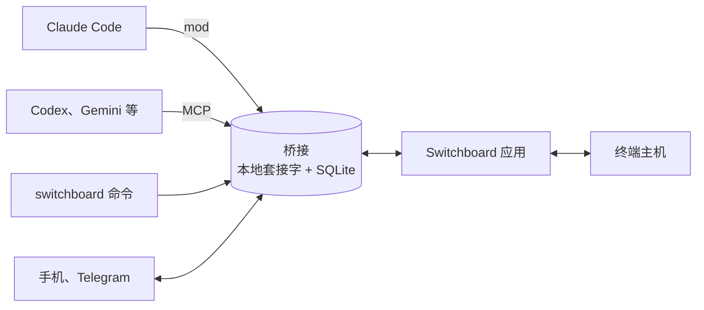

<div align="center">


# Switchboard

### 在一个界面上指挥多个编码代理

同时运行多个 Claude Code、Codex、Gemini CLI 会话，把工作交给它们。<br>
代理不停地工作，只有需要人来决定的问题会集中到一处。

<a href="https://github.com/choco5958/switchboard/releases/latest"></a>
<a href="https://github.com/choco5958/switchboard/actions/workflows/test.yml"></a>

<a href="LICENSE"></a>

**[下载](https://github.com/choco5958/switchboard/releases/latest)** &nbsp;|&nbsp; [安装](#安装) &nbsp;|&nbsp; [功能](#功能) &nbsp;|&nbsp; [安全](#数据与安全)

[한국어](README.md) | [English](README.en.md) | [日本語](README.ja.md) | **简体中文**

<br>

<a href="https://cdn.jsdelivr.net/gh/choco5958/switchboard@main/docs/intro-en.mp4"></a><br>
<sub><a href="https://cdn.jsdelivr.net/gh/choco5958/switchboard@main/docs/intro-en.mp4">▶ 点击观看带声音的完整视频 (58 秒，英文)</a></sub>

</div>

<br>

## 适合谁

- 在多个终端里运行代理时，很容易搞不清**谁在等什么**。
- 代理卡在一个问题上时，**什么都没有推进**。
- 一离开座位，**一个权限确认**就能让工作停几个小时。

在 Switchboard 里，会话把需要决定的问题放进队列，然后继续做别的事。按一个键回答，答案就作为提示词回到该会话。你不在电脑前时，问题和权限确认会发到手机和 Telegram。

## 功能

<table>
<tr>
<td width="50%" valign="top">

<h3>🗳️ 一个键做决定</h3>
会话提交选项、推荐以及推荐理由。用 <code>a</code>、<code>b</code> 选择，用 <code>Enter</code> 发送。也可以暂缓，或附上备注回答。
</td>
<td width="50%" valign="top">

<h3>📊 工作阶段与进度图</h3>
画出需求、设计、实现、完成各阶段以及每个节点的进度。实时查看子代理进行到哪一步。
</td>
</tr>
<tr>
<td width="50%" valign="top">

<h3>🧩 沿用你习惯的代理</h3>
在停靠栏的 ▾ 中选择已安装的 CLI 打开。不改动各 CLI 的配置文件，最后选择的代理会成为默认。
</td>
<td width="50%" valign="top">

<h3>⌘K 随处直达</h3>
直接查找并打开任务、问题和项目。项目可以归入文件夹并折叠。
</td>
</tr>
</table>

|  |  |
| --- | --- |
| 🤝 **会话之间协作** | 向其他会话提问并收到回答。把多个会话的回答汇总到一轮里，委派出去的工作可以中途收回。 |
| 📱 **不在电脑前时** | 用手机或 Telegram 回答决定问题和 Claude Code 的权限确认，不在同一 Wi-Fi 也可以。 |
| ⏰ **定时提示** | 从每天、工作日、间隔、一次中选择，在设定时间向会话发送提示词。 |
| 🔍 **边看边改** | 在内置浏览器中点击元素留下评论，位置、截图和控制台错误会一起发送。会话会自己点击本地页面来确认。 |
| 🖥️ **持续运行的终端** | 在 macOS 和 Linux 上，退出或更新应用后终端里的代理仍在工作，重新打开时界面原样回来。 |
| 🔒 **默认安全** | 只安装带签名的更新。只有应用和通过 HTTPS 连接的手机可以允许权限，会话无法冒充你。 |
| 🎨 **可选外观** | 13 种主题，4 种语言。顶部显示 Claude 用量和上下文使用率。 |

<details>
<summary><b>功能详情</b></summary>

#### 决定与任务
- **待决定队列**: 会话用 `ask_decision` 提交问题，不等待就继续工作。同一个问题不会提交两次。
- **等你处理**: 有待决定、一轮停滞超过 5 分钟、达到用量上限或会话断开的任务会集中在侧栏最上方。停滞的会话和解除上限的会话也会发通知。
- **按项目查看**: 在左侧列表选中项目后，侧栏、主页、日志和停靠栏只显示该项目的内容。

#### 会话之间协作
- 会话用 `list_sessions` 查找其他会话，用 `send_to_session` 发送请求。接收方没有单独回复就结束本轮时，最后的回答会作为结果返回。
- 发给多个会话的问题，回答会汇总后放进一轮。超过 15 分钟则先交付已到的回答。
- 接收方断开或本轮被中断时，会通知发送方。
- 用 `cancel_request` 收回委派的请求。从一个请求开始、会话之间互相委派的请求合计最多 8 次。
- 可以把决定问题交给其他会话代为回答。发给已达用量上限的会话的回答会保留到重置后再交付。

#### 不在电脑前时
- 应用关闭、屏幕锁定或 5 分钟以上没有输入时，决定问题和权限确认会发到 Telegram 和手机。在电脑前时，仍像以前一样由终端询问。
- 每个定时提示可以选择接收的代理；该代理没有会话时，应用会打开它的终端。没有需要通知的运行不会发通知。

#### 边看边改
- 注册并启动开发服务器，用内置浏览器打开。应用终端里 CLI 打开的本地地址也会在内置浏览器中打开。
- 会话用 `browser_*` 工具读取、点击和输入本地页面。默认只处理本机地址，在 设置 > 代理 CLI 中允许后也能处理私有网络地址。

#### 终端
- 停靠栏的 `+` 打开上次打开的代理，▾ 列出已安装的代理，`+ 终端` 打开普通 Shell。
- 代理工作期间 Mac 不会睡眠。
- 如果希望退出应用时关闭终端，在 设置 > 代理 CLI 中开启 `退出应用时关闭终端`。在 Windows 上终端会随应用一起关闭。
- 在设置中开启后，首次打开 Codex、Copilot、Cursor 的文件夹会预先在该 CLI 的文件夹信任确认中记录"是"。默认关闭，自带代理配置 (.codex、.cursor、.mcp.json 等) 的文件夹会跳过。
- 在 Claude Code 中输入 `/switchboard`，可以在侧边窗格查看该会话的工作流程和待决定。

#### 界面
- 侧栏的项目可以用 `+ 文件夹` 归类并折叠。从列表中移除项目后，文件和记录仍然保留。
- 한국어、English、日本語、简体中文。初次使用时跟随系统语言。
- 13 种主题: 经典藏青、冒险日志、荧光终端、像素点阵、地铁线路图、电路板、现代终端、蓝色 DOS 窗口、Dracula、Nord、Solarized 深色与浅色、GitHub 浅色。
- 安装了 Orca 时，可以为每个节点创建工作树，并从 Linear 议题开始任务。

</details>

## 支持的代理

Claude Code 通过 mod 连接，其他 CLI 通过应用只为该次运行附加的连接服务器 (MCP) 连接。两者使用相同的工具，所以大部分功能与代理无关。

| 功能 | Claude Code | Codex、Gemini CLI、Qwen Code、<br>Copilot CLI、OpenCode、Goose、Amp | Cursor CLI、Grok、<br>Kimi、Crush |
| --- | :---: | :---: | :---: |
| 任务汇报、决定问题、会话间提问、浏览器工具 | ✅ | ✅ | 仅终端 |
| 接收回答和消息 | ✅ | ✅ 输入到应用终端 | |
| 定时提示 | ✅ | ✅ | |
| 不在电脑前时转发权限确认 | ✅ | 尚未支持 | |
| 用量条、`/switchboard` 窗格 | ✅ | | |

列表之外的 CLI 可以在 设置 > 代理 CLI 中填写命令和连接方式来添加。停靠栏只显示已安装的 CLI。

## 快速开始

1. 从 [Releases](https://github.com/choco5958/switchboard/releases/latest) 下载安装包并安装。各系统的步骤见下方 [安装](#安装)。
2. 用左上角的 `+ 项目` 选择工作文件夹，再从下方停靠栏的 `+ Claude` 或 ▾ 打开代理。
3. 像平时一样交代工作。左侧问号图标出现数字时，打开问题用按键回答。

| 按键 | 作用 |
| --- | --- |
| `a`、`b`、`1`、`2` | 选择选项 |
| `Enter` | 发送 |
| 按两次 `H` | 暂缓 |
| `M` | 输入备注 (`Cmd+Enter` 发送，`Esc` 退出) |
| `Cmd+K` (Windows 和 Linux 为 `Ctrl+K`) | 查找 |

## 安装

需要 Claude Code 2.1.309 或更高版本。应用内置 Node，无需另外安装。应用尚未获得 Apple 和 Microsoft 的代码签名，首次打开时会出现一次警告。

<details open>
<summary><b>macOS</b></summary>

1. Apple Silicon (M1 及以后) 下载 `Switchboard-<版本>-mac-arm64.dmg`，Intel 下载 `-mac-x64.dmg`。芯片类型可在 苹果菜单 > 关于本机 中查看。
2. 打开 dmg，把 Switchboard 拖到"应用程序"文件夹。
3. 打开 Switchboard。出现无法验证是否含有恶意软件的提示时，点"完成"。
4. 在 系统设置 > 隐私与安全性 中，点击 Switchboard 项的"仍要打开"，输入密码后点"打开"。macOS 14 之前也可以右键点击应用 > 打开。

也可以不做第 4 步，改在终端运行 `xattr -dr com.apple.quarantine /Applications/Switchboard.app`。更新后询问钥匙串使用时，点"始终允许"。

</details>

<details>
<summary><b>Windows</b></summary>

1. 下载 `Switchboard-<版本>-win.exe` (x64 与 ARM 通用)，或适合设备的 `-win-x64.exe` / `-win-arm64.exe`。
2. 运行后，在"Windows 已保护你的电脑"窗口点 更多信息 > 仍要运行。
3. 选择安装文件夹并点安装，然后从开始菜单打开 Switchboard。

</details>

<details>
<summary><b>Linux</b></summary>

- AppImage: 下载 `Switchboard-<版本>-linux-x86_64.AppImage` (ARM 为 `-linux-arm64.AppImage`)，用 `chmod +x` 赋予执行权限后运行。出现 FUSE 错误时安装 `libfuse2` (Ubuntu 24.04 为 `libfuse2t64`)。
- deb: 下载 `-linux-amd64.deb` 或 `-linux-arm64.deb`，用 `sudo apt install ./Switchboard-*.deb` 安装。只有 AppImage 会自动更新。

</details>

**更新**: 应用会检查并下载新版本，在退出应用时安装。应用不会因为更新而自行关闭，没有签名或签名不符的更新不会安装。在 macOS 和 Linux 上，更新期间应用终端也会继续运行。从 macOS 0.3.4 或更早版本升级时，需要手动安装一次。

<details>
<summary><b>连接在其他终端中打开的 Claude Code</b></summary>

应用的 `+ Claude` 终端会自动加载 mod。要连接在其他终端中打开的会话，在 Claude Code 输入框中安装 mod:

```
/plugin install ide-bridge --marketplace choco5958/switchboard
```

在 `Add marketplace?` 处按 `y`，范围选择 user。之后新打开的会话会连接，桥接未运行时由 mod 启动。请先打开一次应用，让 mod 知道如何启动桥接 (`~/.claude-ide/start-bridge.json`)。

</details>

<details>
<summary><b>从源码运行</b></summary>

需要 Node.js 24 或更高版本和 pnpm。

```sh
git clone https://github.com/choco5958/switchboard.git
cd switchboard
pnpm install
pnpm run setup  # 生成 ~/.claude-ide/start-bridge.json 和 ~/.local/bin/switchboard
pnpm dev
```

移动仓库文件夹后，重新运行 `pnpm run setup`。安装包用 `pnpm dist` 生成。

</details>

## 不在电脑前时

### 手机连接

无需安装应用，用手机浏览器回答决定问题、允许或拒绝权限确认、查看任务、给会话发消息。

1. 在电脑和手机上安装 [Tailscale](https://tailscale.com) 并登录。
2. 在 设置 > 手机连接 中开启 `开启手机连接` 和 `开启 Tailscale HTTPS`。
3. 地址选择 Tailscale HTTPS，点 `显示二维码`，用手机相机扫描。
4. 添加到主屏幕。iPhone 为 Safari 的分享按钮 > 添加到主屏幕，Android 为 Chrome 菜单 (⋮) > 添加到主屏幕。首次打开 iPhone 主屏幕应用时，在电脑应用中重新显示二维码，输入旁边的 8 位代码。

在主屏幕应用中开启通知后，不在电脑前时也能收到新问题和权限确认的通知。

<details>
<summary><b>手机不装 Tailscale 使用、只在同一 Wi-Fi 使用</b></summary>

- **Tailscale Funnel**: 开启 `开启 Tailscale HTTPS` 下方的 `接受来自其他 Wi-Fi 和移动网络的连接`，同一个 HTTPS 地址会对互联网开放，手机不装 Tailscale 也能在任何网络使用。首次需要在 Tailscale 管理页面允许这台电脑的 Funnel (设置中会显示链接)。知道地址的人可以打开页面，但内容用每部手机不同的密钥加密，只有已连接的手机能查看和回答。
- **同一 Wi-Fi (HTTP 地址)**: 地址选择 `这台电脑的名称` (`名称.local`) 或 IP，即可不用 Tailscale。但这种连接只能用选项回答决定、拒绝、转到终端询问。允许权限、给会话发消息、决定回答的备注，只有通过 Tailscale HTTPS 连接的手机才能做。因为通过 HTTP 传输的页面可能被控制该网络的人替换。Tailscale IP (`100.x.y.z`) 也是 HTTP，受同样限制。
- 每部手机分别连接，用设置中的 `断开连接` 断开。在 0.3.5 及更早版本连接的手机，要允许权限需要用 Tailscale HTTPS 地址的二维码重新连接。

</details>

### 连接 Telegram

1. 在 Telegram 中向 `@BotFather` 发送 `/newbot` 创建机器人。
2. 把收到的令牌粘贴到 设置 > 在 Telegram 上回答，连接机器人。
3. 点 `获取连接码`，10 分钟内在手机上打开链接并点开始。只会连接这个聊天。

在 Telegram 上允许需要再点一次，隐藏了秘密值的请求不能在 Telegram 上允许。

### 定时提示

在 设置 > 定时提示 中设定名称、项目、接收的代理、提示词和日程。间隔至少 5 分钟。上一次运行未结束时跳过本次，关闭期间错过的运行可以选择在启动时运行一次。进入会话的运行连续失败 5 次时，会关闭该定时并通知你。

## 在 Shell 中使用

| 命令 | 作用 |
| --- | --- |
| `switchboard sessions` | 会话列表 (● 已连接) |
| `switchboard send <会话或项目> <工作或 -> [--wait] [--timeout 30m] [--info] [--json]` | 把工作交给会话，并输出类似 `m7` 的编号。`--wait` 等待结果，`--info` 作为无需回复的通知发送。`-` 读取标准输入。 |
| `switchboard status m7` | 交付工作的状态和结果 |
| `switchboard decisions`、`switchboard answer Q12 a [备注]` | 查看并回答待决定 |
| `switchboard waits`、`switchboard fire w3 [内容]` | 查看并唤醒会话开启的等待 |

```sh
# 测试结束后，唤醒等待该结果的会话
pnpm test; switchboard fire w3 "测试结束: 退出码 $?"
```

退出码: 0 完成，1 失败，2 命令行错误，3 会话在等待决定，4 超时 (会话继续工作)，5 桥接未运行或没有该会话。命令在 macOS 和 Linux 上位于 `~/.local/bin`，在 Windows 上位于 `%USERPROFILE%\.claude-ide\bin`。

用这个命令发送的内容会以"来自 Shell 的输入"标注后进入会话，不会被当作你的指示。`switchboard answer` 在代理会话内不会执行。

<details>
<summary><b>会话使用的工具</b></summary>

| 工具 | 作用 |
| --- | --- |
| `ask_decision` | 把问题放进待决定队列，立即返回。 |
| `set_task` | 创建任务，或更新阶段、当前步骤和测试结果。 |
| `plan_nodes`、`update_node` | 把任务拆成节点放进进度图，并更新状态。 |
| `node_worktree` | 为节点创建 Orca 工作树，只在会话文件夹内工作。 |
| `open_in_ide` | 在内置浏览器中打开页面或开发服务器；新命令需要在应用中确认。 |
| `list_sessions`、`send_to_session` | 查看其他会话，发送请求或信息。 |
| `cancel_request` | 取消自己委派的请求。 |
| `await_event`、`close_wait` | 开启和关闭等待构建、部署等外部工作的等待。 |
| `routine_no_update`、`routine_report_failure` | 记录定时运行没有需要通知的内容或运行失败。 |
| `browser_snapshot`、`browser_click`、`browser_type`、`browser_navigate`、`browser_console`、`browser_screenshot` | 读取并操作内置浏览器中的本地页面。 |
| `check_answers` | 供其他编码 CLI 使用。在应用外运行的会话取回尚未收到的回答。 |

</details>

## 数据与安全

- **所有数据只保存在这台电脑上** (`~/.claude-ide/`，仅本人可读)。只有开启手机连接时才会有可从外部访问的端口。
- **只安装带签名的更新。** 每次发布都会给更新信息签名，应用用固定的公钥验证。
- **只有人能允许权限。** 允许需要应用的密钥 (用系统钥匙串加密)，每次允许都用该密钥签名。有 Shell 权限的会话直接请求桥接或修改数据库，也无法允许自己的请求。应用只把密钥发给已证明持有该密钥的桥接和终端主机。
- **会话无法冒充你。** 来自 Shell 命令的内容会标明来源并放在边界内，必须有会话注册时获得的令牌才能处理该会话的回答和请求。
- **手机**: 每部手机用不同的密钥加密全部请求和响应 (ChaCha20-Poly1305)，同一请求不能重放。只有通过 Tailscale HTTPS 连接的手机可以允许权限。
- **远程批准**会显示命令原文以及关闭沙箱等设置。无法完整显示的请求和要在沙箱外运行的命令，只在终端询问。
- **会离开电脑的内容**: 连接 Telegram 后，问题和权限确认的内容会经过 Telegram 服务器；手机通知会经过推送服务器。两者都会隐藏看起来像令牌的值，通知内容经过加密，推送服务器无法读取。账号邮箱在界面上隐藏，不会发送到任何地方。

<details>
<summary><b>安全详情</b></summary>

- 套接字和数据库为 0600，文件夹为 0700。在 Windows 上，桥接只在 127.0.0.1 上开放端口，只回应带有每次启动生成的令牌的请求。
- 权限确认回答、离开状态、Telegram 设置、定时提示、设置变更和会话控制只能由应用执行。mod 先启动的桥接没有密钥，应用启动时会重新启动一次。
- 不带应用密钥读取的界面状态会隐藏权限请求中的秘密值，并去掉终端键和会话令牌。
- 只向应用为该代理打开的终端输入回答，CLI 显示确认菜单时会等待，按 Enter 之前也会再检查一次。
- 会话的浏览器工具默认只打开本机地址。浏览器工具和界面评论的脚本在与页面隔离的环境中运行。
- 会话用 `open_in_ide` 添加的开发服务器命令，在首次运行 (以及每次变化) 时由应用显示原文和文件夹并请求确认。含有隐藏字符的命令会被拒绝。
- 手机连接在开启前不会开放。开启后只接受来自本机、私有网络和 Tailscale 的连接，并检查 Tailscale serve 添加的 `X-Forwarded-Proto: https` 和这台电脑的 HTTPS 名称。关闭手机连接或桥接停止时，Tailscale HTTPS 也会关闭。失败请求较多的地址会被暂时封锁。
- 含有隐藏字符或改变文字顺序字符的命令会显示为 `[U+202E]` 这样的标记，不能在手机和 Telegram 上允许。
- 应用可执行文件禁用了 `NODE_OPTIONS` 和 `--inspect`。
- 给代理 Shell 权限时，建议用 Claude Code 沙箱阻止访问 `~/.claude-ide`。
- 工作日志 7 天后删除。

</details>

## 架构与开发



<details>
<summary><b>目录结构与开发命令</b></summary>

| 目录 | 作用 |
| --- | --- |
| `bridge/` | 本地中继服务器，使用 `~/.claude-ide/bridge.sock` 和 SQLite。定时运行、Telegram 和手机连接也在这里运行。 |
| `mod/` | Claude Code mod `ide-bridge`。注册工具，把回答送进会话，绘制 `/switchboard` 窗格。 |
| `mcp/` | 供其他编码 CLI 使用的 MCP 服务器 (stdio)。 |
| `scripts/` | 安装脚本、`switchboard` 命令和发布签名脚本。 |
| `src/` | Electron 应用 (React) 和终端主机。 |

```sh
pnpm test        # 桥接、mod、脚本 (node:test) 和界面逻辑 (vitest)
pnpm typecheck
pnpm build && pnpm start
claude plugin test mod
```

测试会清除真实账号的环境变量，并在临时主目录中运行。界面检查使用与真实数据隔离的桥接:

```sh
CLAUDE_IDE_SOCKET=/tmp/sb/b.sock CLAUDE_IDE_DB=/tmp/sb/ide.db node bridge/server.ts &
CLAUDE_IDE_SOCKET=/tmp/sb/b.sock CLAUDE_IDE_CAPTURE=/tmp/sb/shot.png pnpm exec electron .
```

设置 `CLAUDE_IDE_CAPTURE` 后，应用不显示窗口，把界面保存为 PNG 后退出。添加主题的方法见 [DESIGN_SYSTEM.md](DESIGN_SYSTEM.md)。

</details>

## 许可证

[MIT](LICENSE)
