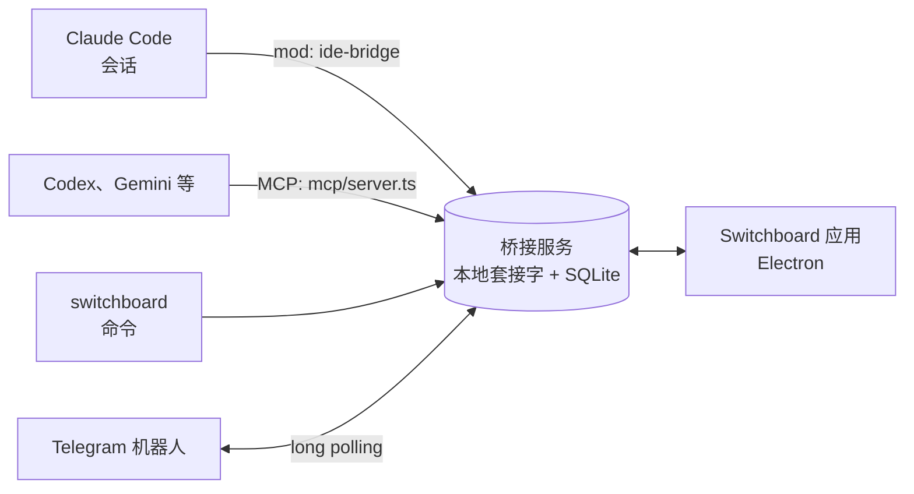

<div align="center">


# Switchboard

**在一个界面上指挥多个编码智能体的桌面应用**

Claude Code、Codex、Gemini CLI 会话会向你请求决定、彼此委派工作，你不在电脑前时通过 Telegram 联系你。

<a href="https://github.com/choco5958/switchboard/releases/latest"></a>
<a href="https://github.com/choco5958/switchboard/actions/workflows/test.yml"></a>

<a href="LICENSE"></a>

<p><b>下载</b> &nbsp; <a href="https://github.com/choco5958/switchboard/releases/latest">macOS</a> &nbsp;|&nbsp; <a href="https://github.com/choco5958/switchboard/releases/latest">Windows</a> &nbsp;|&nbsp; <a href="https://github.com/choco5958/switchboard/releases/latest">Linux</a></p>

[한국어](README.md) | [English](README.en.md) | [日本語](README.ja.md) | **简体中文**

</div>

<br>


会话需要人来做决定时，会把问题放进待决定队列，然后不等回答继续做别的事。你按一个键回答，答案就作为提示词回到该会话。会话之间也可以互相委派工作；你不在电脑前时，决定问题和权限确认会发到你自己的 Telegram。

## 一览

<table>
<tr>
<td width="50%" valign="top">
<h3>🗳️ 待决定队列</h3>
<p>会话把问题放进队列后继续做别的事。按一个键回答，答案就作为提示词进入该会话。</p>
</td>
<td width="50%" valign="top">
<h3>🤝 会话之间协作</h3>
<p>会话可以向其他会话提问并拿到回答。多个会话的回答会合并后一次送达，委派的工作也能中途取消。</p>
</td>
</tr>
<tr>
<td width="50%" valign="top">
<h3>📱 不在电脑前时</h3>
<p>通过 Telegram 或手机浏览器回答决定问题和 Claude Code 的权限确认。定时提示会在设定的时间运行。</p>
</td>
<td width="50%" valign="top">
<h3>🔍 边看边改</h3>
<p>在内置浏览器中点击元素留下批注，位置、截图和控制台错误会一并发送。会话也会亲自点击本地页面来确认。</p>
</td>
</tr>
<tr>
<td width="50%" valign="top">
<h3>🧩 多种编码 CLI</h3>
<p>Codex、Gemini CLI、Qwen Code、Copilot CLI、OpenCode、Goose、Amp 也接入同一个待决定队列和任务报告。</p>
</td>
<td width="50%" valign="top">
<h3>🎨 可选的界面</h3>
<p>支持 13 种主题和 4 种语言。顶部显示 Claude 用量和上下文使用率。</p>
</td>
</tr>
</table>

## 快速开始

1. 从 [Releases](https://github.com/choco5958/switchboard/releases/latest) 下载适合你系统的安装包并打开。详见[安装](#安装)。
2. 在底部停靠栏点击 `+ Claude` 打开会话，像平时一样交代工作。
3. 有决定问题时按键回答，其余的交给会话继续。

## 主要功能

### 决定与任务

- **待决定队列**: 会话用 `ask_decision` 提交选项、推荐项和推荐理由。用 `a`、`b` 等键选择，按 `Enter` 发送。也可以暂缓，或附上备注回答。同一个问题不会重复进入队列。
- **任务与进度图**: 任务阶段 (需求、设计、工作、完成) 和节点 (确认、实现、测试、评审) 会画在界面上，每个节点负责的子智能体是在运行还是已结束都一目了然。
- **等你处理**: 有待决定、回合停滞超过 5 分钟、达到用量上限或会话断开的任务，会集中到侧边栏最上方。停滞的会话和上限已恢复的会话还会发出 macOS 通知。
- **按项目查看**: 在左侧列表选中文件夹后，整个界面只显示该项目的会话和任务。

### 会话之间协作

- **提问与回复**: 会话用 `list_sessions` 查找其他会话，用 `send_to_session` 发送请求。收到请求的会话如果没有单独回复就结束了回合，它的最后一条回答会作为结果返回。
- **同时问多个会话**: 发给多个会话的问题，会把回复收齐后放进同一个回合。期间如果有人在应用或终端里给提问的会话发消息，已收到的回复会随那个回合一起送入；超过 15 分钟则先送入已到的回复。
- **收不到回复时**: 接收方会话断开连接或回合被中断时，会通知发送方不会有回复，发送方不必等待，继续工作。
- **取消委派与委派上限**: 会话可以用 `cancel_request` 收回自己交出的请求。尚未送达的不会再送入；如果接收方的回合只在处理这个请求，就停止该回合。由一个请求开始、在会话之间转交的请求合计最多 8 次。
- **转交决定**: 可以把决定问题转给另一个会话，由它代为回答。
- **用量上限**: 发给已达用量上限的会话的回答和消息会先保存，等上限恢复后再送达。

### 不在电脑前时

- **在 Telegram 上回答**: 应用关闭、屏幕锁定或超过 5 分钟没有输入时，决定问题会发到你自己的 Telegram 机器人。用按钮或回复来回答。
- **权限确认转发**: 同样的情况下，Claude Code 的权限确认也会发到应用和 Telegram。在 Telegram 上允许需要再点一次确认。人在电脑前时，仍像以前一样由终端询问。
- **手机浏览器**: 在同一 Wi-Fi(或 Tailscale)下的手机上回答决定问题、允许或拒绝权限确认、查看任务并给会话发消息。无需安装应用，添加到主屏幕后就能像应用一样打开。
- **定时提示**: 可选每天、工作日、间隔或一次，把提示词发给项目的会话。没有已连接的会话时，应用会打开一个 `+ Claude` 终端。没有需要汇报内容的运行不会发通知。

### 边看边改 (实时调试)

- 登记并启动开发服务器，用内置浏览器打开。
- 点击页面元素留下评论，会话会同时收到位置、CSS、截图，以及当时页面的控制台错误和失败的请求。
- 会话用 `browser_*` 工具直接读取、点击本地页面并输入内容，亲自确认修改结果。只能操作本机或私有网络中的地址。
- 在应用终端里由 CLI 打开的本地地址会在内置浏览器中打开。

### 终端与 Shell

- **内置终端**: 底部停靠栏的 `+ Claude` 打开已连接 mod 的 Claude Code，`+ 终端` 打开普通 Shell。
- **其他编码 CLI**: Codex、Gemini CLI、Qwen Code、GitHub Copilot CLI、OpenCode、Goose、Amp 也能接入待决定队列和任务汇报。应用通过启动参数挂上 MCP 服务器，不会改动各 CLI 的配置文件。Cursor CLI、Grok、Kimi、Crush 仅作为终端打开，其他 CLI 可在设置中登记命令。停靠栏只显示已安装的 CLI。
- **`switchboard` 命令**: 在 Shell 或脚本中把工作交给会话并取回结果，结果也可以通过退出码区分。
- **会话侧面板**: 在 Claude Code 中输入 `/switchboard`，即可在侧边面板查看该会话的工作流程和待决定。

### 界面

- 顶部显示 Claude 的 5 小时和每周用量，以及上下文使用率。
- 支持 한국어、English、日本語、简体中文。初次启动跟随系统语言，可在设置中切换。
- 13 款主题: 经典藏青、冒险日志、荧光终端、像素点阵、地铁线路图、电路板、现代终端、蓝色 DOS 窗口、Dracula、Nord、Solarized 深色和浅色、GitHub 浅色。
- 安装了 Orca 时，可以为每个节点创建工作树，也可以从 Linear 议题开始任务。


## 截图

<table>
<tr>
<td width="50%"><p align="center"><sub>待决定: 蓝色 DOS 窗口主题</sub></p></td>
<td width="50%"><p align="center"><sub>任务界面: 阶段与进度图</sub></p></td>
</tr>
</table>

## 架构



| 文件夹 | 作用 |
| --- | --- |
| `bridge/` | 本地中转服务，使用 `~/.claude-ide/bridge.sock` 套接字和 `~/.claude-ide/ide.db` SQLite。不开放任何网络端口。定时运行和 Telegram 连接也在这里进行。 |
| `mod/` | Claude Code mod `ide-bridge`。注册工具，把应用传来的回答送进会话，并绘制 `/switchboard` 面板。 |
| `mcp/` | 面向其他编码 CLI 的 MCP 服务器 (stdio)。在 mod 的工具之外再加上 `check_answers`。 |
| `scripts/` | 安装脚本和 `switchboard` 命令。 |
| `src/` | Electron 应用 (React)。 |

## 环境要求

- macOS、Windows、Linux。已在 macOS (Apple Silicon) 上验证；Windows 和 Linux 通过了自动测试，但尚未在真机上运行过。
- Claude Code 2.1.309 及以上 (需要 mod 功能)
- 可选: Codex、Gemini CLI 等其他编码 CLI，Orca (工作树、Linear)，Telegram 账号
- 仅从源码运行时需要: Node.js 24 及以上、pnpm

## 安装

### 安装包

从 [Releases](https://github.com/choco5958/switchboard/releases/latest) 下载适合你系统的文件。应用自带 Node，无需另外安装。

| 系统 | 文件 |
| --- | --- |
| macOS | Apple Silicon 用 `Switchboard-<版本>-mac-arm64.dmg`，Intel 用 `-mac-x64.dmg` |
| Windows | `Switchboard-<版本>-win-x64.exe` (ARM 设备用 `-win-arm64.exe`) |
| Linux | `.AppImage` (加上执行权限后直接运行) 或 `.deb` |

应用尚未进行代码签名，第一次打开时会出现警告。

- macOS: 把应用移到"应用程序"文件夹，右键点击并选择"打开"，在弹出的窗口中再点一次"打开"。
- Windows: 在"Windows 已保护你的电脑"窗口中点击"更多信息"，再点"仍要运行"。

应用每次启动时，都会按当前位置重写 `~/.claude-ide` 中的桥接启动文件和 `switchboard` 命令。`switchboard` 命令在 macOS 和 Linux 上位于 `~/.local/bin`，在 Windows 上位于 `%USERPROFILE%\.claude-ide\bin`，请把该文件夹加入 PATH。

应用会自行检查新版本。Windows 和 Linux (AppImage) 会先下载新版本，在关闭应用时安装。macOS 没有签名无法自动安装，点击通知会打开下载页面。

### 从源码运行

```sh
git clone https://github.com/choco5958/switchboard.git
cd switchboard
pnpm install
pnpm run setup  # 生成 ~/.claude-ide/start-bridge.json 和 ~/.local/bin/switchboard
pnpm dev        # 启动应用
```

移动仓库文件夹后需要重新运行 `pnpm run setup`。安装包用 `pnpm dist` 生成。

### 连接其他终端中的 Claude Code

应用的 `+ Claude` 终端会自动加载 mod。如果要让其他终端里打开的 Claude Code 会话也连接上，请在 Claude Code 输入框中安装 mod:

```
/plugin install ide-bridge --marketplace choco5958/switchboard
```

`Add marketplace?` 处按 `y`，范围选择第一项 user。也可以在 Shell 中用 `claude plugin install ide-bridge --marketplace choco5958/switchboard` 安装。

安装后新打开的会话会连接到桥接服务。桥接服务未运行时，mod 或应用会先启动它。mod 通过应用或 `pnpm run setup` 生成的 `~/.claude-ide/start-bridge.json` 启动桥接服务，所以请先启动一次应用或运行 setup。

## 使用方法

1. 启动应用，点击底部停靠栏的 `+ Claude`。第一次使用时，先用左上角的 `+ 文件夹` 选择要工作的项目文件夹。
2. 像平常一样把工作交给 Claude Code。工具说明里写明了何时使用，会话会自行提交任务，需要决定时会提问。
3. 左侧问号图标出现数字，表示有待决定的问题。打开问题，用按键回答。

### 按键

| 按键 | 作用 |
| --- | --- |
| `a`、`b`、`1`、`2` | 选择选项 |
| `Enter` | 发送 |
| `H` | 暂缓 |
| `M` | 输入备注 (`Cmd+Enter` 发送，`Esc` 退出) |
| `Cmd+K` | 查找 (打开任务、获取进度汇报等操作) |

### 连接 Telegram

1. 在 Telegram 中向 `@BotFather` 发送 `/newbot`，设定机器人的名称和 ID。
2. 在 Switchboard 的 设置 > 在 Telegram 上回答 中粘贴 BotFather 给的令牌 (形如 `123456:ABC...`)，点击「连接机器人」。
3. 点击「获取连接码」，在 10 分钟内用手机打开链接并点开始。只有这个聊天会被连接，其他人发来的回答一律不接受。

桥接服务主动向 Telegram 服务器查询新消息，因此不需要开放任何端口。

### 手机连接

1. 在 设置 > 手机连接 中打开“开启手机连接”。如果 macOS 询问是否接受传入连接，请选择“允许”。
2. 选择手机要打开的地址，填写手机名称，然后点击“显示二维码”。
3. 用手机相机扫描二维码并打开。从浏览器的分享菜单添加到主屏幕后，就能像应用一样打开。

每部手机单独连接，随时可以用设置里的“断开连接”断开。如果要在家或公司以外使用，请在电脑和手机上安装 [Tailscale](https://tailscale.com)，并用 Tailscale 地址(100.x.x.x)显示二维码。手机页面不会推送通知，如果想第一时间知道新问题，请同时连接 Telegram。

### 定时提示

在 设置 > 定时提示 中设定名称、项目、提示词和计划。间隔至少 5 分钟。上一次运行尚未结束时，本次运行会跳过。应用或桥接服务关闭期间错过的运行，可以选择是否在启动时补跑一次。

### Shell 命令

| 命令 | 作用 |
| --- | --- |
| `switchboard sessions` | 会话列表 (● 已连接) |
| `switchboard send <会话或项目> <工作内容 或 -> [--wait] [--timeout 30m] [--info] [--json]` | 把工作交给会话，并输出 `m7` 这样的编号。加 `--wait` 会等到结果再输出；`--info` 作为不需要回复的通知发送。`-` 表示从标准输入读取。 |
| `switchboard status m7` | 已交付工作的状态和结果 |
| `switchboard decisions`、`switchboard answer Q12 a [备注]` | 查看并回答待决定。 |
| `switchboard waits`、`switchboard fire w3 [内容]` | 查看会话开启的等待，并唤醒它。 |

退出码: 0 完成，1 失败，2 命令行错误，3 会话正在等待决定，4 超时 (会话仍在继续工作)，5 桥接服务未运行或会话不存在。

```sh
# 测试结束后，唤醒正在等待测试结果的会话
pnpm test; switchboard fire w3 "测试结束: 退出码 $?"
```

## 会话使用的工具

| 工具 | 作用 |
| --- | --- |
| `ask_decision` | 把问题放进待决定队列。不等待，立即返回。 |
| `set_task` | 创建任务，或更新阶段、当前工作和测试结果。 |
| `plan_nodes`、`update_node` | 把任务拆成节点放到进度图上，并更改状态 (等待、进行中、完成、失败)。 |
| `node_worktree` | 为节点创建 Orca 工作树。需要 Orca。 |
| `open_in_ide` | 在实时调试标签页中打开页面或开发服务器。 |
| `list_sessions`、`send_to_session` | 查看其他会话，向其发送请求或信息。回复会在之后的回合送达。 |
| `cancel_request` | 取消自己交出的请求。如果接收方的回合只在处理这个请求，就停止该回合。 |
| `await_event`、`close_wait` | 开启和关闭一个等待，用于等候构建、部署等外部工作。 |
| `routine_no_update`、`routine_report_failure` | 记录定时运行没有需要汇报的内容，或运行失败。 |
| `browser_snapshot`、`browser_click`、`browser_type`、`browser_navigate`、`browser_console`、`browser_screenshot` | 读取并操作内置浏览器中的本地页面。用过期的 ref 点击会被拒绝。 |
| `check_answers` | 面向其他编码 CLI。在应用之外运行的会话用它取回尚未收到的回答。 |

## 数据与安全

- 所有数据只保存在本机的 `~/.claude-ide/` 下。文件夹仅本人可读 (0700)，套接字和数据库也仅限本人 (0600)。
- 连接 Telegram 后，决定问题和权限确认的内容会经过 Telegram 服务器。看起来像令牌的值会在发送前遮盖。机器人令牌不放进界面状态，只保存在数据库中。
- 附在界面评论上的控制台和请求记录，也会在收集时遮盖看起来像令牌的值。
- 会话的浏览器工具只打开本机和私有网络中的地址。
- 浏览器工具和屏幕批注的脚本在与页面隔离的环境中运行。页面脚本无法伪造点击位置或读取到的内容，也无法代替用户保存批注。
- 向其他 CLI 的终端输入消息之前会先检查屏幕。CLI 正在显示“要运行这条命令吗？”之类的确认菜单时会等待，以免输入选中其中的选项。
- 回答权限确认、设置离开状态、配置 Telegram、定时提示、修改设置和控制会话，只能由应用完成。应用把用系统钥匙串加密保存的密钥通过标准输入交给桥接服务，这些接口只响应带有该密钥的请求。因此，即使有 Shell 权限的会话直接请求桥接服务，也无法允许自己的权限请求。mod 先启动的桥接服务没有密钥，应用启动时会重新启动它一次。
- 回答待决定问题、给会话发消息、唤醒等待是 `switchboard` 命令使用的接口，同一用户的程序都可以执行。给智能体 Shell 权限时，建议用 Claude Code 沙箱禁止访问 `~/.claude-ide`。
- 会话通过 `open_in_ide` 指定的开发服务器命令，首次运行 (以及每次变更) 时，应用会显示命令和文件夹并请你确认。
- 远程审批会把命令放在最前面。无法完整显示的请求 (被截断、含隐藏字符、多处修改) 只在终端中询问，含被遮盖值的请求不能在 Telegram 上允许。
- 在 Windows 上，桥接服务只在 127.0.0.1 上开放端口，并且只响应带有每次启动时生成的令牌的请求。来自网页的请求会被拒绝。
- 手机连接在开启之前不会监听。开启后只接受来自本机、私有网络和 Tailscale 地址的连接。每部手机用二维码中拿到的密钥加密所有请求和响应(ChaCha20-Poly1305)，每个请求都带有时间和只用一次的值，无法被重新发送。同一 Wi-Fi 下的其他人既看不到内容，也无法代你回答。手机只能回答决定和权限确认、给会话发消息以及读取界面。
- 工作日志 7 天后删除。账号邮箱在界面上遮盖显示，不会发送到任何地方。

## 开发

```sh
pnpm test        # 桥接服务、mod、脚本 (node:test) 和界面逻辑 (vitest)
pnpm typecheck
pnpm build && pnpm start
claude plugin test mod
```

测试会清除真实账号的环境变量，并在临时主目录中运行 (`scripts/test-env.ts`)。

界面检查使用与真实数据隔离的桥接服务。macOS 把套接字路径限制在约 104 字节，所以路径要短。

```sh
CLAUDE_IDE_SOCKET=/tmp/sb/b.sock CLAUDE_IDE_DB=/tmp/sb/ide.db node bridge/server.ts &
CLAUDE_IDE_SOCKET=/tmp/sb/b.sock CLAUDE_IDE_CAPTURE=/tmp/sb/shot.png pnpm exec electron .
```

设置 `CLAUDE_IDE_CAPTURE` 后，应用不显示窗口，把界面保存为 PNG 后退出。添加主题的方法见 [DESIGN_SYSTEM.md](DESIGN_SYSTEM.md)。应用图标用 `node scripts/icon.mjs` 重新绘制。

## 许可证

[MIT](LICENSE)
